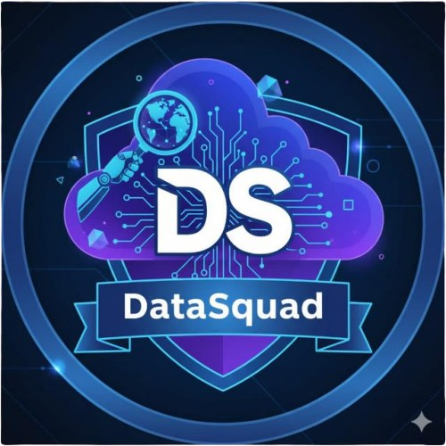

# API 2026 - DATASQUAD: NEXUS

Faculdade de Tecnologia de São José dos Campos - Professor Jessen Vidal

#   

            <h2 align="center"> Data Squad </h2>
  

  | <a href ="#desafio"> Desafio</a>  |  <a href ="#solucao"> Solução</a>  |     <a href ="#backlog"> Backlog do Produto</a>|     <a href ="#sprintbacklog"> Sprint Backlog </a>  |  <a href ="#sprint"> Cronograma de Sprints</a>  |  <a href ="#tecnologias">Tecnologias</a> |  <a href ="#link">Link para Documentação</a>  |   <a href ="#equipe"> Equipe</a> | <a href="#jira"> Jira</a> | <a href="#contribuicao"> Contribuição</a> | | <a href="#videos"> Vídeos</a> |
  

> Status do Projeto: Em andamento

* * * 

## 📌 Links úteis  

- 🎯 **[Board do Jira (público)](https://64a6ab18-5340-4b42-a28d-a1b9b71321e9.hello.atlassian-dev.net/x1/5zYlzyKtY28RUSRspu5yKzKhMzU?contentId=1&contentType=board&token=f7942e6d-341b-4133-8414-03d003d2edca)** — Acompanhamento das issues e da sprint atual.
- 📖 **[Guia de Contribuição](./docs/CONTRIBUTING.md)** — Padrões de commit, branch, PR e merge.

## 👥 Alocação de Tarefas

> O acompanhamento diário e a distribuição de tarefas podem ser vistos em tempo real no nosso [Board do Jira](https://64a6ab18-5340-4b42-a28d-a1b9b71321e9.hello.atlassian-dev.net/x1/5zYlzyKtY28RUSRspu5yKzKhMzU?contentId=1&contentType=board&token=f7942e6d-341b-4133-8414-03d003d2edca).

| Função | Integrante | Frente / Responsabilidades | Issues em andamento |
|---|---|---|---|
| Product Owner | Wanderson Ricardo dos Santos | Backlog, priorização, validação com cliente, Desenvolvimento | [Ver no Jira](https://64a6ab18-5340-4b42-a28d-a1b9b71321e9.hello.atlassian-dev.net/x1/5zYlzyKtY28RUSRspu5yKzKhMzU?contentId=1&contentType=board&token=f7942e6d-341b-4133-8414-03d003d2edca) |
| Scrum Master | Maria Clara Prado Farkas | Processo, cerimônias, bloqueios, Desenvolvimento | [Ver no Jira](https://64a6ab18-5340-4b42-a28d-a1b9b71321e9.hello.atlassian-dev.net/x1/5zYlzyKtY28RUSRspu5yKzKhMzU?contentId=1&contentType=board&token=f7942e6d-341b-4133-8414-03d003d2edca) |
| Team Member | Guilhermina Moreira D'Onofrio | Desenvolvimento | [Ver no Jira](https://64a6ab18-5340-4b42-a28d-a1b9b71321e9.hello.atlassian-dev.net/x1/5zYlzyKtY28RUSRspu5yKzKhMzU?contentId=1&contentType=board&token=f7942e6d-341b-4133-8414-03d003d2edca) |
| Team Member | Rubens Ferreira Venancio | Desenvolvimento | [Ver no Jira](https://64a6ab18-5340-4b42-a28d-a1b9b71321e9.hello.atlassian-dev.net/x1/5zYlzyKtY28RUSRspu5yKzKhMzU?contentId=1&contentType=board&token=f7942e6d-341b-4133-8414-03d003d2edca) |

* * * 

## Desafio 

A comunicação e o trâmite documental entre a UG FUSEX (Exército) e as OCS/PSA (clínicas, hospitais e profissionais da área de saúde) ainda depende, em grande parte, de processos manuais e desconexos, desde a emissão do pedido médico até o faturamento. Essa fragmentação eleva o risco de erros de preenchimento, retrabalho e inconsistências no faturamento, além de dificultar o rastreamento de todo o processo.

## Solução 

Para enfrentar esse cenário, propomos o desenvolvimento de uma aplicação que digitaliza e centraliza o fluxo documental entre beneficiários, FUSEX e OCS/PSA. O sistema permite que o beneficiário crie a pré-guia de forma digital a partir do encaminhamento médico, elimina a necessidade de deslocamento físico até o FUSEX, e possibilita que a guia seja emitida, assinada digitalmente e enviada eletronicamente à OCS escolhida.

Na etapa de faturamento, a aplicação padroniza o recebimento dos espelhos enviados pela OCS e automatiza o processo de lisura e glosa, comparando os valores da guia, do espelho e do contrato — reduzindo o retrabalho manual e a chance de erro humano. O funcionário do FUSEX mantém a possibilidade de revisar e intervir no resultado antes da conclusão do processo, garantindo controle humano sobre casos excepcionais sem abrir mão da agilidade da automação. Com isso, todo o trâmite passa a ser rastreável de ponta a ponta, desde a criação da pré-guia até a liquidação da fatura.

* * *  

## Backlog do Produto 

| Rank | Prioridade | User Story | Estimativa | Sprint |  
| ---- |------------| ---------------------------------------------------------------------------------------------------------------------------------------------------------------------------------------------------------------------------- |------------|--------|  
| 1    | Alta       | Como beneficiário, quero anexar o encaminhamento médico digitalizado ao meu cadastro, para que ele sirva de base na criação da pré-guia. | 8          | 1      |  
| 2    | Alta       | Como beneficiário, quero criar a pré-guia de forma digital informando a OCS e os procedimentos/exames a serem realizados, para que eu não precise ir pessoalmente ao FUSEX com o encaminhamento em mãos. | 5          | 1      |  
| 3    | Alta       | Como beneficiário, quero acompanhar os status das minhas pré-guias já preenchidas e enviadas, para que eu saiba em que etapa do processo ela está. | 5          | 2      |  
| 4    | Alta       | Como médico do FUSEX, quero ter a possibilidade de criar uma pré-guia para um beneficiário durante uma consulta, para que não haja a necessidade de entregar um encaminhamento físico ao beneficiário. | 5          | 2      |  
| 5    | Alta       | Como funcionário do setor de Guias do FUSEX, quero visualizar e gerenciar os detalhes de uma pré-guia recebida, para que eu possa gerar uma Guia digital com as informações coletadas. | 8          | 2      |  
| 6    | Média      | Como beneficiário, quero ter a possibilidade de acessar as Guias emitidas em meu perfil de forma totalmente digital, para que eu não precise ir até o FUSEX desnecessariamente. | 4          | 2      |  
| 7    | Média      | Como beneficiário, quero ter a possibilidade de conseguir a Guia impressa indo até a recepção do FUSEX, para o caso de eu estar sem acesso ao aplicativo. | 4          | 2      |  
| 8    | Média      | Como um usuário do aplicativo, quero incluir uma assinatura digital em meu perfil após a conclusão do meu cadastro, para que eu possa assinar as Guias com menos gargalos e burocracias. | 7          | 2      |  
| 9    | Média      | Como beneficiário, quero ter a possibilidade de incluir um dependente em uma pré-guia, para garantir que ele também tenha direito ao FUSEX. |            | 3      |  
| 10   | Baixa      | Como funcionário do setor de faturas do FUSEX, quero que o espelho enviado pela OCS seja recebido em um formato padronizado, para que os dados possam ser facilmente lidos e coletados pelo sistema. |            | 3      |  
| 11   | Baixa      | Como funcionário do setor de rastreabilidade do FUSEX, quero que o sistema compare automaticamente o valor da Guia com o valor do espelho, para que eu possa visualizar e corrigir divergências. |            | 3      |  
| 12   | Baixa      | Como funcionário do setor de rastreabilidade do FUSEX, quero que o sistema compare automaticamente o valor do espelho com o valor presente no contrato com a OCS, para a possível necessidade de agilizar a glosa. |            | 3      |  
| 13   | Baixa      | Como funcionário do setor de rastreabilidade do FUSEX, quero conferir as comparações automáticas antes de concluir a rastreabilidade de uma fatura, para que eu possa corrigir eventuais erros antes de enviá-los para a auditoria final. |            | 3      |

* * *  

## Sprint Backlog 📅 

  
  
<b>Sprint 1</b>
  

### **Sprint 1: Execução e Planejamento**

* **Capacidade Estimada da Equipe:** 13 Story Points.
* **Meta da Sprint:** User Story de rank 1 e 2.

| Link                                                                              | rank | Prioridade | User Story                                                                                                                                    | Estimativa | Sprint |  
| ------------------------------------------------------------------------------- | ---- | ---------- | --------------------------------------------------------------------------------------------------------------------------------------------- |------------| ------ |  
| [Anexação do encaminhamento médico digitalizado](docs/sprint/Sprint-1/US1.md) | 1    | Alta       | Como beneficiário, quero anexar o encaminhamento médico digitalizado ao meu cadastro, para que ele sirva de base na criação da pré-guia. | 8          | 1      |  
| [Criação digital da pré-guia](docs/sprint/Sprint-1/US2.md)                      | 2    | Alta       | Como beneficiário, quero criar a pré-guia de forma digital informando a OCS e os procedimentos/exames a serem realizados, para que eu não precise ir pessoalmente ao FUSEX com o encaminhamento em mãos.                                | 5          | 1      |   

  

   

* * *  

  
  
<b>Sprint 2</b>
  

### **Sprint 2: Execução e Planejamento**

* **Capacidade Estimada da Equipe:** 33 Story Points.
* **Meta da Sprint:** User Stories de rank 3, 4, 5, 6 e 7 (Acompanhamento, criação médica, gestão de pré-guias, acesso a guias e impressão na recepção).
* **Metas Extras:** User Story de rank 8 (Assinatura digital).

| Link | rank | Prioridade | User Story | Estimativa | Sprint |  
|---------------------------------------------------------------------------------|------|------------| --------------------------------------------------------------------------------------------------------------------------------------------- |------------|--------|  
| [Acompanhar Status das pré-guias](docs/sprint/Sprint-2/US3.md)                  | 3    | Alta       | Como beneficiário, quero acompanhar o status das minhas pré-guias já preenchidas e enviadas, para que eu saiba em que etapa do processo ela está. | 5          | 2      |  
| [Criação digital da pré-guia pelo médico](docs/sprint/Sprint-2/US4.md)          | 4    | Alta       | Como médico do FUSEX, quero ter a possibilidade de criar uma pré-guia para um beneficiário durante uma consulta, para que não haja a necessidade de entregar um encaminhamento físico ao beneficiário. | 5          | 2      |
| [Visualização e gestão de pré-guias](docs/sprint/Sprint-2/US5.md)               | 5    | Alta       | Como funcionário do setor de Guias do FUSEX, quero visualizar e gerenciar os detalhes de uma pré-guia recebida, para que eu possa gerar uma Guia digital com as informações coletadas. | 8          | 2      |
| [Acesso às Guias no perfil](docs/sprint/Sprint-2/US6.md)                          | 6    | Média      | Como beneficiário, quero ter a possibilidade de acessar as Guias emitidas em meu perfil de forma totalmente digital, para que eu não precise ir até o FUSEX desnecessariamente. | 4          | 2      |
| [Impressão de Guia na recepção](docs/sprint/Sprint-2/US7.md)                    | 7    | Média      | Como beneficiário, quero ter a possibilidade de conseguir a Guia impressa indo até a recepção do FUSEX, para o caso de eu estar sem acesso ao aplicativo. | 4          | 2      |
| [Inclusão de assinatura digital](docs/sprint/Sprint-2/US8.md)                    | 8    | Média      | Como um usuário do aplicativo, quero incluir uma assinatura digital em meu perfil após a conclusão do meu cadastro, para que eu possa assinar as Guias com menos gargalos e burocracias. | 7          | 2      |

  

   

* * *  

## Cronograma de Sprints 

Sprint | Previsão | Status       |  
|------|--------|--------------|  
|Sprint 01 | 07/09/2026 | Finalizada   |  
|Sprint 02| 05/10/2026| Finalizada   |  
|Sprint 03| 02/11/2026 | Não iniciado |  

* * * 
### Definition of Ready (DoR)

Para uma User Story estar apta ao início de um Sprint, os critérios a seguir devem ser concluídos:

- Itens mandatórios já identificados.
- Tem uma clara separação de **instruções, descrição e exemplos**.
- **Critérios de aceitação e regras de negócio** definidos.
- **Prioridade** já definida.
- O **esforço** já definido pela equipe.

### Definition of Done (DoD)

Para uma User Story ser considerada **completa**, os seguintes critérios devem ser concluídos:

- O código está escrito, testado e limpo (seguindo os padrões da equipe).

- A funcionalidade está integrada à branch **develop** do repositório [BD_3S_BACKEND](https://github.com/DATASQUAD-3SEM/BD_3S_BACKEND) ou **develop** do repositório [BD_3S_FRONTEND](https://github.com/DATASQUAD-3SEM/BD_3S_FRONTEND).

- Os **critérios de aceitação** de uma **User Story** foram completos.

- A interface leva em consideração a facilidade de uso ao usuário.

- A funcionalidade foi **testada** e **aprovada** pelo **Product Owner (PO)**.

*** 

## Tecnologias 

<h4 align="center">  
          
          
          
          
          
          
</h4>  

* * *  

## Link para as documentações 

* [Manual de Instalação](docs/manual/instalacao.md)
* [Manual do Usuário](docs/manual/usuario.md)

* * *  

# Equipe 

| Função        | Nome                                    | Github                                                                                                                                              |  
| ------------- | --------------------------------------- | --------------------------------------------------------------------------------------------------------------------------------------------------- |  
| Product Owner | Wanderson Ricardo dos Santos            |                |  
| Scrum Master  | Maria Clara Prado Farkas                |  |
| Team Member   | Guilhermina Moreira D'Onofrio           |            |  
| Team Member   | Rubens Ferreira Venancio                |               |
