# 📋 Especificação Técnica do Sistema FUSEX

> ⚠️ **Aviso sobre os protótipos de tela**
> As telas mostradas neste documento são **protótipos**, criados e validados com o cliente durante o planejamento das Sprints. Por isso, **podem não ser idênticas ao produto final**: textos, posição de botões, cores e pequenos detalhes de fluxo podem mudar na versão implementada.
> **A referência oficial são as Regras de Negócio (seção 4).** Quando um protótipo mostra algo diferente de uma regra, vale a regra. As diferenças conhecidas estão listadas no [Anexo A](#anexo-a--diferenças-conhecidas-entre-protótipos-e-regras).

**Última revisão:** 22/11/2026 (Sprint 3). Revisão anterior: Sprint 2.

---

## Índice

1. [Visão Geral](#1-visão-geral)
2. [Princípio de UX Central](#2-princípio-de-ux-central)
3. [Contexto de Domínio](#3-contexto-de-domínio)
   - 3.1 [Perfis de usuário](#31-perfis-de-usuário)
   - 3.2 [Situações (status) dos documentos](#32-situações-status-dos-documentos)
4. [Regras de Negócio](#4-regras-de-negócio)
5. [Protótipos de Telas](#5-protótipos-de-telas)
6. [Escopo por Sprint](#6-escopo-por-sprint)
7. [Documentos relacionados](#7-documentos-relacionados)
- [Anexo A — Diferenças conhecidas entre protótipos e regras](#anexo-a--diferenças-conhecidas-entre-protótipos-e-regras)
- [Anexo B — Histórico de revisões](#anexo-b--histórico-de-revisões)

---

## 1. Visão Geral

**Nome do sistema:** Nexus

**Stack:**

* Linguagem: Java (versão 17+ recomendada)
* Java Spring Boot
* Banco de dados: MySQL 8 (esquema versionado por migrations)

**Objetivo:** Facilitar o fluxo de trabalho do FUSEX, eliminando burocracias repetitivas e a probabilidade de erros humanos durante o processo (dupla cobrança de guias, assinaturas ausentes ou faltantes, erros de lisura, etc.). O Nexus também automatiza a rastreabilidade (lisura e glosa) e deixa todo o trâmite rastreável de ponta a ponta, da criação da pré-guia até a conclusão da fatura.

### Fluxo do Nexus em resumo

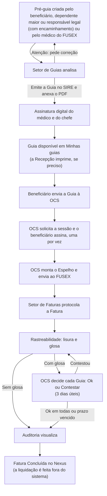

---

## 2. Princípio de UX Central

> **O sistema deve minimizar ao máximo o número de cliques e interações necessárias.** Sempre que possível, use preenchimento automático, herança de dados de períodos anteriores, propagação de configurações entre entidades similares e confirmação em lote.

**Responsividade:** interface adaptável para celular (beneficiários) e desktop (funcionários do FUSEX).

**Feedback:** toda ação que dispara requisição deve indicar loading, sucesso ou erro de forma clara.

**Formulários:** validação no front-end antes do envio; pré-preenchimento de dados já conhecidos do usuário.

**Ações críticas:** operações irreversíveis (ex.: enviar o espelho, enviar as glosas à OCS, confirmar a decisão sobre as glosas, marcar a fatura como visualizada) exigem confirmação explícita, mesmo custando um clique extra.

---

## 3. Contexto de Domínio

Antes de iniciar o desenvolvimento, é preciso internalizar os conceitos abaixo, pois eles se repetem em todo o sistema.

| Termo | Definição |
|---|---|
| **FUSEX** | Sigla para **Fundo de Saúde do Exército**, um sistema de assistência médico-hospitalar destinado aos **beneficiários** do Exército. |
| **Beneficiário** | Militares do Exército (da ativa, reserva ou reformados) e pensionistas, que atuam como **titulares**. O direito se estende aos seus **dependentes** legalmente cadastrados (cônjuges, filhos menores ou estudantes). |
| **Dependente** | Fica atrelado a um titular e é criado e mantido **somente pelo Chefe do FUSEX**. Existe em três situações: **menor sob a guarda do titular**, **menor sob a guarda de um responsável legal** e **maior de idade** (ver [4.5](#45-dependentes-e-responsável-legal)). |
| **Responsável legal (externo)** | Pessoa **sem Prec CP**, que não é beneficiária do FUSEX, cadastrada pelo chefe para agir em nome de um dependente menor. Tem conta própria e assinatura. |
| **Prec CP** | Número do cartão do beneficiário (ou dependente). É usado, por exemplo, pelo médico para localizar o paciente ao criar uma pré-guia. |
| **Encaminhamento médico** | Documento criado pelo médico e entregue ao beneficiário. É essencial para a criação da Pré-Guia **pelo beneficiário**. Aceita-se o encaminhamento de qualquer médico. |
| **Pré-Guia de Encaminhamento** | Documento criado dentro do Nexus pelo beneficiário (ou dependente/responsável) ou pelo **médico do FUSEX**, com a **OCS** escolhida e os dados do paciente. Exige encaminhamento anexado, **exceto quando criada pelo médico**, que informa os exames. |
| **SIRE** | Sistema próprio do Exército usado pelo FUSEX para emitir as Guias. O Nexus **não tem acesso** a ele: a Guia sai do SIRE em PDF e é anexada ao Nexus pelo setor de Guias. |
| **SISFAT** | Sistema exclusivo do setor de faturas do FUSEX de Caçapava, usado para controlar valores, protocolar e criar as capas das faturas. **Continua fora do Nexus.** |
| **Guia de Encaminhamento** | Documento gerado pelo FUSEX (no SIRE) com a OCS escolhida, os procedimentos, o número, a assinatura do médico e do chefe, e a validade. |
| **Validade da Guia** | Prazo em que a Guia pode ser usada. No Nexus vale **somente** a data impressa em **"NÃO RECEBER APÓS"**, lida do PDF (em regra, 60 dias após a emissão). |
| **Cod DGP** | Código de cobrança do procedimento na Guia. Nem sempre é um código TUSS. |
| **Sessão** | Cada unidade da quantidade autorizada de um procedimento na Guia. Equivale a uma ida do beneficiário à OCS. **Só a sessão assinada é cobrável.** |
| **OCS** | Toda a **rede credenciada, conveniada ou contratada, privada ou pública** (que não pertence ao Exército) usada para atender os beneficiários. Cada OCS tem a sua conta no Nexus. |
| **Espelho** | Documento de cobrança que a OCS monta dentro de um período (geralmente cerca de 1 mês), com uma linha por procedimento de cada Guia. Depois que o setor de Faturas protocola, o mesmo documento passa a se chamar **Fatura**. |
| **Fatura** | O Espelho enviado pela OCS, depois que o setor de Faturas protocola o número. Segue para a lisura. |
| **Lisura** | Parte da **rastreabilidade**: conferência dos valores. No Nexus, compara o valor informado pela OCS no espelho com o valor do **contrato**, linha a linha. |
| **Glosa** | Diferença entre o valor informado pela OCS e o valor do contrato. Pode ser para mais ou para menos. |
| **Tabela de preços da OCS** | Valores de contrato por sessão, por Cod DGP, carregados das planilhas do cliente e atualizados pela própria lisura. |
| **Rodada** | Cada envio das glosas pendentes à OCS, com a decisão (Ok ou Contestar) e o motivo, guardada por linha. |
| **Mapa / Auditoria** | Última etapa do Nexus. No fluxo físico, devolvia a fatura em caso de erro. **No Nexus a auditoria só visualiza e conclui; não devolve nada.** |
| **Liquidação** | Pagamento da fatura pelo Exército. **Acontece fora do Nexus.** |

### 3.1 Perfis de usuário

| Perfil | Login | Assinatura digital | O que faz |
|---|---|---|---|
| **Chefe do FUSEX** | nome de usuário | Sim | Maior autoridade. Cadastra, edita e desativa beneficiários, médicos, dependentes e responsáveis legais; assina as Guias. |
| **Beneficiário (titular)** | CPF | Sim | Cria e acompanha pré-guias, corrige as que voltam em Atenção, envia as Guias à OCS e assina as sessões. Também age pelos menores sob a sua guarda. |
| **Dependente maior de idade** | CPF | Sim | Mesmo perfil do beneficiário, mas só para si: cria as próprias pré-guias e assina as próprias sessões. |
| **Responsável legal (externo)** | CPF | Sim | Age só pelos menores que acompanha: cria as pré-guias deles, envia as Guias à OCS e assina as sessões. |
| **Médico do FUSEX** | CPF | Sim | Cria pré-guias durante a consulta (pelo Prec CP), corrige as que criou e voltaram em Atenção e assina as Guias. |
| **Setor de Guias** | nome de usuário | Não | Conta de setor, sem pessoa atribuída. Analisa as pré-guias, pede correção e anexa a Guia emitida no SIRE. |
| **Recepção** | nome de usuário | Não | Conta de setor. Imprime Guias concluídas para quem está sem acesso ao aplicativo. |
| **OCS** | nome de usuário | Não | Conta de setor, uma por OCS. Recebe as Guias, pede a assinatura das sessões, monta e envia o espelho e decide as glosas. |
| **Setor de Faturas** | nome de usuário | Não | Conta de setor. Recebe os espelhos, protocola a fatura e a envia à rastreabilidade. |
| **Rastreabilidade** | nome de usuário | Não | Conta de setor. Faz a lisura e a glosa, envia as glosas à OCS e imprime o verso das Guias glosadas. |
| **Auditoria** | nome de usuário | Não | Conta de setor. Visualiza a fatura já lisurada e conclui o fluxo. |
| *Dependente menor* | *não tem conta* | *Não* | Quem age por ele é o titular ou o responsável legal, com a própria assinatura. |

### 3.2 Situações (status) dos documentos

**Pré-guia**

| Situação | Cor | Significado |
|---|---|---|
| Pendente | amarelo | Criada e ainda não aberta pelo setor de Guias. |
| Em análise | azul | Aberta pelo setor de Guias. Para o beneficiário, continua assim até as duas assinaturas. |
| Atenção | laranja | Devolvida para correção, com observação do setor. |
| Concluída | verde | Guia assinada pelo médico e pelo chefe. |

**Guia (em "Minhas guias")**

| Situação | Significado |
|---|---|
| Não enviada | Pronta para o beneficiário, ainda não enviada à OCS. |
| Enviada | Enviada à OCS, sem nenhuma sessão solicitada. |
| Em execução | Dentro da validade, com sessão solicitada ou assinada, e nem todas assinadas. |
| Realizada | Todas as sessões foram assinadas. |
| Encerrada | A validade venceu e ao menos uma sessão foi assinada. |
| Vencida | A validade venceu e nenhuma sessão foi assinada. |

**Sessão**

| Situação | Significado |
|---|---|
| Disponível | Criada quando a Guia é enviada à OCS. Ainda não solicitada. |
| Solicitada | A OCS pediu a assinatura. |
| Assinada | Assinada por quem age pelo paciente. **Cobrável** e irreversível. |
| Expirada | Não foi assinada até a validade vencer. Não é cobrável. |

**Fatura**

| Situação (no sistema) | Significado |
|---|---|
| Sem nº de fatura | Espelho recém-chegado ao setor de Faturas. |
| Protocolada | Recebeu o número da fatura. |
| Em lisura | Com a rastreabilidade. |
| Aguardando a OCS | Há glosa pendente: a OCS decide, Guia por Guia, em até 3 dias úteis. |
| Em auditoria | Lisurada e liberada para a auditoria. |
| Concluída | Visualizada pela auditoria. Fim do fluxo no Nexus. |

---

## 4. Regras de Negócio

Os códigos **RN01 a RN22** são mantidos desde a Sprint 2 (alguns com texto revisado). As regras **RN23 em diante** foram acrescentadas na Sprint 3. O resumo do que mudou está no [Anexo B](#anexo-b--histórico-de-revisões).

### 4.1 Encaminhamento e Pré-Guia

| Código | Regra | Observação |
|---|---|---|
| RN01 | Não é possível criar uma Pré-Guia sem um encaminhamento médico válido (foto ou PDF) vinculado ao beneficiário, **exceto quando a Pré-Guia é criada pelo médico do FUSEX**. | Validação obrigatória antes da criação da Pré-Guia do beneficiário. |
| RN02 | São aceitos os encaminhamentos médicos de qualquer clínica, não sendo necessário vir de uma OCS credenciada. | Não restringir o Encaminhamento a uma OCS pré-definida. |
| RN03 | A Pré-Guia do beneficiário deve conter obrigatoriamente os dados do paciente, o encaminhamento anexado e a OCS escolhida. | Bloquear o envio se algum desses campos estiver vazio. |
| RN04 | A Pré-Guia criada pelo médico deve conter o paciente (localizado pela Prec CP), a OCS escolhida e **ao menos um exame**. Não exige encaminhamento anexado. | Os dados do médico solicitante são preenchidos automaticamente com o perfil dele. |
| RN05 | Não há filtro entre OCS e procedimento: o médico pode incluir qualquer procedimento do catálogo, seja qual for a OCS. | Decisão do cliente. |
| RN06 | A OCS é escolhida por **busca** (nome, contrato ou tipo), pois existem muitas. | Vale para o beneficiário, para o médico e para as telas de correção. |
| RN23 | O encaminhamento é um arquivo **PDF, JPG ou PNG de até 10 MB**. O sistema confere o conteúdo do arquivo, e não só a extensão. | No celular, a tela permite tirar a foto pela câmera (só funciona em endereço https ou localhost). |
| RN24 | A busca de OCS mostra **somente OCS ativas**. Uma OCS inativa não pode ser escolhida em nenhuma pré-guia. | |
| RN25 | Na Pré-Guia do médico, os exames vêm do catálogo de procedimentos (código TUSS), com busca por nome ou código a partir de 2 caracteres. É preciso ao menos um exame, sem repetir. O bloco "Médico solicitante" mostra nome, patente, CRM, CPF e Prec CP do médico logado. | Os dados do paciente mostrados na tela vêm do cadastro e não são enviados pela tela: o servidor usa o usuário logado e o paciente escolhido. |

### 4.2 Status e correção

| Código | Regra | Observação |
|---|---|---|
| RN07 | A Pré-Guia tem quatro status: **Pendente**, **Em análise**, **Atenção** e **Concluída** (ver [3.2](#32-situações-status-dos-documentos)). Toda Pré-Guia nasce Pendente. Ao abrir uma Pendente, o setor de Guias a move automaticamente para Em análise. | Para o beneficiário, a pré-guia só vira Concluída depois das duas assinaturas; até lá aparece como Em análise. |
| RN08 | Para colocar uma Pré-Guia em **Atenção**, o setor de Guias deve escrever uma observação explicando o problema (até 500 caracteres). A ação só existe em pré-guia Em análise. | Observação obrigatória, guardada no histórico. |
| RN09 | **Atenção em Pré-Guia criada pelo beneficiário:** ele envia um novo encaminhamento, troca a OCS, ou as duas coisas (ao menos uma) e reenvia. A mesma Pré-Guia volta como **Pendente**. | O histórico guarda as duas fotos e a observação do setor. |
| RN10 | **Atenção em Pré-Guia criada pelo médico:** somente o **médico emissor** corrige (OCS e/ou exames, ao menos um e sem repetir), em uma aba própria do perfil dele. O beneficiário continua vendo o status **Atenção**, mas **não pode intervir**. Depois de corrigida, volta como **Pendente** e sai da aba. | O beneficiário não pode ser trocado: para isso, cria-se uma nova pré-guia. A aba do médico fica vazia quando não há pendências. |

### 4.3 Guia e assinaturas

| Código | Regra | Observação |
|---|---|---|
| RN11 | A Guia é gerada **fora do Nexus** (no SIRE). O setor de Guias anexa o PDF, confere os dados lidos dele e clica em **Concluir**. Uma Pré-Guia só pode gerar **uma** Guia. | O PDF tem de ter até 10 MB e texto selecionável. Se for só imagem (escaneado), o setor digita os dados. |
| RN12 | Depois do **Concluir**, a Guia segue para assinatura do médico e do chefe. **Qualquer médico do FUSEX** pode assinar, e a primeira assinatura vale. A Guia aparece ao mesmo tempo na lista de todos os médicos e sai da lista dos demais quando um assina. | Cada Guia aceita no máximo uma assinatura de cada papel (médico e chefe). |
| RN13 | A Pré-Guia só passa a **Concluída** depois das **duas** assinaturas (médico e chefe). | O beneficiário não pode usar uma Guia sem as duas assinaturas. |
| RN14 | Só assina quem já cadastrou a sua **assinatura digital**. | As contas de setor nunca têm assinatura. |
| RN15 | O beneficiário e a Recepção só visualizam, baixam e imprimem Guias de Pré-Guias **Concluídas**. | A validade é a data "NÃO RECEBER APÓS" do PDF. |
| RN16 | O status de assinatura de cada Guia, nas listas do médico e do chefe, usa sempre um destes textos: "Falta assinatura do chefe.", "Falta assinatura de um médico." ou "Faltam assinaturas do chefe e de um médico." | Padronização de interface. |
| RN26 | **Leitura do PDF.** Ao anexar a Guia, o sistema lê do próprio PDF: o número (9 dígitos), a validade, o Prec CP do paciente (o da linha marcada "(PACIENTE)") e os exames com a quantidade. Se o número não for encontrado, o sistema avisa. Ler **não grava nada**: o arquivo e os dados só são gravados no **Concluir**. | Cada conta do setor pode fazer até 20 leituras por minuto. O Prec CP é só conferido (RN29) e não é gravado. |
| RN27 | A **UG** (Unidade Gestora) do cabeçalho é conferida, mas não é gravada: tem de ser **"Cmdo Bda Inf Amv"**, tanto na UG quanto na UG Origem. Outra UG é recusada e a Guia não é concluída. | Decisão do produto: hoje só existe essa UG. |
| RN28 | Guia com validade ("NÃO RECEBER APÓS") **anterior a hoje não é concluída**, com a mensagem "Esta Guia já venceu em dd/mm/aaaa. Não é possível concluir." A tela e o servidor recusam. | A data de hoje é sempre a de Brasília (fuso America/Sao_Paulo). |
| RN29 | **Conferência do paciente:** o sistema compara o Prec CP do paciente na Guia com o do paciente da pré-guia (o titular ou, quando é dependente, o do dependente). Se forem diferentes, o botão Concluir fica desabilitado (a tela e o servidor recusam). Se o sistema não conseguir ler o Prec CP, só avisa para o setor conferir. | Evita inserir a Guia de outro paciente. |
| RN30 | **Exames da Guia:** o sistema preenche uma tabela editável (Cod DGP, descrição, quantidade) com o aviso "Atenção: Confira os exames antes de concluir." O setor pode corrigir, remover e adicionar linhas. Para concluir: de 1 a 50 exames; Cod DGP só com dígitos (até 10) e **sem repetir** na Guia (as quantidades não são somadas); descrição preenchida; quantidade inteira de 1 a 999. Enquanto houver erro, o Concluir fica desabilitado. | Não há comparação com a pré-guia. A OCS não digita nem altera exames. Guias antigas ficam sem exames, sem carga. |
| RN31 | **Assinatura em lote** (médico e chefe): selecionar várias guias e assinar de uma vez, **até 50 por envio** (acima disso, aparece "Selecione até 50 guias por vez."). Cada guia é assinada em operação própria, e uma falha não cancela as demais. Guias que já não fazem sentido assinar (outro médico ou o chefe já assinou, ou a pré-guia já ficou Concluída) saem da lista e da seleção; as demais falhas continuam selecionadas, com o erro no próprio cartão. Sucesso total mostra "N guia(s) assinada(s) com sucesso." | A lista do chefe mostra todas as guias que aguardam a assinatura dele. Clicar no checkbox não abre o detalhe. |
| RN32 | **Assinatura digital:** a pessoa desenha no quadro (mouse ou dedo) ou envia uma imagem **PNG ou JPG de até 2 MB**, reduzida para 1200 × 600 px e gravada com fundo transparente. Cada troca grava uma imagem nova e não apaga a anterior: documentos já assinados mantêm a imagem usada. | Têm assinatura: titular, dependente maior, responsável legal, médico e chefe. Contas de setor nunca têm (regra do banco). |
| RN33 | **Recepção:** busca por nome do beneficiário, Prec CP ou número da Guia, com ao menos 3 caracteres, e mostra até 50 resultados. Pode visualizar, imprimir ou baixar o PDF (o mesmo PDF montado com as assinaturas, inclusive a do beneficiário, RN53). | A Recepção só imprime Guias físicas: não envia à OCS nem assina sessões. |

### 4.4 Contas, acesso e histórico

| Código | Regra | Observação |
|---|---|---|
| RN17 | O **login** é o **CPF** para beneficiário, dependente maior, responsável legal e médico, e o **nome de usuário** para o chefe e para as contas de setor (Guias, Recepção, OCS, Faturas, Rastreabilidade e Auditoria). O campo de login é de texto livre. | O servidor aceita o CPF com ou sem pontuação. Nomes de usuário não podem ter formato de CPF. |
| RN18 | A tela de login não tem cadastro. Beneficiários, médicos, dependentes maiores e responsáveis legais são cadastrados pelo **Chefe do FUSEX**. As contas do chefe e dos setores são criadas por seed. | As contas de setor não têm pessoa atribuída. Há uma conta por OCS. |
| RN19 | "Excluir" uma conta significa **desativá-la**. Nada é apagado, para preservar o histórico. Conta desativada não consegue entrar: depois que a senha confere, aparece "Conta desativada. Procure o Chefe do FUSEX." | "Reativar" devolve o acesso. |
| RN20 | O **beneficiário** só edita o próprio telefone. O **médico** não edita nenhum dado. O **chefe** edita nome, patente, login (sem espaços e sem repetir outro) e senha da própria conta. Os dados de beneficiários e médicos só são alterados pelo chefe. | O dependente maior e o responsável legal só consultam os dados. |
| RN21 | **CPF** e **Prec CP** têm 11 dígitos. O CPF precisa ter os dois dígitos verificadores corretos (CPF com todos os dígitos iguais é recusado). O telefone é um celular com DDD (11 dígitos, o terceiro é 9). Tudo é gravado **só com dígitos**, e a máscara existe apenas na exibição. | A idade e a faixa etária são calculadas a partir da data de nascimento. |
| RN22 | Cada mudança de status da pré-guia (criação, abertura, atenção, reenvio ou correção, conclusão) é registrada em um **histórico**, com quem agiu, quando, a observação e o encaminhamento vigente. As ações do Setor de Guias aparecem como "Setor de Guias", sem pessoa. | O histórico só recebe registros novos: nunca é editado nem apagado. |
| RN34 | **Senha:** de 8 a 72 caracteres, sempre guardada como hash. É definida pelo chefe no cadastro. O titular, o dependente maior e o médico trocam a própria senha informando a senha atual, a nova (diferente da atual) e a confirmação. Depois de **5 tentativas seguidas** com a senha atual errada, a troca fica bloqueada por **15 minutos**. | O **responsável legal não tem troca de senha**: quem altera é o chefe. Na edição pelo chefe, deixar a senha em branco mantém a atual. |
| RN35 | Cada perfil só acessa as próprias telas e rotas. Quem digita o endereço de uma tela de outro perfil volta ao início do próprio perfil, e o servidor recusa a rota (erro 403). Login inexistente ou senha errada mostram sempre a mesma mensagem: "CPF, usuário ou senha incorretos." | Páginas iniciais: [seção 5.0](#50-resumo-por-perfil). |
| RN36 | **Cadastros do chefe.** *Titular:* nome, CPF (será o login), Prec CP, data de nascimento, telefone e senha inicial. *Médico:* nome, CPF, Prec CP, patente, CRM (formato número-UF, ex.: 123456-SP) e senha inicial. CPF, Prec CP e CRM não podem repetir. As listas têm filtro Ativos, Inativos e Todos, busca por nome, CPF ou Prec CP e paginação. | Desativar um médico também impede que ele assine Guias. |

### 4.5 Dependentes e responsável legal

| Código | Regra | Observação |
|---|---|---|
| RN37 | Só existem **três situações** de dependente, e nada além delas: **(1)** menor sob a guarda do titular; **(2)** menor sob a guarda de um responsável legal; **(3)** maior de idade. | Decisão do cliente: dependentes são um bônus, sem complicação. |
| RN38 | Todo dependente pertence a um **titular**, que é quem aparece na Guia, e é cadastrado e editado **somente pelo chefe**. O titular, o dependente maior e o responsável legal só consultam, em Minhas informações. Dados: nome, data de nascimento, **CPF** (obrigatório, inclusive para o menor, único entre todas as pessoas), telefone (opcional), **Prec CP** e vínculo (texto livre, só informativo). | O Prec CP é sugerido em sequência (9 primeiros dígitos do titular + 2 dígitos livres), editável pelo chefe e único entre titulares, médicos e dependentes. |
| RN39 | O tipo é decidido pela **idade na data do cadastro**: 18 anos ou mais é **maior**; menos de 18 é **menor**, e o chefe escolhe quem age por ele (o titular ou um responsável legal externo). | |
| RN40 | O **maior** tem conta própria (login pelo CPF, perfil Beneficiário, mas não é titular). O **menor** não tem conta. O **responsável legal** é uma pessoa externa, com conta própria (perfil "Responsável legal", login pelo CPF) e assinatura. **Cada menor tem um só responsável legal**, e a mesma pessoa pode ser responsável de mais de um menor, inclusive de titulares diferentes. | A senha inicial é definida pelo chefe no cadastro. A assinatura é cadastrada pela própria pessoa em Minhas informações. |
| RN41 | **Vigência:** informada pelo chefe. Para o menor, que sempre tem data final, o sistema sugere **22 anos menos 1 dia** a partir do nascimento (o chefe pode alterar). O maior é **vitalício** por padrão, ou tem data final se o chefe preencher. Com a vigência vencida, o dependente deixa de aparecer em Nova pré-guia e na busca do médico por Prec CP e não recebe novas pré-guias. | Nada é encerrado por rotina, e as Guias que já existem seguem a própria validade. Para encerrar o acesso antes do prazo, o chefe altera a vigência. |
| RN42 | **Pré-guia do dependente:** o titular escolhe para quem é (ele mesmo ou um menor sob a sua guarda); o responsável legal escolhe um dos menores que acompanha (não cria para si); o dependente maior cria só as próprias. O médico também cria pré-guia de dependente, buscando pelo Prec CP dele. A pré-guia guarda o titular e, quando o paciente é dependente, o dependente. | A conferência do Prec CP na Guia (RN29) compara com o Prec CP do dependente. |
| RN43 | **Minhas guias e assinatura:** quem age pelo paciente vê, envia à OCS e assina as sessões com a **própria** assinatura: o titular (paciente titular ou menor sob a sua guarda), o responsável legal (menor que acompanha) ou o dependente maior (por si). | O titular **não vê** as guias do dependente maior nem as do menor sob responsável legal (decisão do cliente). |
| RN44 | **Reaproveitamento de conta:** quando o CPF já tem conta, o cadastro reaproveita a conta e mantém a senha atual. *(a)* Maior de idade cujo CPF é de um responsável legal: o perfil passa a Beneficiário e os vínculos de responsável são mantidos. *(b)* Responsável legal cujo CPF é de um dependente maior vitalício: segue como Beneficiário. | **Recusado (erro 422):** responsável legal com CPF de dependente com vigência determinada, de titular ou de outra pessoa do sistema; e maior com CPF de conta de outro perfil. |
| RN45 | **Fora desta versão** (decisão do cliente): mudança de situação do dependente (ex.: o menor que faz 18 anos), troca do responsável legal, **remoção** e reativação de dependente. | Para encerrar o acesso antes do prazo, o chefe altera a vigência. |

### 4.6 Envio da Guia à OCS e sessões

| Código | Regra | Observação |
|---|---|---|
| RN46 | O **beneficiário** (ou quem age pelo paciente) envia a Guia à OCS, em "Minhas guias". A Guia só aparece ali depois das duas assinaturas. A OCS é a escolhida na pré-guia e **não pode ser trocada** no envio. A tela de confirmação mostra o número, o procedimento, as sessões autorizadas e a OCS. Ao confirmar, o sistema grava a data e quem enviou, muda a situação para **Enviada** e cria as sessões (uma para cada unidade da quantidade autorizada de cada procedimento), todas **Disponíveis**. | Guia sem validade gravada mostra "Guia sem validade". Guia concluída antes da gravação dos exames mostra "Guia sem exames cadastrados". |
| RN47 | Só a sessão **Assinada** é cobrável. A assinatura **não pode ser desfeita**, e o número de sessões assinadas de um procedimento **nunca passa** da quantidade autorizada. | |
| RN48 | A OCS pede a assinatura **uma sessão por vez** ("Requerer assinatura"). Se houver mais de uma sessão no mesmo dia, faz um requerimento para cada. Só a OCS da Guia pode solicitar, e não em Guia vencida. A OCS vê apenas as Guias enviadas a ela (busca por nome, número da Guia ou Prec CP). | A sessão passa a Solicitada, com data e quem solicitou. |
| RN49 | O paciente (ou quem age por ele) assina **uma sessão Solicitada por vez**, com a assinatura cadastrada, **somente até a data de validade**. Sem assinatura cadastrada, aparece "Você ainda não tem assinatura cadastrada. Cadastre em Minhas informações para assinar." e a sessão continua Solicitada. | O sistema guarda a assinatura usada, a data e quem assinou. |
| RN50 | A Guia tem seis situações (ver [3.2](#32-situações-status-dos-documentos)). Em "Minhas guias" há o filtro **Mostrar**: "Todas" (padrão), "Em andamento" (Não enviada, Enviada e Em execução) e "Finalizadas" (Realizada, Encerrada e Vencida). | O filtro é feito na própria tela. |
| RN51 | **Vencimento:** não existe rotina agendada. A virada (Guia em aberto com a validade passada vira Encerrada ou Vencida, e as sessões Solicitadas e não assinadas viram **Expiradas**) acontece sempre que a Guia é lida e antes de cada assinatura. Se a validade já passou, a assinatura é recusada: "Esta Guia venceu em dd/mm/aaaa. A sessão não pode mais ser assinada." A Guia vale até o fim do dia impresso em "NÃO RECEBER APÓS" (data de Brasília). | Ex.: Guia com 30 sessões e 28 assinadas: as 28 são cobráveis e as outras 2 ficam Expiradas. |
| RN52 | Avisos ao beneficiário: Guia **Encerrada**: "A sua Guia expirou antes de você realizar todas as assinaturas. Será necessário o requerimento de uma nova Guia." Guia **Vencida**: "A sua Guia expirou e você não realizou nenhuma assinatura. Será necessário o requerimento de uma nova Guia." A Guia Vencida continua visível. | O beneficiário não exclui Guias. |
| RN53 | **Assinatura do beneficiário no PDF:** o campo "Assinatura do Responsável" fica em branco enquanto a Guia não está finalizada. Quando fica **Realizada** ou **Encerrada**, o PDF passa a trazer a assinatura usada na **última sessão assinada**. Guia Vencida, Não enviada, Enviada ou Em execução dentro da validade: não. As assinaturas são inseridas na hora de montar o PDF (o arquivo guardado não é alterado), e o PDF é o mesmo para beneficiário, OCS e Recepção. | Se o rótulo ou a imagem da assinatura não for encontrado quando deveria ser inserido, é erro e o PDF não é entregue. |
| RN54 | **A OCS não altera nada da Guia** (exames, quantidades, validade, dados do paciente, PDF). Ela só: recebe as Guias, pede a assinatura de sessões, adiciona Guias ao espelho, informa os valores no espelho e envia o espelho. A OCS vê o PDF da Guia sem máscara, com as assinaturas. | As OCS já têm acesso às Guias físicas (decisão do produto). Rotas de alteração da Guia respondem 403 ao perfil OCS. |

### 4.7 Espelho (OCS)

| Código | Regra | Observação |
|---|---|---|
| RN55 | Só pode entrar no espelho uma Guia **fechada**: **Realizada** ou **Encerrada**. Guia Em execução não aparece para escolha. Guia Vencida (nenhuma sessão assinada) nunca aparece. | |
| RN56 | Uma Guia só pode estar em **um** espelho. A OCS tem **um espelho em construção por vez**. | Essa trava evita a dupla cobrança. |
| RN57 | Cada linha do espelho é um **procedimento de uma Guia**. A quantidade de sessões é a das sessões **assinadas**, contada automaticamente. O **valor por sessão** é digitado pela OCS e precisa ser maior que zero. | O sistema não traz o valor pronto, porque ele pode variar por negociação ou reajuste. |
| RN58 | Enquanto o espelho está **em construção**, a OCS pode **remover** uma ou mais Guias (com confirmação; a Guia volta a ficar disponível) ou, com exatamente uma Guia selecionada, **editar o valor por sessão**. A quantidade de sessões não é editável. | |
| RN59 | Ao concluir o período, a OCS clica em **Enviar para o FUSEX**, com confirmação. O espelho é fechado: não recebe mais Guias nem pode ser editado, reaberto ou excluído. Novas Guias formam um novo espelho. A OCS consulta os já enviados, em modo somente leitura. | Operação sem volta. |
| RN60 | O espelho sai **sem** o cabeçalho de CNPJ, endereço e telefone da OCS (o cliente não tem esses dados). | Decisão do produto. |

### 4.8 Fatura (Setor de Faturas)

| Código | Regra | Observação |
|---|---|---|
| RN61 | O setor de Faturas vê os espelhos que as OCS enviaram, do mais recente para o mais antigo, com filtros de OCS e de situação. O espelho em construção não aparece. | |
| RN62 | A fatura passa pelas situações: Sem nº de fatura, Protocolada, Em lisura, Aguardando a OCS, Em auditoria e Concluída (ver [3.2](#32-situações-status-dos-documentos)). Cada mudança fica registrada com data, conta do setor e nome do responsável. | Nas telas, a situação interna AUDITADA aparece como **Concluída**. |
| RN63 | **Protocolo:** "Inserir nº da fatura" abre "Protocolar fatura", com Data de Entrada (a data em que a OCS enviou o espelho, só leitura), OCS/PSA (só leitura), **Nº da Fatura** e Responsável. O nº tem o formato **XXX/XXXX** (ex.: 003/2026) e é numerado **por OCS**: o sistema sugere o próximo da OCS no ano corrente (de Brasília), o setor pode alterar, e o nº **não pode repetir dentro da mesma OCS**. | A capa impressa continua sendo gerada pelo SISFAT. |
| RN64 | **Enviar para a rastreabilidade:** pede confirmação e o nome do responsável. A situação passa a Em lisura, e o setor de Faturas não altera mais nada. Nesse momento, o sistema copia para cada linha o preço do contrato da OCS, quando ele consta na tabela de preços. | |
| RN65 | Como as contas de setor não têm pessoa atribuída, **toda ação que muda a etapa** (Faturas, Rastreabilidade, OCS e Auditoria) pede o campo **"Responsável (seu nome)"**, de 3 a 100 caracteres. | Decisão do cliente. |
| RN66 | **Controle de fluxo da fatura:** em todo detalhe de fatura, nos quatro setores, aparece a tabela da capa do SISFAT, preenchida pelo sistema: Etapa (Protocolo, Lisura / Glosa, Glosa / OCS, Auditagem e Arquivo, com o setor), Data de entrada, Data de saída, Responsável, Valor inicial e Valor final após lisura. A linha "Glosa / OCS" só aparece quando houve glosa, e o par "Lisura / Glosa" + "Glosa / OCS" pode se repetir a cada contestação. | As colunas FUSEX, Fator Custo e PASS-EB da capa ficam fora desta versão. |
| RN67 | A aba **Faturas Auditadas** mostra, só para leitura, as faturas já visualizadas pela auditoria. É o **fim do fluxo no Nexus**: a liquidação é feita fora do sistema. | Se a OCS enviar um espelho errado, não há como desfazer dentro do Nexus. |

### 4.9 Rastreabilidade (lisura e glosa)

| Código | Regra | Observação |
|---|---|---|
| RN68 | Em "Faturas Recebidas", a rastreabilidade vê as faturas **Em lisura** e **Aguardando a OCS**, da mais antiga para a mais recente, com filtro de OCS e quantas linhas já estão decididas. | |
| RN69 | A lisura no Nexus é a comparação do **valor informado pela OCS** com o **valor do contrato**, linha a linha (um procedimento de uma Guia). Cada linha mostra o informado, o contrato, a glosa e a situação: "Conforme o contrato", "Acima do contrato", "Abaixo do contrato" ou "Sem preço no contrato". A lisura **não altera a Guia nem o espelho**. | A conferência do valor da Guia é feita no SIRE, fora do Nexus: o Nexus não lê, guarda nem altera o V.Unit da Guia. |
| RN70 | **Lisura híbrida.** Quando há preço na tabela da OCS (selo "Tabela"), o sistema compara sozinho. Se o lisurador sabe que o preço está desatualizado, usa "O valor mudou?" (selo "Tabela (corrigida)") e o novo valor substitui o da tabela. Quando **não há preço**, a linha pergunta "Valor de acordo com o contrato?": **Sim** (selo "Conferido", sem glosa) ou **Não** (digita o valor do contrato, selo "Manual"). | Todo valor gravado na tabela de preços da OCS vale para as próximas faturas do mesmo código e pede o nome do responsável. |
| RN71 | **Glosa por linha**, para mais e para menos: `glosa = (valor informado − valor do contrato) × quantidade de sessões`, com sinal (positiva quando a OCS cobrou a mais). Qualquer diferença, até um centavo, é glosa. O **valor final** após lisura é o valor do contrato × quantidade. | O valor informado pela OCS nunca é alterado. Não há motivo de glosa digitado. |
| RN72 | Em qualquer linha, a rastreabilidade pode escrever uma **observação livre** de até 500 caracteres, opcional. **Só a rastreabilidade escreve**; a OCS e a auditoria só leem, e ela viaja com a fatura até o fim. | |
| RN73 | Uma linha está **decidida** quando tem valor do contrato. "Salvar lisura" guarda o trabalho sem enviar. Os envios exigem todas as linhas decididas. Uma linha tem **glosa pendente** quando tem glosa e a OCS ainda não deu "Ok" nela. **Sem glosa pendente:** botão "Enviar para a auditoria" (a fatura vai a Em auditoria). **Com glosa pendente:** botão "Enviar glosas à OCS" (a fatura vai a Aguardando a OCS), levando todas as glosas pendentes de uma vez, numa rodada. Os dois envios pedem confirmação e responsável. | Depois do envio, a lisura fica travada. |
| RN74 | O botão **"Ver guia (PDF)"** da linha abre a Guia só para consulta, para a rastreabilidade e para a auditoria. | |
| RN75 | A **tabela de preços da OCS** é carregada uma vez, a partir das planilhas do cliente: só entram códigos com **valor fixo por sessão** (cada planilha traz o nº do contrato). Planilhas com fórmula (ex.: CBHPM) ou orçamento ficam para a lisura manual. Não há tela de manutenção: a própria lisura atualiza a tabela. A vigência do contrato não é conferida. | A comparação usa o código de cobrança da Guia (Cod DGP), que nem sempre é TUSS. |

### 4.10 OCS decide as glosas

| Código | Regra | Observação |
|---|---|---|
| RN76 | Ao enviar as glosas, a fatura fica **Aguardando a OCS** com um prazo de **3 dias úteis** contado do envio. Só sábado e domingo são não úteis (feriados não são descontados). O prazo termina às **23h59min59s** do 3º dia útil, no horário de Brasília. A rastreabilidade e o setor de Faturas veem um aviso do prazo (dentro ou vencido). | Ex.: envio na quarta às 9h, prazo até a segunda seguinte às 23h59min59s. Não há e-mail nem aviso push: quem acompanha entra na tela. |
| RN77 | Na aba **Glosas Recebidas**, a OCS vê só as faturas Aguardando a OCS dela cuja rodada atual ainda não tem decisão. Ao abrir uma, vê só as Guias da rodada atual (linhas com glosa pendente), com informado, contrato, glosa com sinal e a observação da rastreabilidade. A OCS **não edita** nada do espelho. | Depois de decidida, a fatura some da lista; o histórico fica no controle de fluxo. |
| RN78 | Para cada Guia da rodada, a OCS escolhe **"Ok"** (de acordo com o contrato) ou **"Contestar"**. Contestando, é obrigatório escrever um **motivo de 10 a 500 caracteres**. A decisão vale para todas as linhas da Guia na rodada. A confirmação é **uma ação só** para todas as Guias glosadas da fatura, pede o nome do responsável e **não pode ser desfeita**. | Decisão do cliente: a OCS pode contestar o valor do contrato, não só tomar ciência dele. |
| RN79 | **Resultado da confirmação.** Todas "Ok": a fatura fica liberada e a rastreabilidade vê "Enviar para a auditoria". Alguma contestada: a **fatura inteira volta para Em lisura**; as Guias com "Ok" ficam travadas, e as contestadas voltam **sem valor de contrato**, com o motivo da OCS visível. A nova decisão da linha (Sim: o contrato passa a ser o valor informado; Não: o lisurador digita o contrato, podendo manter o anterior) também atualiza a tabela de preços da OCS. Se ainda restar glosa pendente, a fatura vai de novo à OCS, com **novo prazo**; se não, segue para a auditoria. | O ciclo não tem limite de repetições. Cada rodada fica guardada por linha (contrato enviado, decisão e motivo). |
| RN80 | Se o prazo de 3 dias úteis vencer **sem nenhuma decisão**, a fatura fica liberada para a auditoria. O que libera é o "Ok" em todas **ou** o vencimento do prazo, o que vier primeiro. Vencido o prazo, a OCS não pode mais decidir aquela rodada (a tela dela fica só de leitura). | |

### 4.11 Auditoria

| Código | Regra | Observação |
|---|---|---|
| RN81 | Em "Faturas Recebidas", a auditoria vê as faturas **Em auditoria**: já lisuradas e, quando houve glosa, já liberadas pela OCS ("Ok" em todas as Guias glosadas do envio mais recente, ou prazo vencido). Da mais antiga para a mais recente, com filtro de OCS. | A auditoria nunca vê uma fatura ainda pendente de decisão da OCS. |
| RN82 | A visualização é **só de leitura**: linha a linha, o informado, o contrato (Tabela, Tabela (corrigida), Conferido ou Manual), a glosa com sinal e a observação da rastreabilidade, além do "Ver guia (PDF)" e do controle de fluxo. Em cada Guia que passou pela OCS, o **"Andamento da glosa"** mostra todas as rodadas (envios, decisões, motivos e revisões, com datas e responsáveis). | Ninguém altera o valor da lisura enquanto a fatura está com a auditoria. |
| RN83 | A auditoria **não aprova, não reprova e não devolve**. O botão **"Marcar como visualizada"** pede confirmação e o nome do responsável; a fatura passa a **Concluída** e volta ao setor de Faturas. A aba **Faturas Analisadas** lista, só para consulta, as que a auditoria já visualizou (data e responsável). | Decisão do cliente: as chances de erro vindo da rastreabilidade são muito baixas. |

### 4.12 Verso da Guia glosada

| Código | Regra | Observação |
|---|---|---|
| RN84 | A rastreabilidade imprime o **verso** de cada Guia glosada (aba "Versos das Guias"). O verso só existe para Guias que foram à OCS em alguma rodada e só fica disponível depois que a OCS respondeu ou o prazo venceu: fatura Aguardando a OCS já liberada, Em auditoria ou Concluída. | |
| RN85 | O verso é uma folha **A4 em preto e branco**, para imprimir no verso da Guia física. Traz: "Guia nº" e "Fatura nº" em destaque; paciente (o dependente, quando for o caso, com o titular logo abaixo), OCS e contrato; os procedimentos glosados (código, procedimento, quantidade, informado, contrato e glosa, com o total); a observação da rastreabilidade; e o **"Andamento da glosa"**, com o selo da situação final ("Aceita pela OCS", "Prazo vencido" ou "Contestação acatada") e cada rodada com data e responsável. O rodapé traz a data de emissão. **Sem campo de assinatura.** | |
| RN86 | Prazo vencido: o verso sai com o selo "Prazo vencido" e a linha "Prazo vencido sem resposta da OCS. A glosa segue como lisurada pela rastreabilidade." O fluxo segue normalmente. | |
| RN87 | A rastreabilidade imprime **uma Guia por vez** ou **todas as Guias glosadas da fatura de uma vez** (um PDF, uma página por Guia). Imprimir não grava nada e pode ser repetido. | |

---

## 5. Protótipos de Telas

> ⚠️ **Lembrete:** são protótipos validados com o cliente e **podem não ser idênticos ao produto final**. Onde houver diferença para uma regra, vale a regra (ver [Anexo A](#anexo-a--diferenças-conhecidas-entre-protótipos-e-regras)).

As imagens ficam em `docs/telas_prototipos/` (caminhos abaixo relativos à pasta `docs/`): `sprint1/` e `sprint2/<perfil>/` para as primeiras telas, e `sprint3/<área>/` para as demais.

### 5.0 Resumo por perfil

| Perfil | Menu (e página inicial) |
|---|---|
| Beneficiário e dependente maior | **Início** · Nova pré-guia · Minhas pré-guias · Minhas guias · Minhas informações |
| Responsável legal | **Início** · Nova pré-guia · Minhas pré-guias · Minhas guias · Minhas informações |
| Médico do FUSEX | **Início** · Nova pré-guia · Corrigir pré-guias · Guias para assinar · Minhas informações |
| Chefe do FUSEX | **Guias para assinar** · Beneficiários · Médicos · Minhas informações |
| Setor de Guias | **Fila de pré-guias** |
| Recepção | **Guias para impressão** |
| OCS | Guias recebidas · Guias Finalizadas · **Espelho** · Glosas Recebidas |
| Setor de Faturas | **Espelhos Recebidos** · Faturas Auditadas |
| Rastreabilidade | **Faturas Recebidas** · Versos das Guias *(aba prevista na regra RN84; ainda sem protótipo)* |
| Auditoria | **Faturas Recebidas** · Faturas Analisadas |

**Cores dos status da pré-guia:** Pendente (amarelo) · Em análise (azul) · Atenção (laranja) · Concluída (verde).

---

### 5.1 Login (todos os perfis)

**Tela 1 — Login**

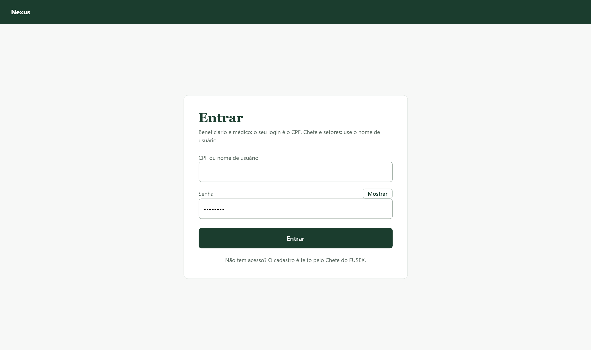

Tela única de entrada. Tem o campo **CPF ou nome de usuário** (texto livre, sem máscara), o campo **Senha** (com botão *Mostrar*) e o botão **Entrar**. A legenda informa que beneficiário e médico entram pelo CPF e que chefe e setores usam o nome de usuário. O rodapé avisa que o cadastro é feito pelo Chefe do FUSEX. Depois de entrar, cada perfil vai para a sua página inicial. *(RN17, RN18, RN35)*

**Tela 2 — Login com erro**

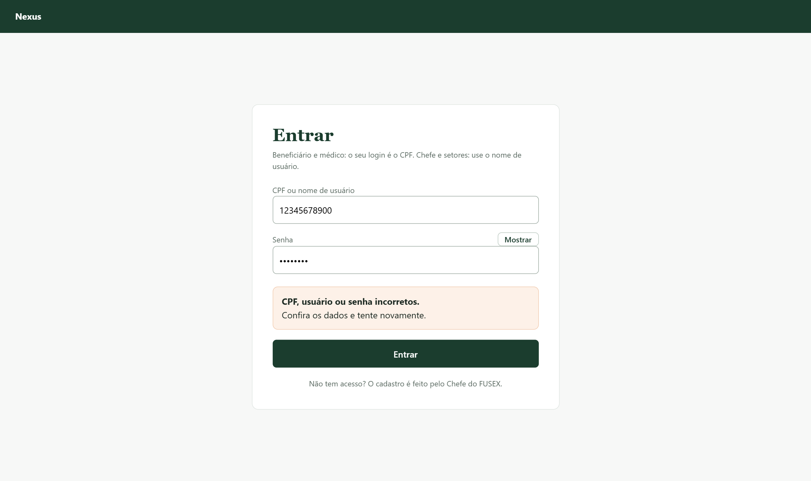

Quando os dados estão incorretos, aparece a mensagem genérica "CPF, usuário ou senha incorretos.", que não diz qual dado errou. Conta desativada também não entra e recebe um aviso próprio. *(RN19, RN35)*

---

### 5.2 Telas do beneficiário (titular e dependente maior)

**Tela 3 — Início**

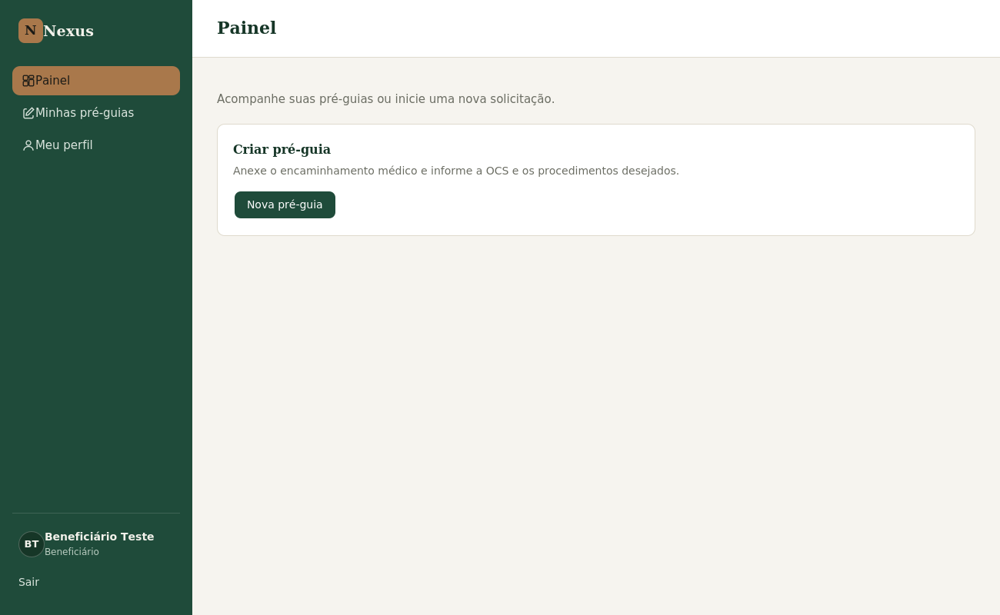

Tela inicial do beneficiário ao entrar, com acesso rápido à criação de uma nova pré-guia.

**Tela 4 — Nova pré-guia, passo 1: para quem é**

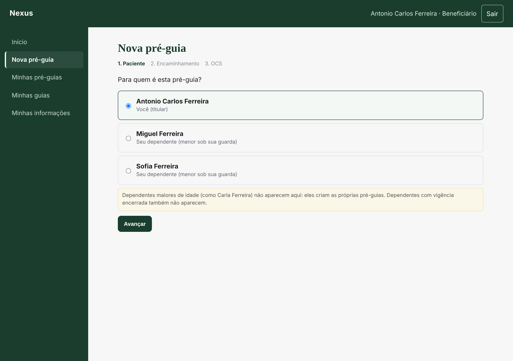

A criação da pré-guia tem três passos: **1. Paciente**, **2. Encaminhamento** e **3. OCS**. No primeiro, o titular escolhe para quem é a pré-guia: ele mesmo ou um menor sob a sua guarda. Dependentes maiores de idade e dependentes com vigência encerrada **não aparecem** (o maior cria as próprias pré-guias com o login dele). Quem não tem dependentes pode ir direto aos passos seguintes. *(RN42, RN41)*

**Tela 5 — Nova pré-guia, dados e encaminhamento**

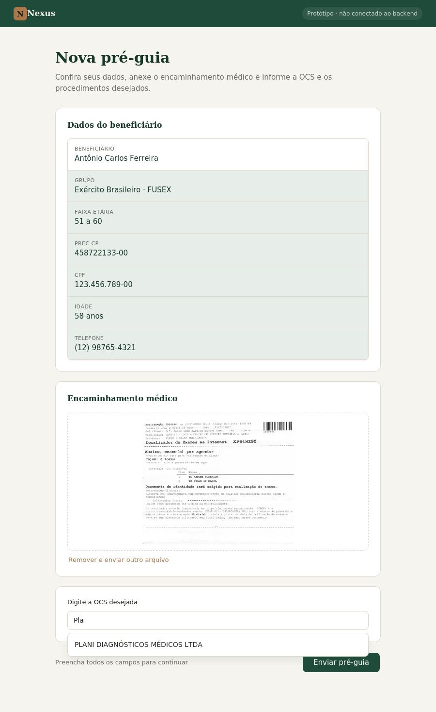

Mostra os dados do paciente (somente leitura, vindos do cadastro), o **upload do encaminhamento médico** (foto ou PDF, com pré-visualização e a opção de remover e enviar outro) e a **busca da OCS**, com lista de resultados. O botão de envio só é liberado com tudo preenchido. *(RN01, RN03, RN06, RN23, RN24)*

**Tela 6 — Minhas pré-guias**

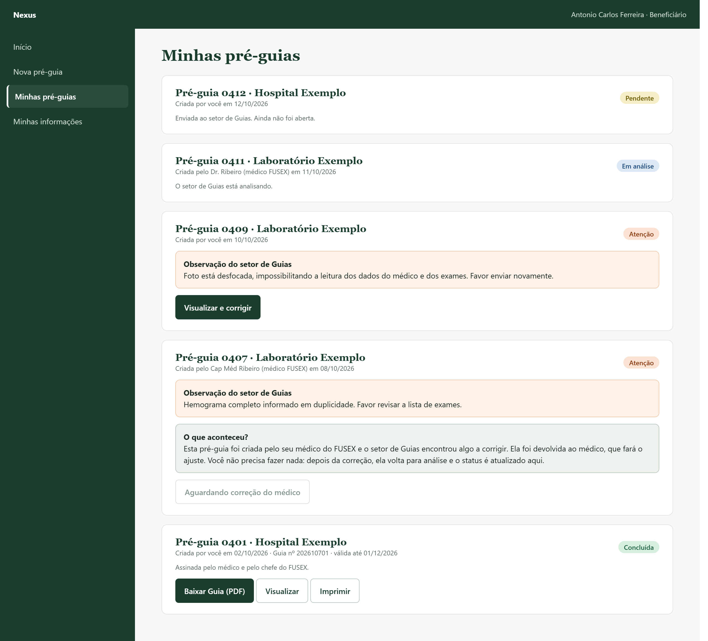

Um cartão por pré-guia, mostrando número, OCS, quem criou (o próprio beneficiário ou um médico do FUSEX), data e status. O comportamento depende do status:

* **Pendente / Em análise:** apenas acompanhamento.
* **Atenção (criada por ele):** mostra a observação do setor de Guias e o botão **Visualizar e corrigir**. *(RN09)*
* **Atenção (criada pelo médico):** mostra a observação e a legenda **"O que aconteceu?"**, explicando que a pré-guia foi devolvida ao médico. O botão fica desabilitado ("Aguardando correção do médico"). *(RN10)*
* **Concluída:** mostra o número da Guia, a validade e os botões **Baixar Guia (PDF)**, **Visualizar** e **Imprimir**. A partir daí, o acompanhamento passa para **Minhas guias**. *(RN15)*

**Tela 7 — Pré-guia em Atenção (Visualizar e corrigir)**

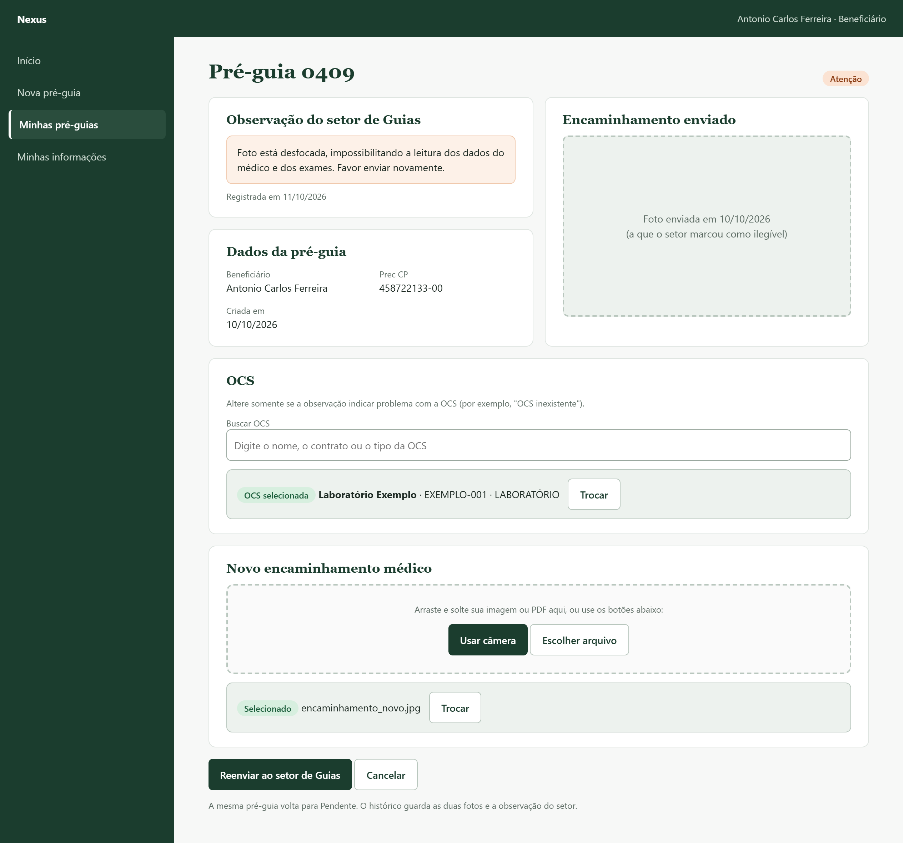

Aberta pelo botão **Visualizar e corrigir**. Mostra a observação do setor, os dados da pré-guia (somente leitura) e a foto de encaminhamento enviada antes. Para corrigir, o beneficiário pode **trocar a OCS** (pelo mesmo campo de busca) e/ou **enviar um novo encaminhamento**. Em **Reenviar ao setor de Guias**, a mesma pré-guia volta como Pendente. **Cancelar** descarta as mudanças. *(RN09)*

**Tela 8 — Minhas guias**

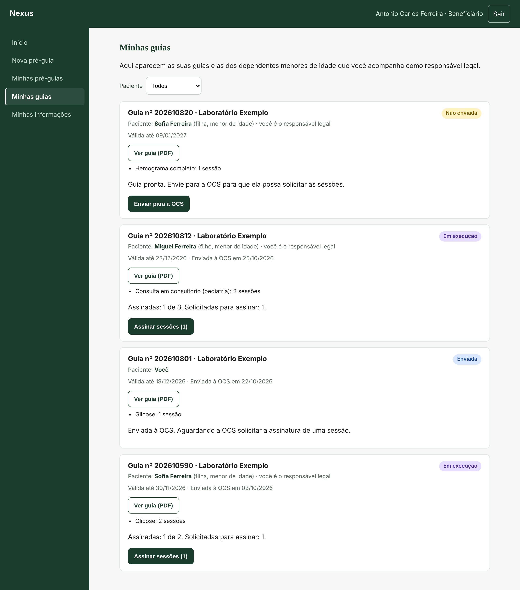

Lista as Guias já assinadas pelo médico e pelo chefe, as do próprio beneficiário e as dos menores que ele acompanha. Há o filtro **Paciente** (Todos ou um por vez) e, pelas regras, o filtro **Mostrar** (Todas, Em andamento, Finalizadas). Cada cartão traz o número da Guia, a OCS, a **situação**, o paciente ("Você" ou o menor, com a indicação de que ele é o responsável), a validade e a data de envio, o botão **Ver guia (PDF)**, a lista de procedimentos com o número de sessões e um resumo ("Assinadas: 1 de 3. Solicitadas para assinar: 1."). O botão muda conforme a situação:

* **Não enviada:** "Enviar para a OCS".
* **Enviada:** só o aviso "Aguardando a OCS solicitar a assinatura de uma sessão".
* **Em execução com sessão solicitada:** "Assinar sessões (n)".

*(RN43, RN46, RN50)*

**Tela 9 — Assinar sessões**

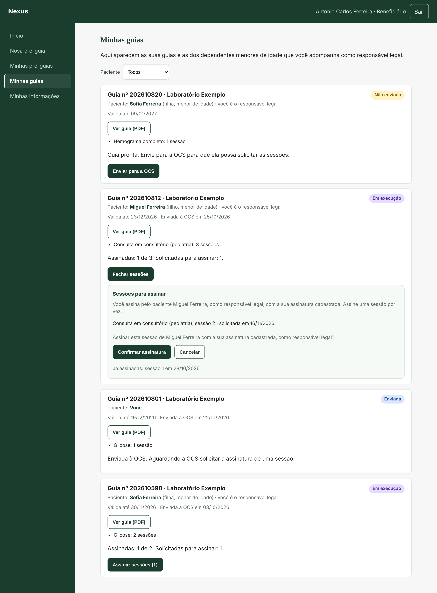

Ao clicar em **Assinar sessões**, abre o painel **Sessões para assinar**. Ele avisa em nome de quem a assinatura é feita ("Você assina pelo paciente … como responsável legal, com a sua assinatura cadastrada") e lista as sessões solicitadas pela OCS. A pessoa assina **uma sessão por vez** em **Confirmar assinatura** (ou **Cancelar**). Embaixo ficam as sessões já assinadas, com a data. O botão do cartão passa a **Fechar sessões**. Sem assinatura cadastrada, o sistema avisa e a sessão continua Solicitada. *(RN47, RN49)*

**Tela 10 — Minhas informações**

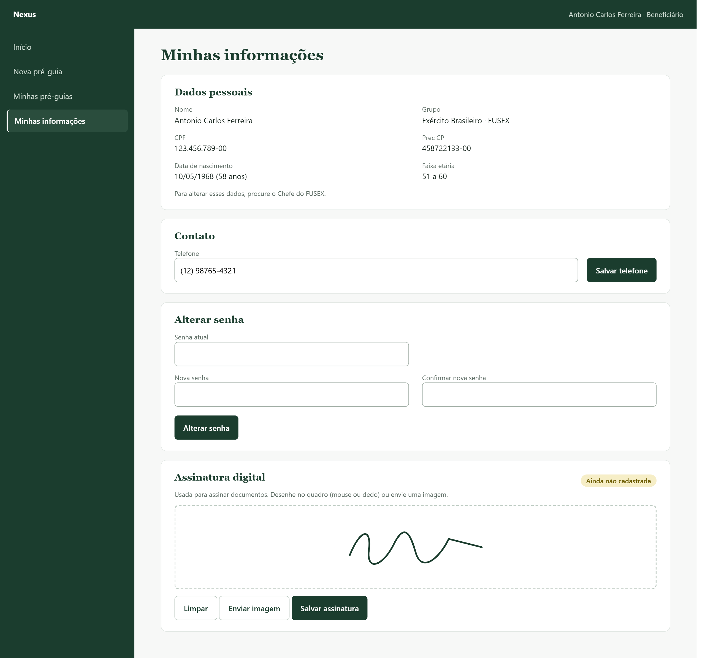

* **Dados pessoais** (somente leitura): nome, grupo, CPF, Prec CP, data de nascimento (com idade) e faixa etária. Alterações só pelo Chefe.
* **Contato:** o telefone é o único dado editável, com o botão **Salvar telefone**.
* **Alterar senha:** senha atual, nova senha e confirmação.
* **Assinatura digital:** a pessoa desenha no quadro ou envia uma imagem e clica em **Salvar assinatura**. Enquanto não houver assinatura, aparece "Ainda não cadastrada".

*(RN20, RN32, RN34)*

**Tela 11 — Minhas informações: aba Dependentes**

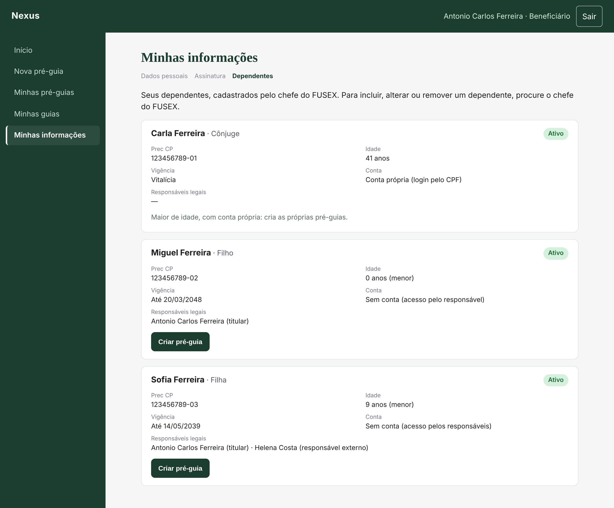

Quando o beneficiário tem dependentes, a tela se organiza em abas (**Dados pessoais**, **Assinatura** e **Dependentes**). A aba Dependentes é **somente consulta**: cada cartão mostra nome, vínculo, Prec CP, idade, vigência, tipo de conta e responsáveis legais. Nos menores há o botão **Criar pré-guia**, que leva ao passo 1 da Tela 4. Para incluir ou alterar um dependente, é preciso procurar o chefe. *(RN38, RN42)*

---

### 5.3 Telas do responsável legal

**Tela 12 — Minhas guias**

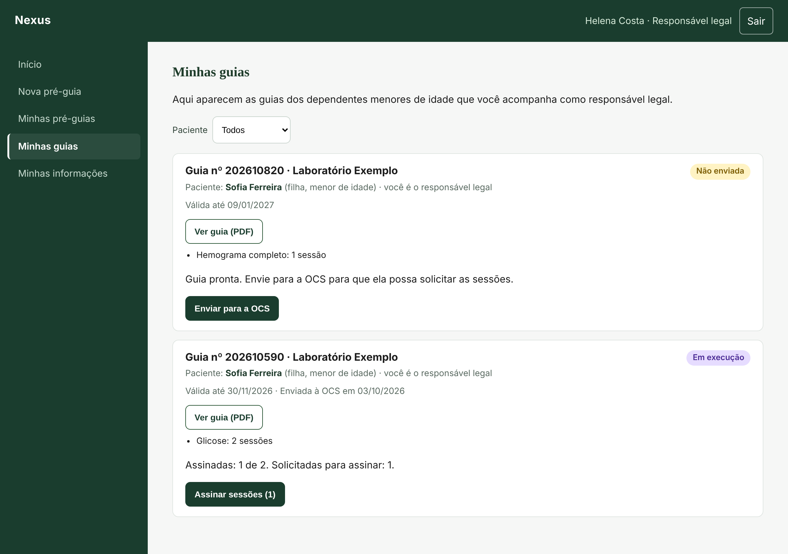

Igual à Tela 8, mas mostra **apenas as Guias dos menores** que a pessoa acompanha como responsável legal. Ela envia as Guias à OCS e assina as sessões com a própria assinatura. *(RN43)*

**Tela 13 — Minhas informações**

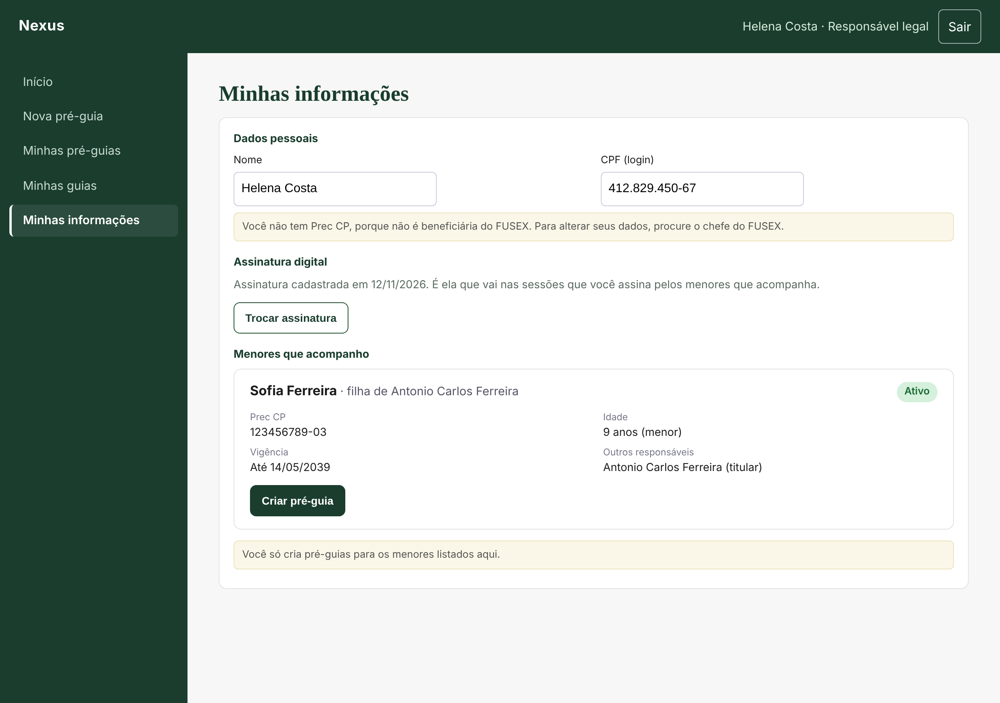

Mostra o nome e o CPF (login), com o aviso de que a pessoa não tem Prec CP por não ser beneficiária e de que alterações só pelo chefe. Tem o bloco **Assinatura digital** (com **Trocar assinatura**, usada nas sessões dos menores) e a lista **Menores que acompanho**, cada um com um botão **Criar pré-guia**. Ela só cria pré-guias para os menores listados. Não há troca de senha para este perfil. *(RN34, RN40, RN42)*

---

### 5.4 Telas do médico do FUSEX

**Tela 14 — Nova pré-guia**

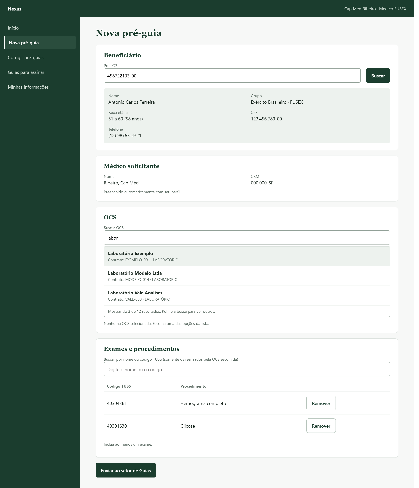

Criação da pré-guia durante a consulta. O médico digita a **Prec CP** e clica em **Buscar**: o sistema preenche os dados do paciente, e o bloco **Médico solicitante** vem do perfil dele. Depois escolhe a **OCS** (por busca) e inclui os **exames** (busca por nome ou código TUSS, com lista dos escolhidos e botão **Remover**). É obrigatório ter ao menos um exame, e não é preciso anexar encaminhamento. O envio vai para o setor de Guias. *(RN04, RN05, RN06, RN25)*

**Tela 15 — Nova pré-guia de um dependente**

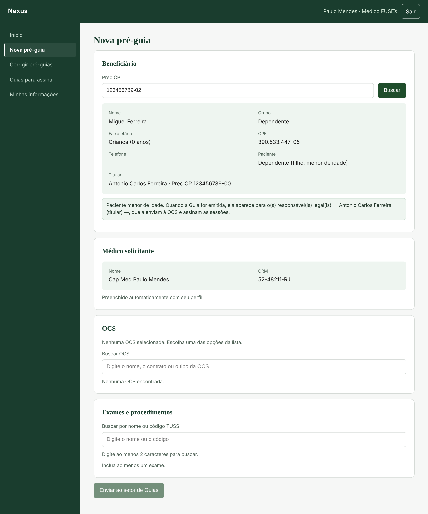

Se a Prec CP digitada é de um dependente, o bloco do paciente mostra nome, grupo "Dependente", faixa etária, CPF, telefone, o tipo ("Dependente (filho, menor de idade)") e o **titular** com o Prec CP dele. Para menores, um aviso explica que, quando a Guia for emitida, ela aparece para o responsável legal, que a envia à OCS e assina as sessões. *(RN42)*

**Tela 16 — Corrigir pré-guias**

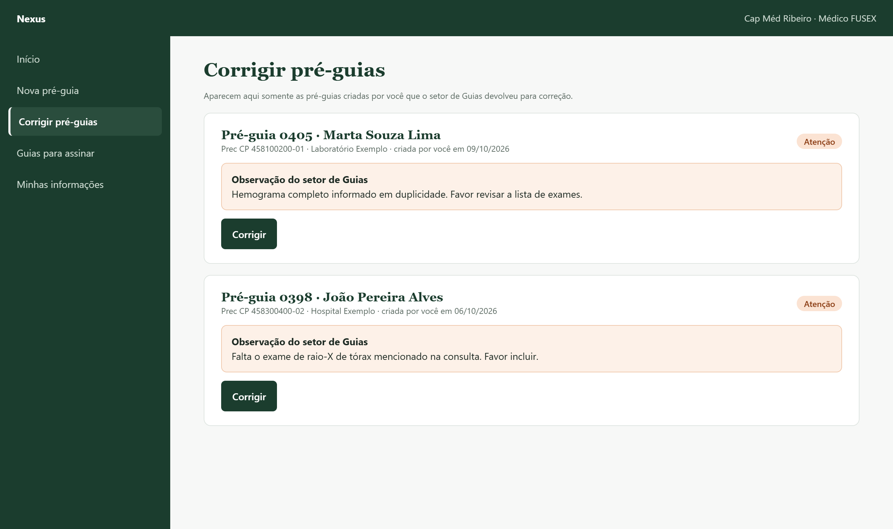

Aba usada **somente para corrigir**. Lista as pré-guias **criadas por ele** que o setor de Guias devolveu com status Atenção, mostrando beneficiário, Prec CP, OCS, data e a observação do setor, com o botão **Corrigir**. *(RN10)*

**Tela 17 — Corrigir pré-guia (expandida)**

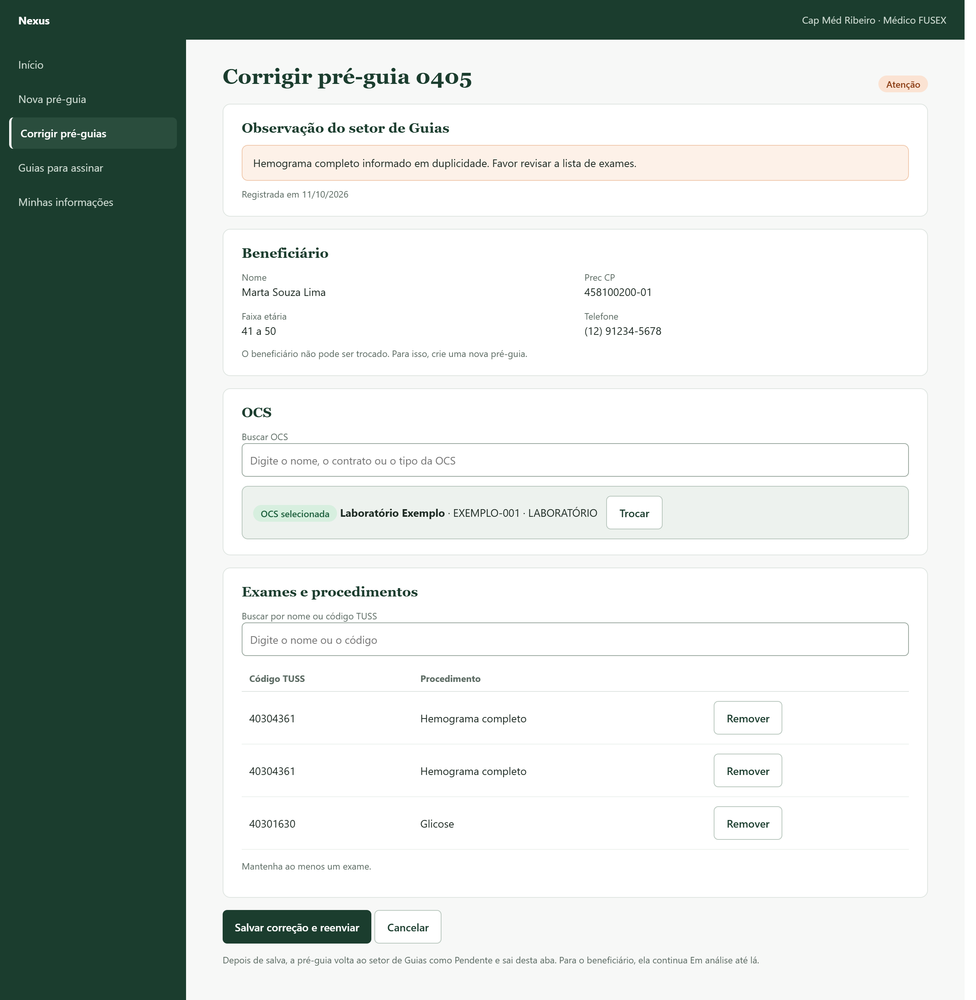

Ao corrigir, o médico vê a observação do setor, o beneficiário (somente leitura, não pode ser trocado), a **OCS** (busca, com "Trocar") e a lista de **exames** (remover e incluir, mantendo ao menos um). **Salvar correção e reenviar** devolve a pré-guia ao setor de Guias como Pendente, e ela sai da lista. **Cancelar** descarta as mudanças. *(RN10)*

**Tela 18 — Corrigir pré-guias (vazia)**

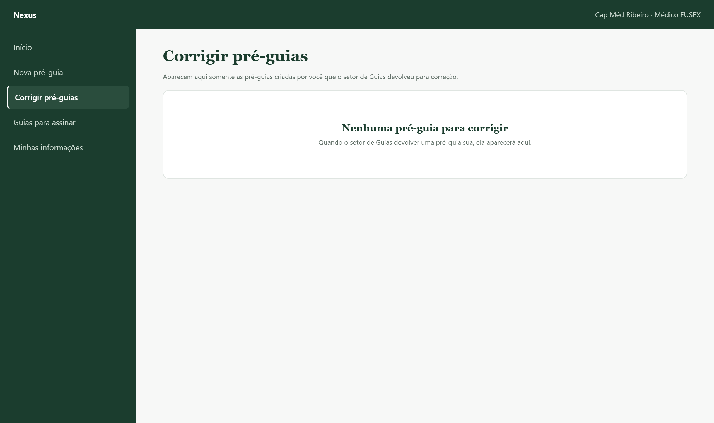

Quando não há nenhuma pré-guia para corrigir, a aba mostra "Nenhuma pré-guia para corrigir". *(RN10)*

**Tela 19 — Guias para assinar**

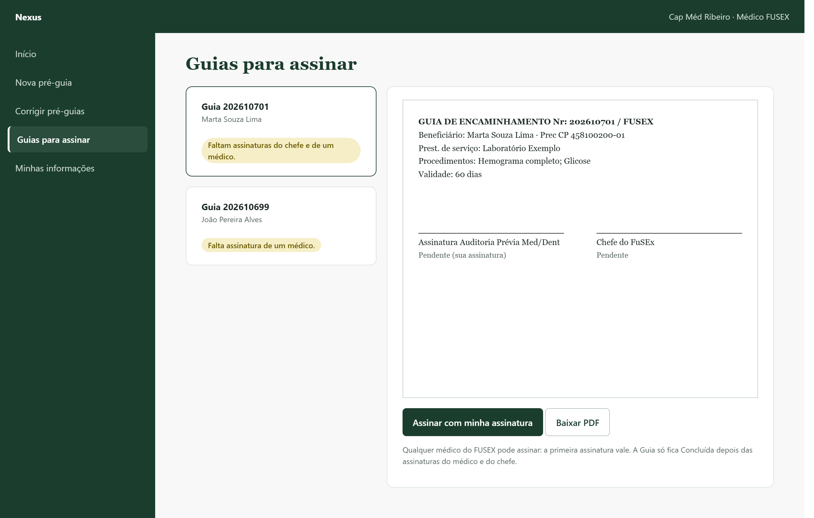

Lista as Guias inseridas pelo setor de Guias e a prévia, com as linhas de assinatura do médico e do chefe. Cada Guia mostra o status de assinatura com os textos padronizados. O botão **Assinar com minha assinatura** registra a assinatura do médico; qualquer médico pode assinar e a primeira vale. Só assina quem já cadastrou a assinatura digital. Pelas regras, é possível **selecionar várias guias e assinar em lote** (até 50 por vez). *(RN12, RN14, RN16, RN31)*

**Tela 20 — Minhas informações**

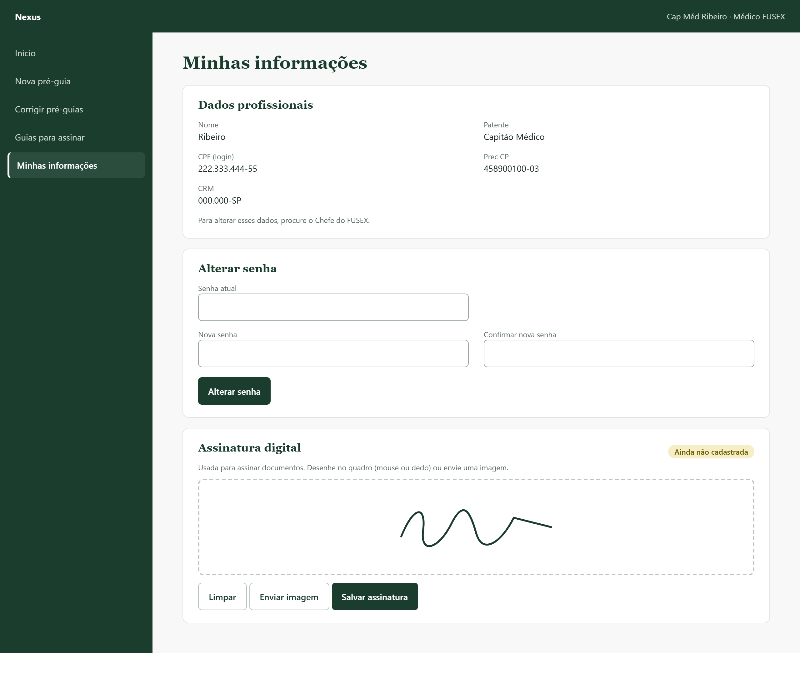

Mostra os dados profissionais (nome, patente, CPF, Prec CP e CRM), todos **somente leitura**, pois só o Chefe altera. Tem o bloco **Alterar senha** e o cadastro da **assinatura digital**, igual ao do beneficiário. *(RN20, RN32, RN34)*

---

### 5.5 Telas do Setor de Guias

**Tela 21 — Fila de pré-guias**

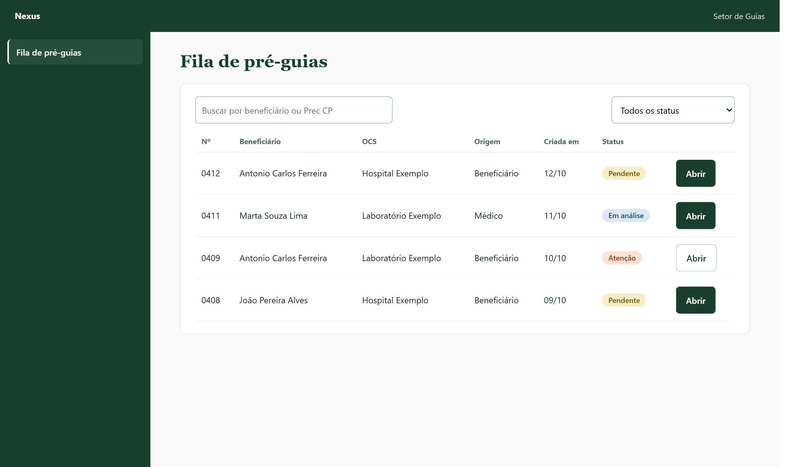

Fila de pré-guias recebidas (da mais recente para a mais antiga, 20 por página), com busca por beneficiário ou Prec CP, filtro por status e tabela com número, beneficiário, OCS, origem (beneficiário ou médico), data, status e o botão **Abrir**. Ao abrir uma pré-guia Pendente, ela passa para **Em análise**. *(RN07)*

**Tela 22 — Pré-guia selecionada**

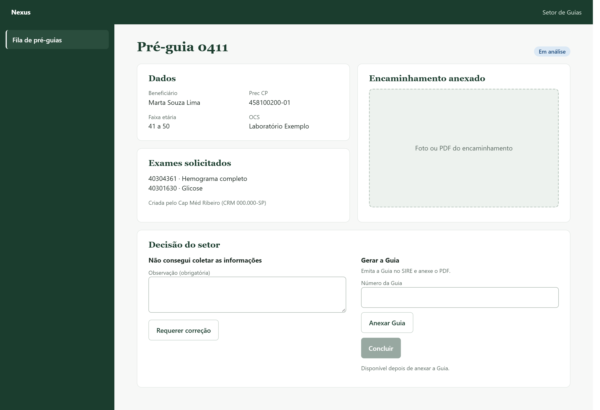

Mostra todas as informações da pré-guia: dados do paciente, OCS, exames (quando criada pelo médico) e o encaminhamento anexado. O bloco **Decisão do setor** tem dois caminhos:

* **Não consegui coletar as informações:** o funcionário escreve a observação (obrigatória) e clica em **Requerer correção**. A pré-guia vai para **Atenção**. *(RN08)*
* **Gerar a Guia:** o funcionário emite a Guia no SIRE e clica em **Anexar Guia** (PDF). O botão **Concluir** fica desabilitado até a Guia ser anexada. *(RN11)*

**Tela 23 — Pré-guia com Guia anexada**

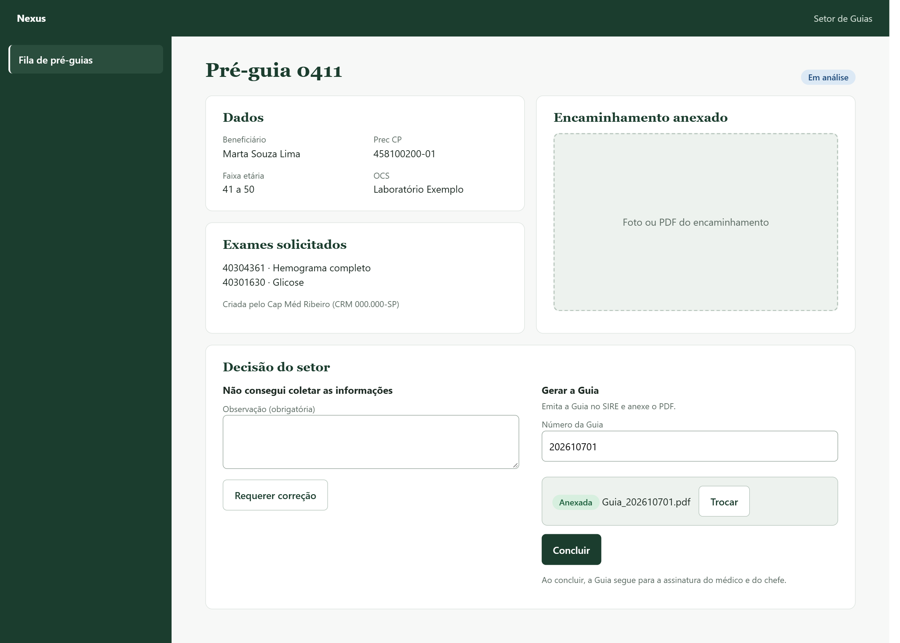

Estado da tela anterior depois de anexar a Guia: o PDF aparece como anexado (com opção de **Trocar**) e o botão **Concluir** é habilitado. Ao concluir, a Guia segue para a assinatura do médico e do chefe. A pré-guia só vira Concluída depois das duas assinaturas. *(RN12, RN13)*

**O que a versão final faz ao anexar o PDF** *(regras RN26 a RN30; esse comportamento ainda não aparece nos protótipos acima)*: o sistema lê o número da Guia, a validade, o Prec CP e os exames; confere a UG, a validade e o paciente; e preenche uma tabela de exames para o setor conferir e corrigir. O **Concluir** só fica habilitado quando tudo está correto.

---

### 5.6 Telas do Chefe do FUSEX

**Tela 24 — Guias para assinar**

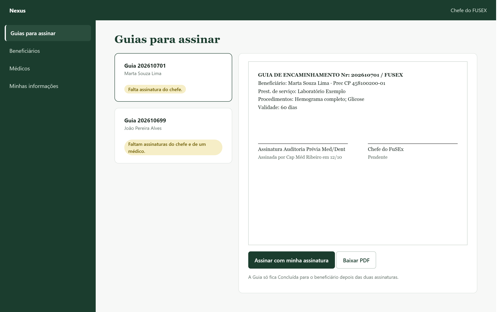

Mesma estrutura da tela do médico: lista das Guias pendentes, prévia com as duas linhas de assinatura e o botão **Assinar com minha assinatura**, que registra a assinatura do chefe. Mostra o status de assinatura de cada Guia com os textos padronizados. O chefe também pode assinar **em lote**. *(RN12, RN14, RN16, RN31)*

**Tela 25 — Beneficiários**

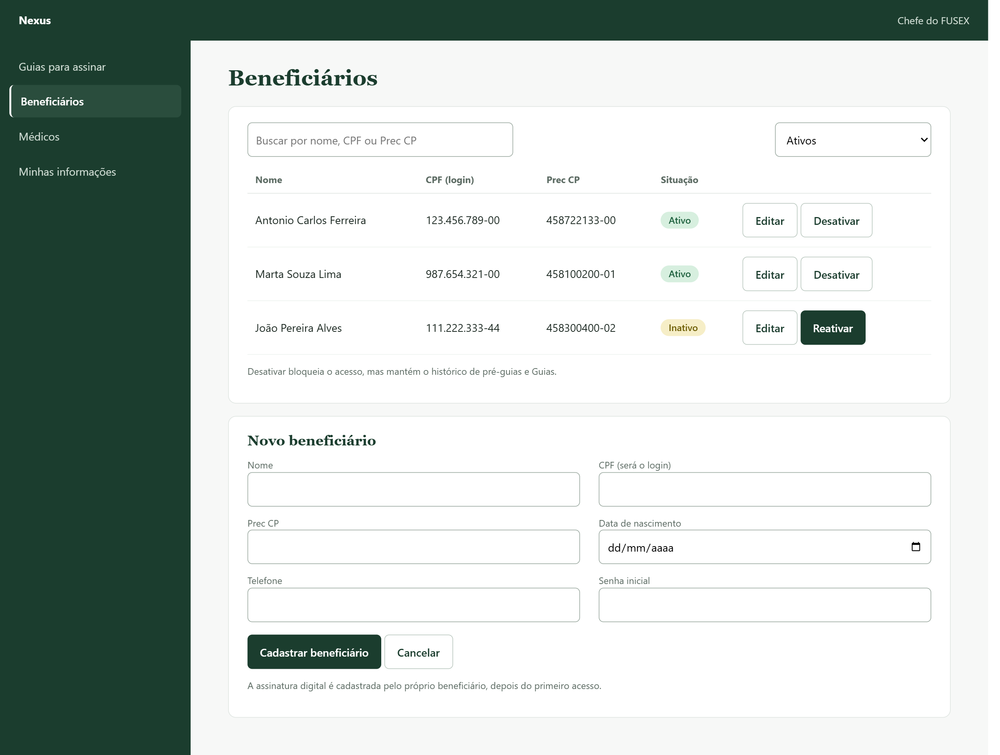

Busca, filtro de situação (Ativos, Inativos, Todos) e tabela com nome, CPF (login), Prec CP, situação e as ações **Editar**, **Desativar** e **Reativar**. O cadastro de um novo beneficiário é feito no formulário **Novo beneficiário** (nome, CPF, Prec CP, data de nascimento, telefone e senha inicial). Desativar mantém o histórico. *(RN18, RN19, RN21, RN36)*

**Tela 26 — Beneficiários com dependentes**

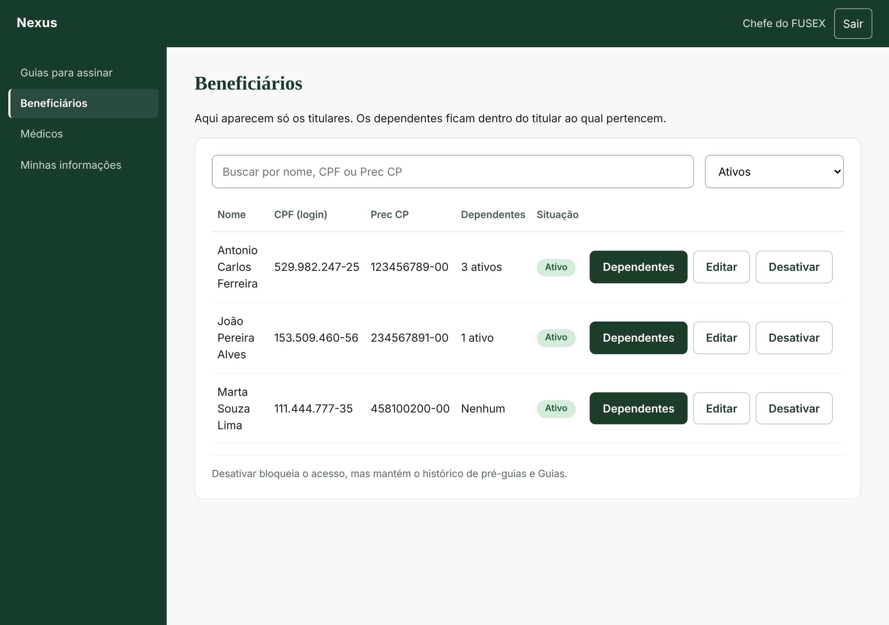

A lista passa a mostrar só os **titulares**, com uma coluna **Dependentes** (ex.: "3 ativos") e o botão **Dependentes** em cada linha, que abre a lista de dependentes daquele titular. *(RN38)*

**Tela 27 — Editando beneficiário**

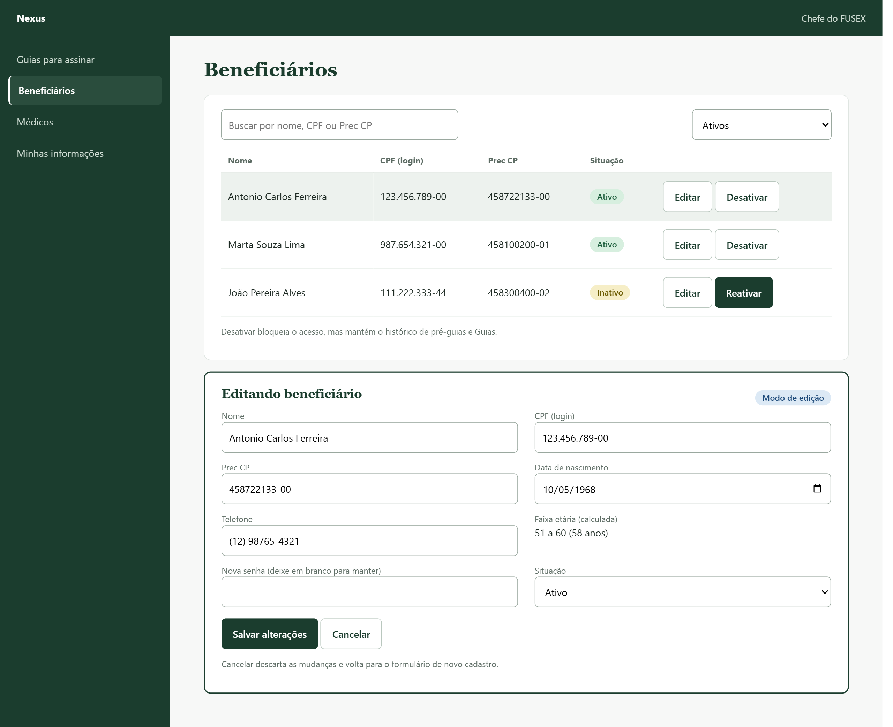

Ao clicar em **Editar**, a linha da tabela fica destacada e o formulário vira **"Editando beneficiário"**, mostrando os dados preenchidos (nome, CPF, Prec CP, nascimento, telefone, faixa etária calculada, situação e nova senha opcional). **Salvar alterações** grava, e **Cancelar** descarta. O chefe também pode editar beneficiários inativos. *(RN20)*

**Tela 28 — Médicos**

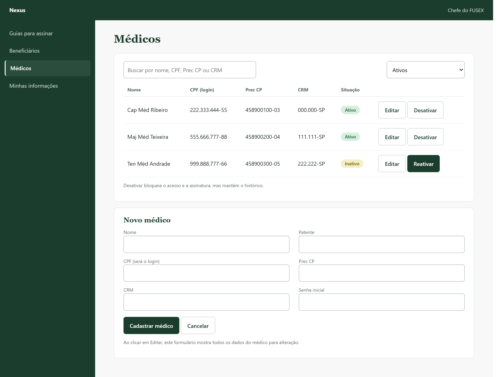

Mesmo padrão da lista de beneficiários: busca, filtro de situação e tabela com nome, CPF (login), Prec CP, CRM, situação e as ações Editar, Desativar e Reativar. O formulário cadastra um novo médico (nome, patente, CPF, Prec CP, CRM e senha inicial). *(RN18, RN19, RN36)*

**Tela 29 — Dependentes do titular**

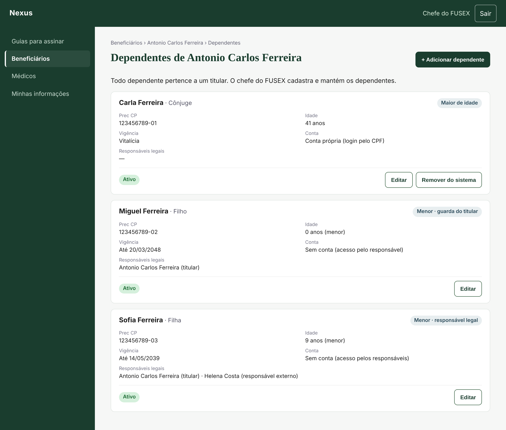

Lista os dependentes de um titular, com o botão **+ Adicionar dependente**. Cada cartão traz nome, vínculo, o selo do tipo (**Maior de idade**, **Menor · guarda do titular** ou **Menor · responsável legal**), Prec CP, idade, vigência, tipo de conta, responsáveis legais, a situação (Ativo) e o botão **Editar**. *(RN37, RN38, RN40, RN41)*

**Tela 30 — Adicionar dependente (menor)**

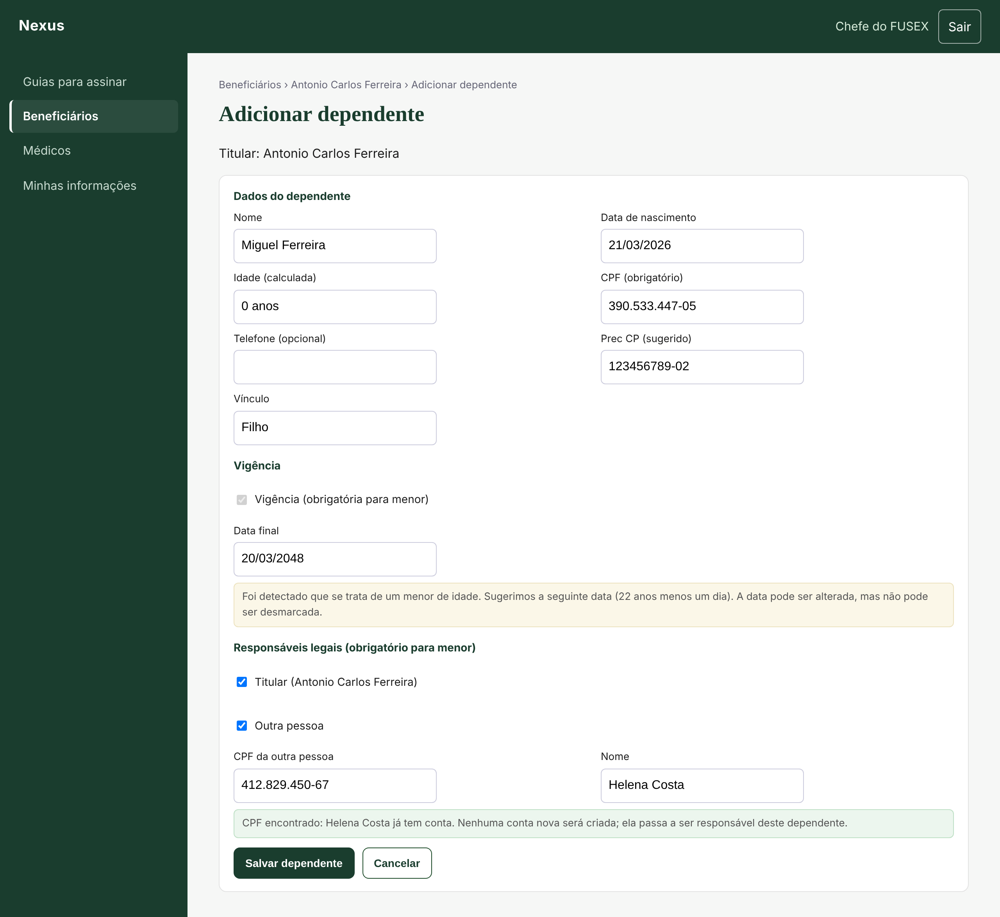

O formulário pede nome, data de nascimento, idade (calculada), **CPF (obrigatório)**, telefone (opcional), **Prec CP (sugerido em sequência)** e vínculo. Para menor, a **vigência é obrigatória**: o sistema sugere a data final (22 anos menos um dia), que pode ser alterada, mas não desmarcada. Em **Responsáveis legais**, o chefe indica quem age pelo menor: o titular ou **outra pessoa** (CPF e nome). Se o CPF informado já tem conta, o sistema avisa que nenhuma conta nova será criada e que a pessoa passa a ser responsável. *(RN38, RN39, RN40, RN41, RN44)*

**Tela 31 — Adicionar dependente (maior)**

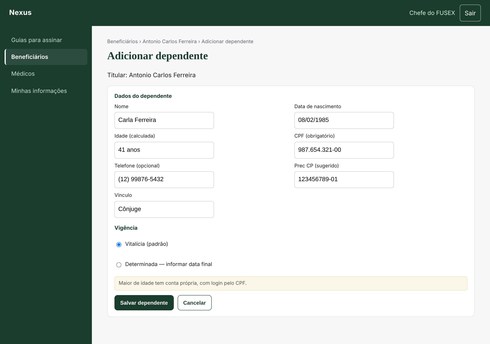

Mesmo formulário, mas para o maior de idade a vigência é **Vitalícia (padrão)** ou **Determinada** (com data final), e o aviso lembra que o maior tem **conta própria, com login pelo CPF**. A senha inicial é definida pelo chefe. *(RN39, RN40, RN41)*

**Tela 32 — Minhas informações**

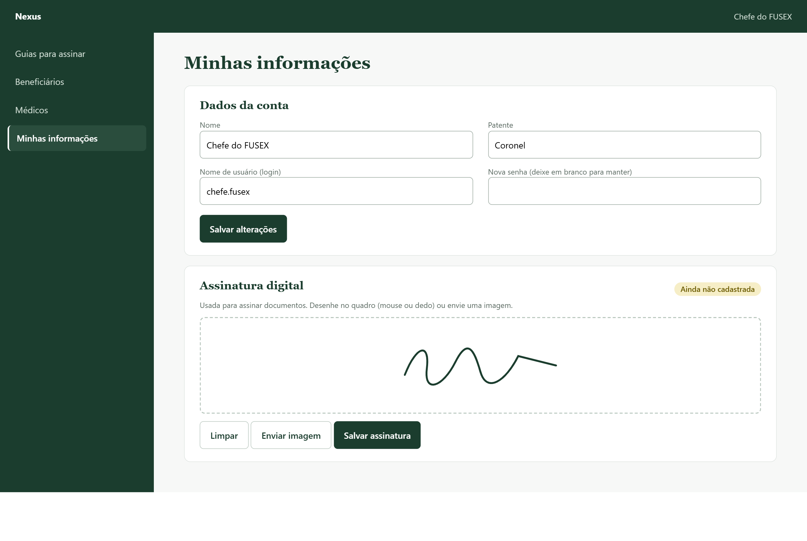

Todos os dados da conta do chefe são editáveis (nome, patente, nome de usuário e nova senha), além do cadastro da **assinatura digital**. *(RN20, RN32)*

---

### 5.7 Telas da Recepção

**Tela 33 — Guias para impressão**

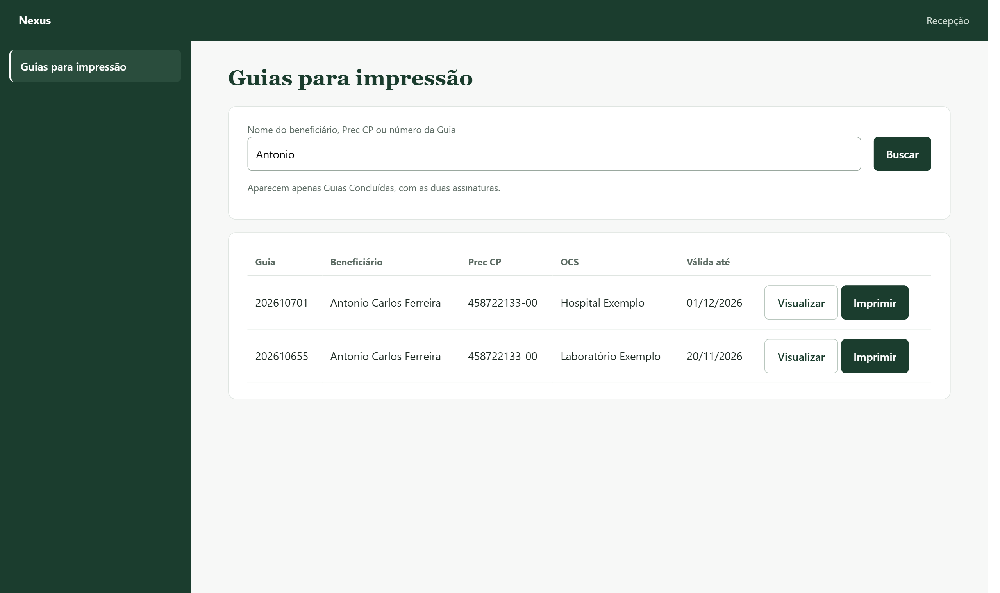

Busca por nome do beneficiário, Prec CP ou número da Guia. A tabela mostra Guia, beneficiário, **Prec CP**, OCS, validade e os botões **Visualizar** e **Imprimir**. Só aparecem Guias de pré-guias **Concluídas**, com as duas assinaturas. *(RN15, RN33)*

**Tela 34 — Guia selecionada**

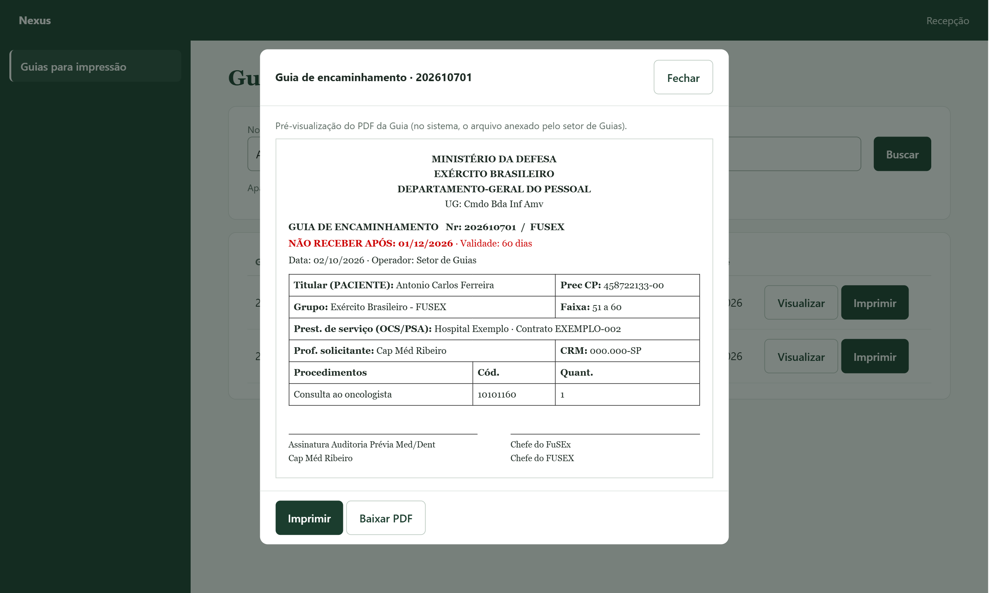

Ao clicar em **Visualizar**, abre uma janela sobre a lista com a Guia de encaminhamento (o PDF anexado pelo setor de Guias, com as assinaturas) e os botões **Imprimir**, **Baixar PDF** e **Fechar**. *(RN15, RN33)*

---

### 5.8 Telas da OCS

A OCS também tem as abas **Guias recebidas** (com a grade de sessões e o botão "Requerer assinatura"), **Guias Finalizadas** e **Espelho**, descritas nas regras RN48 e RN55 a RN59. Essas telas **ainda não têm protótipo** neste documento. Abaixo, as telas de decisão sobre as glosas.

**Tela 35 — Glosas Recebidas**

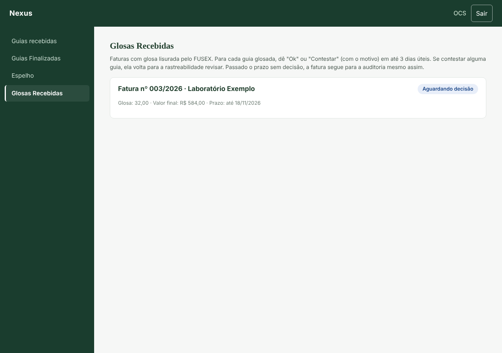

Lista as faturas com glosa que aguardam a decisão da OCS. Um texto explica a regra: para cada guia glosada, dar "Ok" ou "Contestar" (com o motivo) em até 3 dias úteis; se contestar, a fatura volta para a rastreabilidade; passado o prazo, ela segue para a auditoria. Cada cartão mostra o número da fatura, a glosa, o valor final, o **prazo** e a situação "Aguardando decisão". *(RN77, RN80)*

**Tela 36 — Detalhe da glosa**

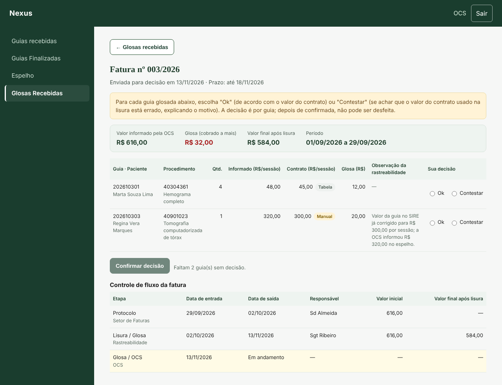

Mostra o resumo da fatura (valor informado, glosa, valor final e período) e a tabela das Guias glosadas: paciente, procedimento, quantidade, valor informado, valor do contrato (com o selo **Tabela** ou **Manual**), glosa e a **observação da rastreabilidade**. Em cada linha, a OCS escolhe **Ok** ou **Contestar**. O botão **Confirmar decisão** só habilita quando todas as Guias têm decisão. Embaixo está o **Controle de fluxo da fatura**. *(RN66, RN77, RN78)*

**Tela 37 — Decisão mista (Ok e Contestar)**

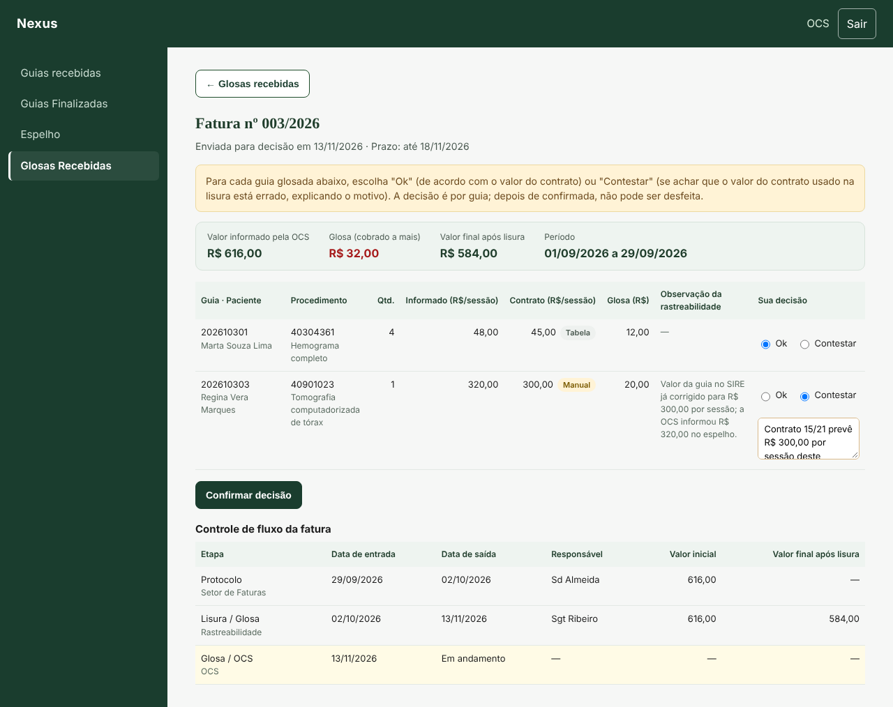

Ao escolher **Contestar**, aparece um campo para o **motivo** (obrigatório, de 10 a 500 caracteres). Cada Guia pode ter uma decisão diferente. *(RN78)*

**Tela 38 — Confirmar a decisão**

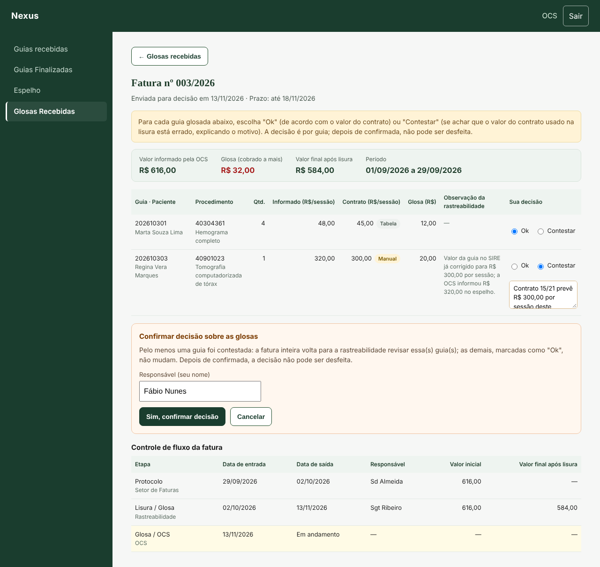

Antes de concluir, o sistema pede confirmação e o **nome do responsável**. Se alguma Guia foi contestada, o aviso explica que a **fatura inteira volta para a rastreabilidade** revisar essa(s) Guia(s), e que as marcadas como "Ok" não mudam. A decisão não pode ser desfeita. *(RN65, RN78, RN79)*

---

### 5.9 Telas do Setor de Faturas

**Tela 39 — Espelhos recebidos**

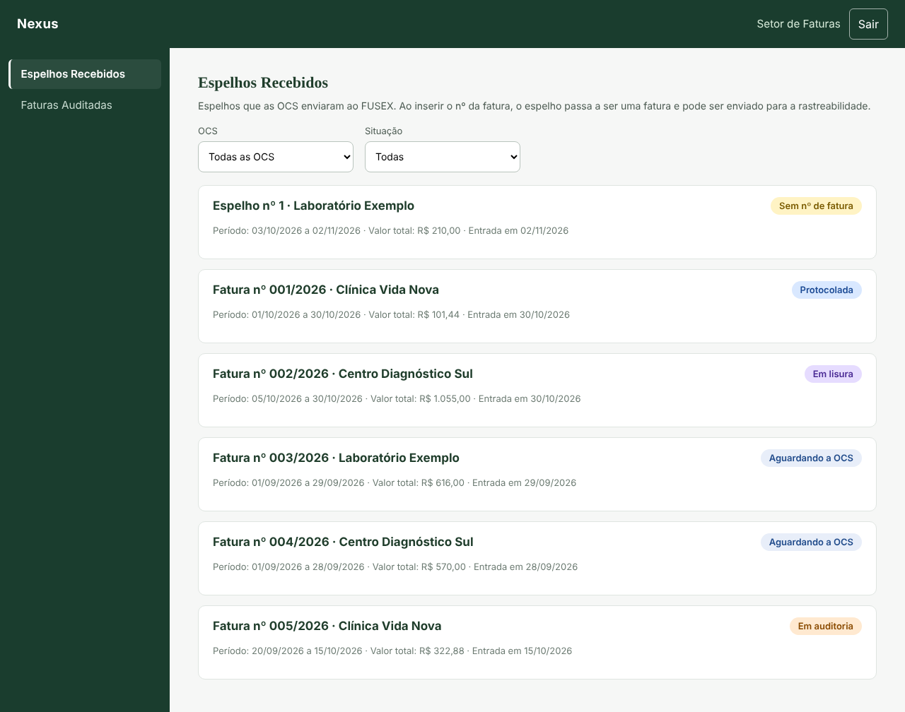

Lista os espelhos que as OCS enviaram e as faturas já protocoladas, com filtros de **OCS** e de **Situação**. Cada cartão mostra "Espelho nº" (ou "Fatura nº"), a OCS, a situação, o período, o valor total e a data de entrada. *(RN61, RN62)*

**Tela 40 — Detalhe do espelho**

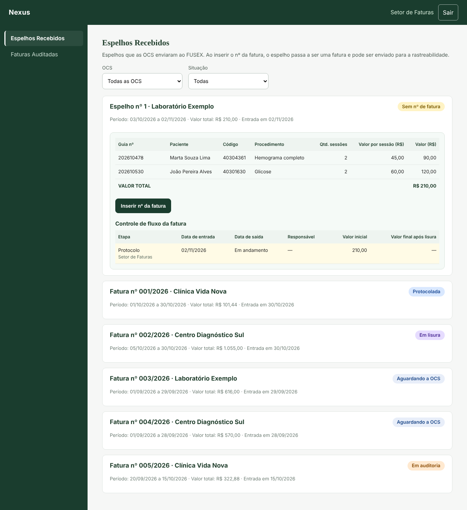

Ao clicar em um espelho, abre o detalhe só de leitura: Guia, paciente, código, procedimento, quantidade de sessões, valor por sessão e valor, com o **valor total**. Aparece o botão **Inserir nº da fatura** e, embaixo, o **Controle de fluxo da fatura** com a etapa Protocolo em andamento. *(RN63, RN66)*

**Tela 41 — Protocolar fatura**

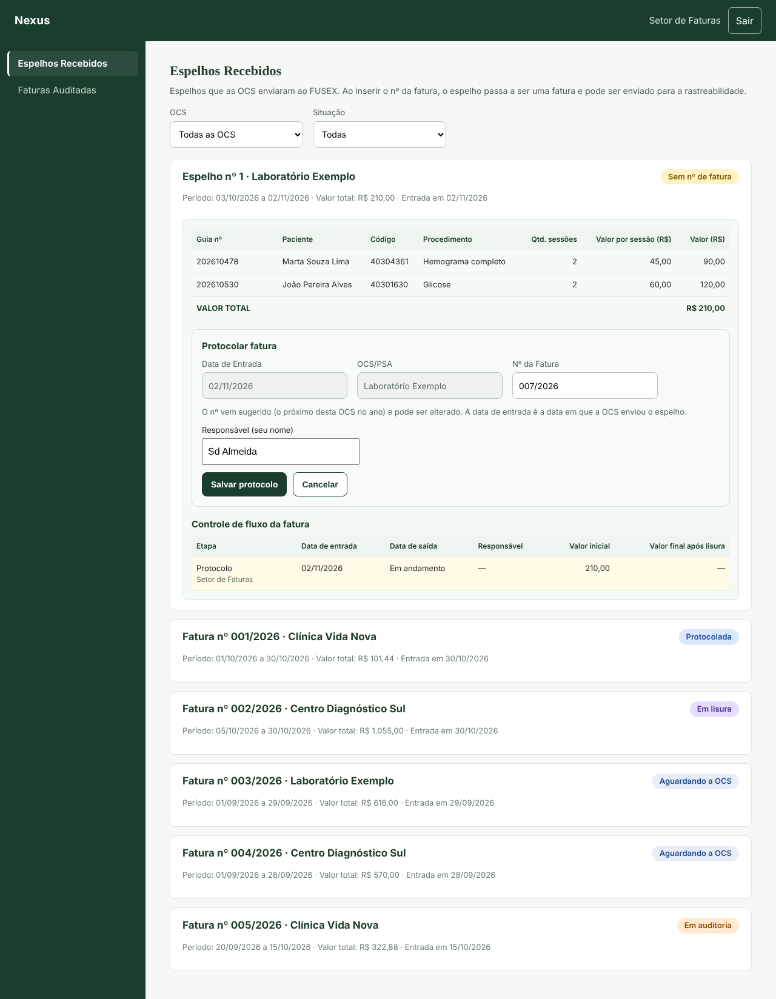

O formulário traz a **Data de Entrada** e a **OCS/PSA** (somente leitura), o **Nº da Fatura** (já sugerido, ex.: 007/2026, e editável) e o **Responsável (seu nome)**. **Salvar protocolo** transforma o espelho em fatura. *(RN63, RN65)*

**Tela 42 — Fatura protocolada**

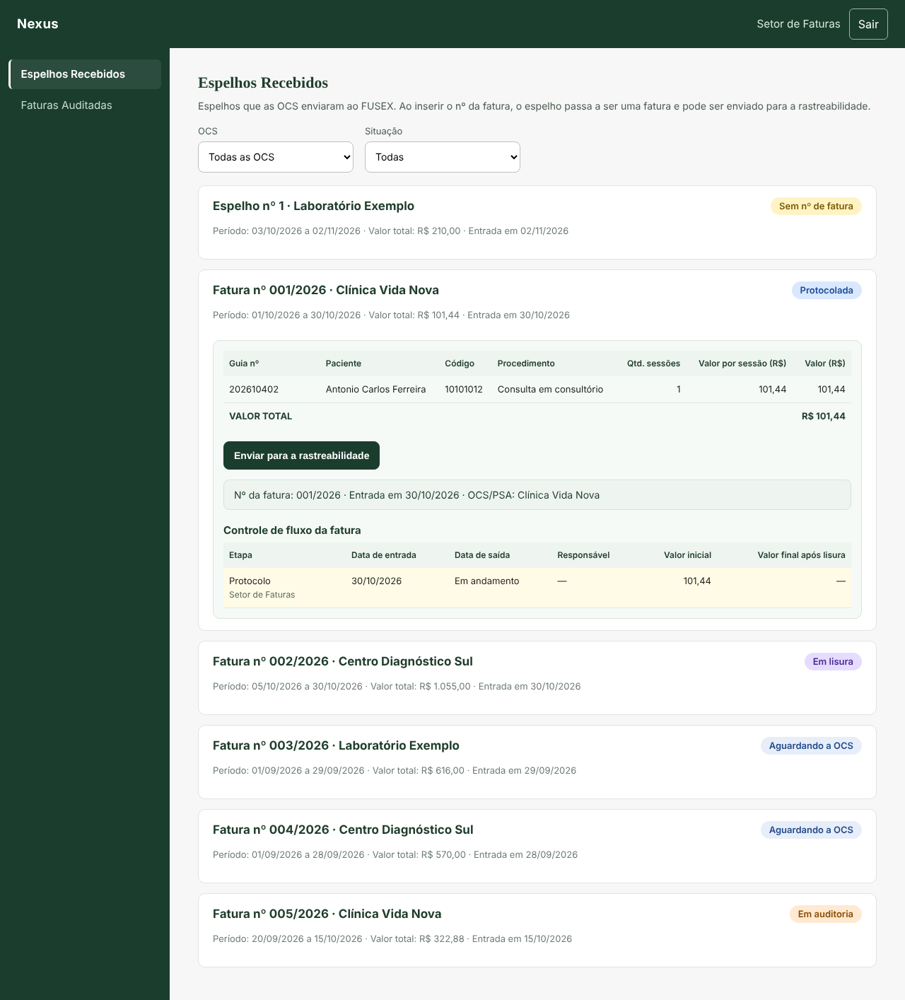

Depois de protocolada, o cartão mostra a situação **Protocolada**, o nº da fatura, a data de entrada e a OCS, e o botão **Enviar para a rastreabilidade**. *(RN64)*

**Tela 43 — Confirmar o envio à rastreabilidade**

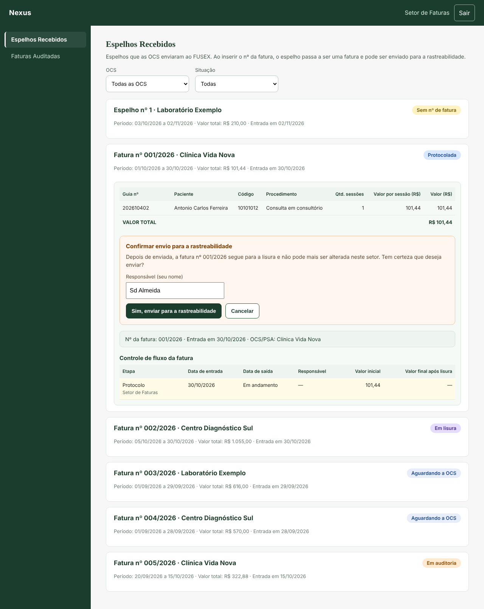

Pede confirmação e o nome do responsável, avisando que, depois de enviada, a fatura segue para a lisura e **não pode mais ser alterada neste setor**. *(RN64, RN65)*

**Tela 44 — Filtro por situação "Aguardando a OCS"**

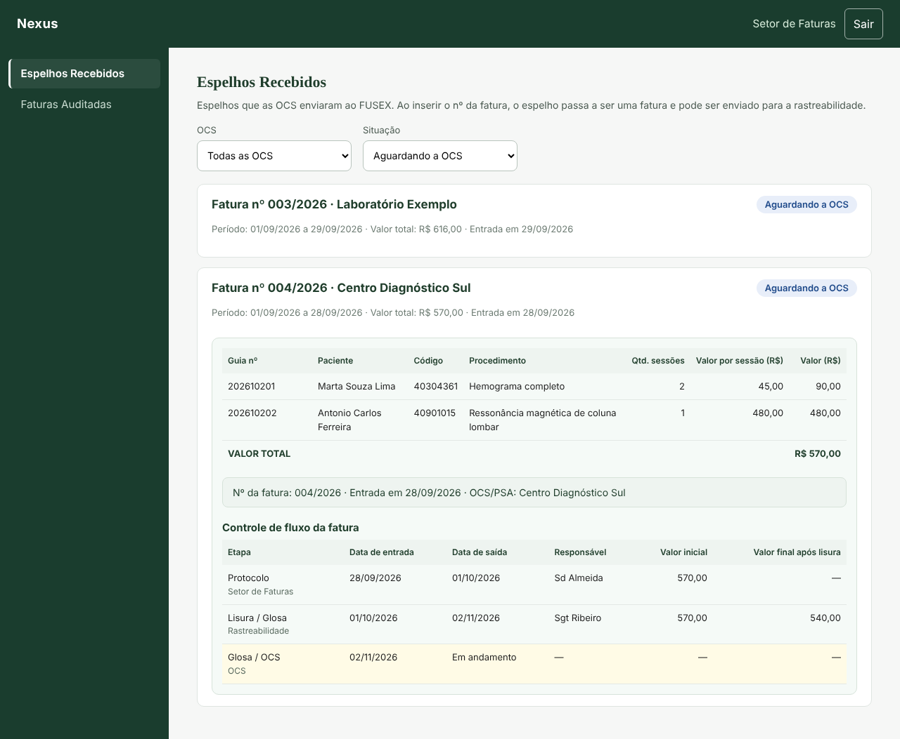

Exemplo do filtro de situação. A fatura aberta mostra o controle de fluxo com a etapa **Glosa / OCS** em andamento. *(RN62, RN66)*

**Tela 45 — Faturas Auditadas**

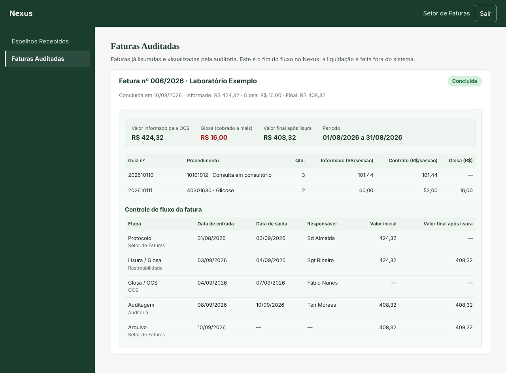

Mostra as faturas já visualizadas pela auditoria, com a situação **Concluída**. O texto lembra que este é o **fim do fluxo no Nexus** e que a liquidação é feita fora do sistema. O detalhe traz o resumo (valor informado, glosa, valor final e período), a tabela por Guia (informado, contrato e glosa) e o controle de fluxo completo, até a etapa **Arquivo**. *(RN66, RN67)*

---

### 5.10 Telas da Rastreabilidade

**Tela 46 — Faturas Recebidas**

Lista as faturas **Em lisura** e **Aguardando a OCS**, com filtro de OCS. Cada cartão mostra período, valor informado e, conforme o caso, "Linhas decididas: 3 de 4", "Glosas enviadas à OCS em…" ou "Liberada para a auditoria". *(RN68, RN76)*

**Tela 47 — Lisura com comparação automática**

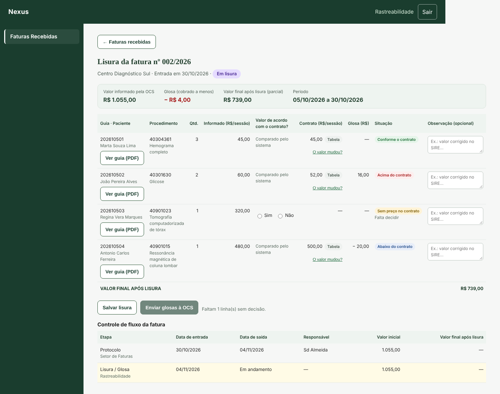

No topo, o resumo (valor informado pela OCS, glosa, valor final parcial e período). Na tabela, cada linha mostra Guia e paciente, procedimento, quantidade, valor informado, o **contrato** (com o selo **Tabela**), a **glosa** e a **situação** ("Conforme o contrato", "Acima do contrato", "Abaixo do contrato" ou "Sem preço no contrato"), além do botão **Ver guia (PDF)** e da **observação opcional**. Nas linhas sem preço, a pergunta "Valor de acordo com o contrato?" (**Sim** ou **Não**). **Salvar lisura** guarda o trabalho; **Enviar glosas à OCS** só habilita com todas as linhas decididas ("Faltam 1 linha(s) sem decisão"). *(RN69, RN70, RN71, RN72, RN73, RN74)*

**Tela 48 — Linha manual com observação**

Ao responder **Não**, aparece o campo para digitar o **valor do contrato** daquele exame ("Insira o valor de contrato aqui, ficará salvo"). O selo passa a **Manual**, o sistema calcula a glosa e o valor entra na tabela de preços da OCS. A observação da linha também pode ser preenchida. *(RN70, RN72)*

**Tela 49 — Corrigir valor desatualizado da tabela**

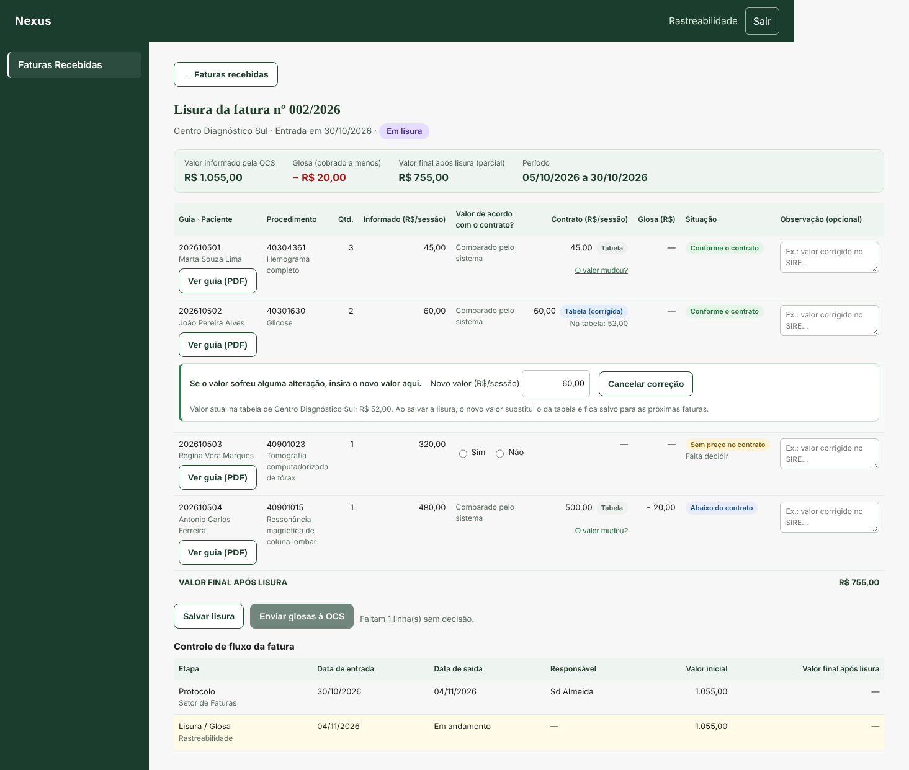

Ao clicar em **"O valor mudou?"**, aparece o campo **Novo valor (R$/sessão)**, com o valor atual da tabela como referência. O selo passa a **Tabela (corrigida)**, e o novo valor substitui o da tabela para as próximas faturas. **Cancelar correção** volta ao valor anterior. *(RN70)*

**Tela 50 — Confirmar o envio das glosas à OCS**

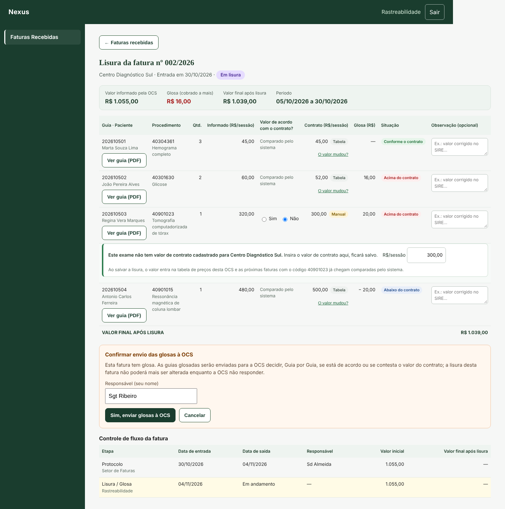

Explica que as Guias glosadas serão enviadas à OCS, que decide Guia por Guia (Ok ou Contestar), e que a lisura **não poderá mais ser alterada** enquanto a OCS não responder. Pede o nome do responsável. *(RN65, RN73)*

**Tela 51 — Aguardando a OCS (dentro do prazo)**

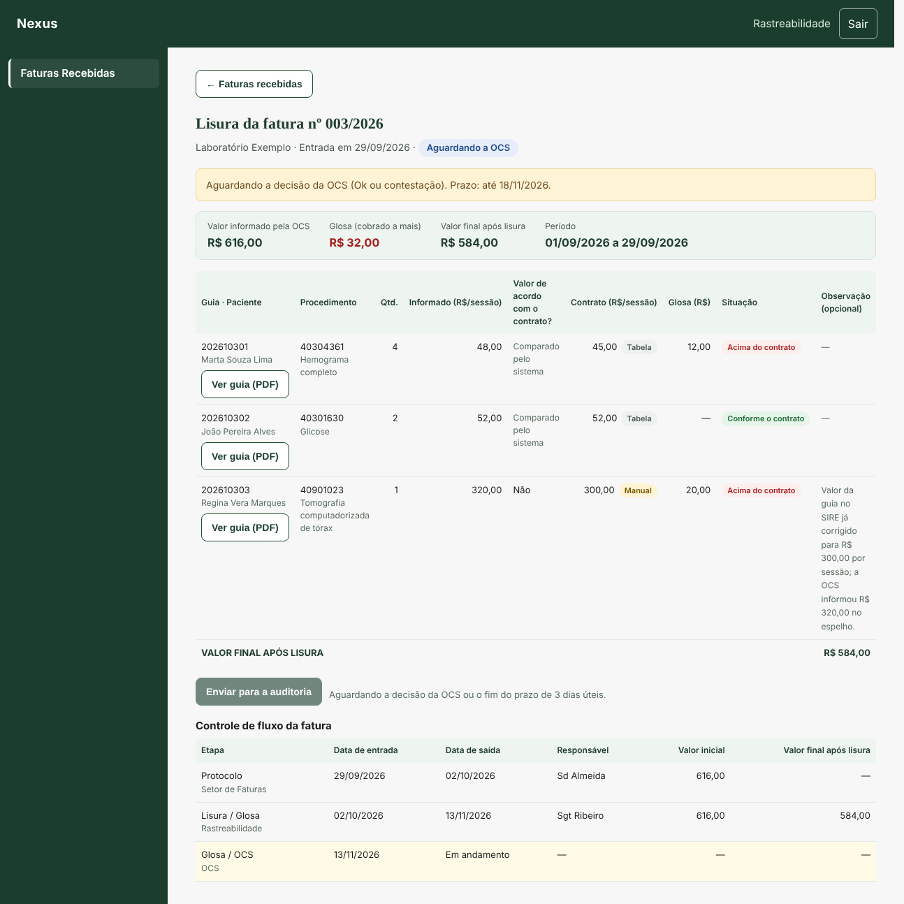

A fatura fica somente leitura, com o aviso "Aguardando a decisão da OCS (Ok ou contestação). Prazo: até…". O botão **Enviar para a auditoria** aparece desabilitado, com a explicação "Aguardando a decisão da OCS ou o fim do prazo de 3 dias úteis". *(RN76, RN80)*

**Tela 52 — Aguardando a OCS (prazo vencido)**

Quando o prazo vence sem decisão, o aviso muda para "Prazo de 3 dias úteis vencido em…, sem decisão da OCS. Já pode seguir para a auditoria." e o botão **Enviar para a auditoria** é habilitado. *(RN80)*

**Tela 53 — Confirmar o envio à auditoria**

Pede confirmação e o nome do responsável. Depois de enviada, a fatura segue para a auditoria. *(RN65, RN73)*

**Tela 54 — Guia contestada pela OCS**

Quando a OCS contesta, a fatura volta à rastreabilidade. A Guia com "Ok pela OCS" aparece decidida, e a **contestada** volta **sem valor de contrato**, com o **motivo da OCS** destacado ("Contestada pela OCS: …"). O lisurador decide de novo (Sim ou Não). O controle de fluxo passa a mostrar cada ciclo: Lisura / Glosa, Glosa / OCS e, de novo, Lisura / Glosa em andamento. *(RN66, RN79)*

---

### 5.11 Telas da Auditoria

**Tela 55 — Faturas Recebidas**

Lista as faturas **Em auditoria**, já lisuradas (e, quando houve glosa, já liberadas pela OCS), com filtro de OCS. Cada cartão mostra o valor informado, a glosa e o valor final. *(RN81)*

**Tela 56 — Visualização da fatura**

Tela **somente leitura**: resumo da fatura, aviso sobre a decisão da OCS, e a tabela por Guia com informado, contrato (com o selo), glosa, a **conferência** ("Sem glosa" ou "Glosada"), a observação e o botão **Ver guia (PDF)**. Embaixo, o **Controle de fluxo** com a etapa **Auditagem** em andamento e o botão **Marcar como visualizada**. Pelas regras, em cada Guia que passou pela OCS também aparece o **Andamento da glosa**. *(RN66, RN74, RN82)*

**Tela 57 — Confirmar visualização**

Pergunta "Marcar a fatura como visualizada?" e avisa que ela **volta para o setor de Faturas como concluída** e encerra o fluxo no Nexus. Pede o nome do responsável. *(RN65, RN83)*

**Tela 58 — Faturas Analisadas**

Consulta das faturas que a auditoria já visualizou, com a data, o responsável e o selo **Concluída**. Só leitura, sem o botão de marcar. *(RN83)*

---

### 5.12 Verso da Guia glosada

O verso é um documento A4 em preto e branco, impresso pela rastreabilidade. Os três exemplos abaixo mostram as situações finais possíveis. *(RN84 a RN87)*

**Tela 59 — Glosa aceita pela OCS**

Mostra o **Registro de lisura e glosa**, com a **Guia nº** e a **Fatura nº** em destaque; o paciente, a OCS e o contrato; a tabela de **Procedimentos glosados** (código, procedimento, quantidade, informado, contrato e glosa, com o total); a **Observação da rastreabilidade**; e o **Andamento da glosa** com o selo **Aceita pela OCS** e cada passo com data e responsável (envio da glosa, prazo de 3 dias úteis e o "Ok" da OCS). O rodapé indica em qual Guia imprimir.

**Tela 60 — Guia contestada e depois aceita**

O Andamento da glosa mostra todas as rodadas: o envio, a **contestação da OCS com o motivo**, a revisão da rastreabilidade (o que foi mantido e o que não foi contestado), o reenvio com novo prazo e o "Ok" final.

**Tela 61 — Prazo vencido sem resposta da OCS**

O selo passa a **Prazo vencido**, e o último passo diz "Prazo vencido sem resposta da OCS. A glosa segue como lisurada pela rastreabilidade." Neste exemplo a glosa é negativa (**cobrado a menos**), e o total aparece com sinal.

---

### 5.13 Convenções de formulário

* **CPF e Prec CP:** 11 dígitos, exibidos com máscara (123.456.789-00 e 458722133-00) e guardados só com dígitos.
* **Telefone:** celular com DDD, exibido como (12)99154-2346 e guardado só com os 11 dígitos. Qualquer outro formato é recusado.
* **Campo de login:** texto livre, sem máscara.
* **Busca de OCS:** mostra uma lista de resultados com contrato e tipo, avisa "Mostrando N de M resultados" quando há mais, e a OCS escolhida aparece como "OCS selecionada" com o botão **Trocar**.
* **Senha:** sempre guardada como hash. Na edição, deixar o campo de nova senha em branco mantém a atual.
* **Ações de setor:** toda ação que muda a etapa de uma fatura pede o campo **"Responsável (seu nome)"**.
* **Valores em dinheiro:** exibidos em reais, com duas casas decimais.

---

## 6. Escopo por Sprint

| Sprint | Situação | User stories |
|---|---|---|
| Sprint 1 | Finalizada | Rank 1: anexar o encaminhamento digitalizado. Rank 2: criar a pré-guia digital, informando a OCS. |
| Sprint 2 | Finalizada | Rank 3: acompanhar o status das pré-guias. Rank 4: médico cria a pré-guia durante a consulta. Rank 5: setor de Guias gerencia a pré-guia e anexa a Guia. Rank 6: beneficiário acessa as Guias em meio digital. Rank 7: Guia impressa pela Recepção. Rank 8: assinatura digital no perfil. |
| Sprint 3 | Em andamento | Rank 9: enviar a Guia à OCS e assinar as sessões. Rank 10: espelho padronizado (a OCS monta e envia; o setor de Faturas recebe e protocola). Rank 11: lisura (comparação com o contrato). Rank 12: conferência antes de enviar. Rank 13: auditoria. Rank 14: dependentes. |

**Fora do escopo do Nexus nesta versão:**

* Emissão da Guia (**SIRE**), capa e protocolo da fatura (**SISFAT**) e **liquidação** (pagamento).
* Devolução da fatura pela auditoria. A única volta possível é a contestação da OCS (RN79).
* Desfazer o envio de um espelho, e reabrir ou editar um espelho já enviado.
* Notificações por e-mail ou push.
* Mudança de situação do dependente, troca do responsável legal, remoção e reativação de dependente (RN45).
* Conferência do valor da Guia (V.Unit), conferência da vigência do contrato e as colunas FUSEX, Fator Custo e PASS-EB da capa.

---

## 7. Documentos relacionados

* [`README.md`](../README.md): backlog, sprints, equipe e links úteis.
* [`docs/sprint/`](sprint): as User Stories de cada Sprint.
* [`docs/BD/`](BD): diagramas do banco de dados (o esquema atual é o das migrations V1 a V21, com 26 tabelas).
* [`docs/videos/`](videos): vídeos das funcionalidades.
* [`docs/telas_prototipos/`](telas_prototipos): imagens dos protótipos citados na seção 5.
* [`docs/CONTRIBUTING.md`](CONTRIBUTING.md): padrão de commits, branches e Pull Requests.

---

## Anexo A — Diferenças conhecidas entre protótipos e regras

Os protótipos foram criados no início de cada Sprint. A lista abaixo mostra onde eles diferem das regras da seção 4. **Os itens de ajuste pequeno podem ser implementados como estão nas regras. Os dois primeiros precisam de decisão com o cliente**, pois fogem do escopo atual.

| # | Tela | O que o protótipo mostra | O que a regra diz | Encaminhamento |
|---|---|---|---|---|
| 1 | 8, 11, 13, 29, 30 | Um menor com **mais de um responsável legal** (o titular **e** uma pessoa externa); o formulário permite marcar os dois. O titular vê as guias do menor sob responsável externo. | RN40 e RN43: um só responsável legal por menor; o titular não vê as guias do menor sob responsável externo. O banco guarda um único responsável. | **A decidir com o cliente.** Mudar exige alterar o modelo de dados. |
| 2 | 11, 29 | Botão **"Remover do sistema"** (e o texto "remover um dependente"). | RN45: remoção está fora desta versão; o acesso é encerrado alterando a vigência. | **A decidir com o cliente.** A tela de confirmação da remoção (`dep-real-10`) não foi incluída neste documento. |
| 3 | 31 | O formulário do dependente maior não mostra campo de senha. | RN40: a senha inicial é definida pelo chefe no cadastro. | Ajuste pequeno: incluir o campo. |
| 4 | 46, 55, 56 | Textos como "acompanhar a ciência da OCS" e "A OCS deu ciência das glosas". | RN78 e RN81: a OCS decide "Ok" ou "Contestar". | Ajuste pequeno de texto. |
| 5 | 56 | A visualização da auditoria não mostra o **Andamento da glosa** por Guia. | RN82: deve mostrar todas as rodadas. | Ajuste pequeno: incluir o bloco. |
| 6 | 46 e 39 | Ordem das listas: a rastreabilidade mostra da mais recente para a mais antiga, e a lista do setor de Faturas não segue estritamente a data. | RN68: da mais antiga para a mais recente. RN61: do mais recente para o mais antigo. | Ajuste pequeno de ordenação. |
| 7 | 46 a 54 | O menu da rastreabilidade só tem "Faturas Recebidas". | RN84: aba "Versos das Guias". | Incluir a aba e o protótipo dela. |
| 8 | 54 | A linha já decidida ("Ok pela OCS") mostra a observação editável. | RN79: as linhas com "Ok" ficam travadas. | Ajuste pequeno: travar. |
| 9 | 14 | O rótulo da busca de exames diz "somente os realizados pela OCS escolhida". | RN05: não há filtro entre OCS e procedimento. | Ajuste pequeno de texto. |
| 10 | 14 e 15 | O bloco "Médico solicitante" mostra só nome e CRM. | RN25: nome, patente, CRM, CPF e Prec CP. | Ajuste pequeno. |
| 11 | 22 e 23 | O número da Guia é digitado e não há leitura do PDF. | RN26 a RN30: o sistema lê o PDF e o setor confere a tabela de exames. | Novo protótipo a criar. |
| 12 | 19 e 24 | Assinatura de uma guia por vez; a prévia diz "Validade: 60 dias". | RN31: assinatura em lote (até 50). RN15: vale a data "NÃO RECEBER APÓS". | Ajuste pequeno. |
| 13 | 6 e 10 | O menu do beneficiário não tem "Minhas guias", e "Minhas informações" não tem a aba "Dependentes". | Seção 5.0. | Atualizar os prints. |
| 14 | 3 e 5 | Telas da Sprint 1 em outro visual ("Painel", "Meu perfil") e sem o passo "Para quem é". | Seção 5.2. | Recapturar. |
| 15 | 59 a 61 | Os dados de exemplo dos versos das faturas 002/2026 e 004/2026 não batem com as telas de fatura (Guias, valores e datas diferentes). | — | Recapturar com a mesma carga de dados. |
| 16 | vários | Dados de exemplo fora do formato: CRM "000.000-SP" e "52-48211-RJ"; CPFs como 123.456.789-00; mesmo nome (Antonio Carlos Ferreira) com CPF e Prec CP diferentes entre Sprint 2 e Sprint 3. | RN21 e RN36. | Recapturar com dados válidos. |

---

## Anexo B — Histórico de revisões

| Revisão | Data | Principais mudanças |
|---|---|---|
| Sprint 2 | — | RN01 a RN22: encaminhamento e pré-guia, status e correção, Guia e assinaturas, contas e histórico. Protótipos das Sprints 1 e 2. |
| Sprint 3 | 22/11/2026 | **Reorganizado em seções por assunto.** Aviso sobre protótipos. Glossário e perfis ampliados (11 perfis, mais SISFAT, Sessão, Cod DGP, Rodada). Tabelas de situação e fluxograma. **Regras revisadas:** RN07, RN08, RN09, RN10, RN11, RN12, RN14, RN15, RN17, RN18, RN19, RN20, RN21. **Regras novas:** RN23 a RN25 (encaminhamento, OCS ativas, exames do médico), RN26 a RN33 (leitura do PDF, UG, validade, conferência, exames, lote, assinatura digital, Recepção), RN34 a RN36 (senha, acesso, cadastros), RN37 a RN45 (dependentes e responsável legal), RN46 a RN54 (envio à OCS, sessões, vencimento, PDF), RN55 a RN60 (espelho), RN61 a RN67 (fatura), RN68 a RN75 (lisura e glosa), RN76 a RN80 (decisão da OCS), RN81 a RN83 (auditoria), RN84 a RN87 (verso da Guia). Protótipos da Sprint 3 explicados (telas 4, 8, 9, 11 a 13, 15, 26, 29 a 31 e 35 a 61). Escopo por Sprint e documentos relacionados atualizados. |
