# 📋 Especificação Técnica do Sistema FUSEX

---

## 1. Visão Geral

**Nome sugerido do sistema:** Nexus

**Stack obrigatória:**

* Linguagem: Java (versão 17+ recomendada)
* Java Spring Boot
* Banco de dados: MySQL

**Objetivo:** Facilitar o fluxo de trabalho do FUSEX, eliminando burocracias repetitivas e probabilidade de erros humanos durante o processo (dupla cobrança de guias, assinaturas ausentes ou faltantes, erros de lisuras, etc). Também será desejável automatizar o processo de rastreabilidade (lisuras e glosas).

---

## 2. Princípio de UX Central

> **O sistema deve minimizar ao máximo o número de cliques e interações necessárias.** Sempre que possível, use preenchimento automático, herança de dados de períodos anteriores, propagação de configurações entre entidades similares e confirmação em lote.

**Responsividade:** interface adaptável para celular (beneficiários) e desktop (funcionários do FUSEX).

**Feedback:** toda ação que dispara requisição deve indicar loading, sucesso ou erro de forma clara.

**Formulários:** validação no front-end antes do envio; pré-preenchimento de dados já conhecidos do usuário.

**Ações críticas:** operações irreversíveis (ex: protocolar o Mapa) exigem confirmação explícita, mesmo custando um clique extra.

---

## 3. Contexto de Domínio — Glossário Obrigatório

Antes de iniciar o desenvolvimento da aplicação, o desenvolvedor deve internalizar os seguintes conceitos, pois eles se repetem em todo o sistema:

| Termo | Definição |
|---|---|
| **FUSEX** | Sigla para **Fundo de Saúde do Exército**, um sistema de assistência médico-hospitalar destinado aos **beneficiários** do exército. |
| **Beneficiário** | São os militares do Exército (da ativa, reserva ou reformados) e os pensionistas, que atuam como titulares. O direito se estende aos seus dependentes diretos legalmente cadastrados, como cônjuges e filhos menores ou estudantes. |
| **Prec CP** | Número do cartão do beneficiário. Para ser atendido no FUSEX, o beneficiário (ou dependente) deve apresentar este número. É usado, por exemplo, pelo médico para localizar o beneficiário ao criar uma pré-guia. |
| **Encaminhamento médico** | Documento criado pelo médico e entregue posteriormente ao beneficiário, essencial para a criação da Pré-Guia **pelo beneficiário**. Aceita-se o encaminhamento de qualquer médico. |
| **Pré-Guia de Encaminhamento** | Documento criado (já dentro da aplicação) pelo **beneficiário** ou pelo **médico do FUSEX**, constando a **OCS**, os dados do beneficiário e, quando criada pelo médico, os procedimentos/exames a serem realizados. **Necessário ter o encaminhamento médico para criá-la, exceto quando ela é criada pelo médico do FUSEX.** |
| **SIRE** | Sistema próprio do Exército usado pelo FUSEX para emitir as Guias. O Nexus **não tem acesso** a ele: a Guia sai do SIRE em formato padrão e é anexada ao Nexus pelo setor de Guias. |
| **Guia de Encaminhamento** | Documento gerado pelo FUSEX (no SIRE), contendo: a **OCS** escolhida, os procedimentos, número, assinatura do médico e do chefe do FUSEX, validade de 60 dias, etc. **Necessário ter a Pré-Guia analisada pelo setor de Guias para ser gerado.** |
| **OCS** | Representa toda a **rede credenciada, conveniada ou contratada de caráter privado ou público** (que não pertence ao Exército) utilizada para prestar assistência médica aos beneficiários do FUSEX. |
| **Espelho** | Documento gerado pela OCS dentro de um determinado período (geralmente 1 mês). Contém: número da Guia, paciente, código do procedimento, valor por sessão, quantidade de sessões e valor total. **Cada espelho pode conter várias Guias**, cada uma com vários exames. |
| **Fatura** | Quando a OCS envia o espelho ao FUSEX, é protocolado o número da fatura. Esse documento segue depois para o setor de lisuras. |
| **Lisura** | Procedimento que faz parte da **rastreabilidade**, para conferir se todos os valores estão em conformidade. **Não há como realizar a lisura de uma guia sem possuir o espelho**. |
| **Glosa** | Procedimento que faz parte da lisura, caso seja encontrado **divergências** de valores entre o **espelho** e os valores descritos no **contrato** firmado entre a OCS e o FUSEX. |
| **Mapa** | Auditoria final de todas as guias, feita após o processo de lisura/glosa dentro do FUSEX. Se houver alguma informação errada ou ausente, a fatura é devolvida ao setor de rastreabilidade (lisura/glosa). É o último processo antes da **liquidação**. |
| **Liquidação** | Processo final, onde o exército realiza o pagamento da fatura. |
| **Dependente** | Fica atrelado a um beneficiário e **não tem conta** no sistema: é uma entidade criada e atribuída ao beneficiário pelo Chefe do FUSEX. Será tratado na Sprint 3. |

### 3.1 Perfis de usuário

| Perfil | O que faz |
|---|---|
| **Chefe do FUSEX** | Maior autoridade. Cadastra, edita e desativa beneficiários e médicos (e, na Sprint 3, dependentes) e assina as Guias com a sua assinatura digital. |
| **Beneficiário** | Cria e acompanha pré-guias, corrige as que voltam em Atenção, baixa as Guias prontas e cadastra a sua assinatura. |
| **Médico do FUSEX** | Cria pré-guias para um beneficiário durante a consulta (pela Prec CP), corrige as que criou e voltaram em Atenção e assina as Guias. |
| **Setor de Guias** | Conta de setor, sem pessoa atribuída. Analisa as pré-guias, pede correção quando necessário e anexa a Guia emitida no SIRE. |
| **Recepção** | Conta de setor, sem pessoa atribuída. Imprime Guias concluídas para quem está sem acesso ao aplicativo. |

---

## 4. Regras de Negócio

### 4.1 Encaminhamento e Pré-Guia

| Código | Regra | Observação |
|---|---|---|
| RN01 | Não é possível criar uma Pré-Guia sem um encaminhamento médico válido (foto ou PDF) vinculado ao beneficiário, **exceto quando a Pré-Guia é criada pelo médico do FUSEX**. | Validação obrigatória antes da criação da Pré-Guia do beneficiário. |
| RN02 | São aceitos os encaminhamentos médicos de qualquer clínica, não sendo necessário vir de uma OCS credenciada. | Não restringir a anexação do Encaminhamento a uma OCS pré-definida. |
| RN03 | A Pré-Guia do beneficiário deve conter obrigatoriamente os dados do beneficiário, o encaminhamento anexado e a OCS escolhida. | Bloquear envio da Pré-Guia se algum desses campos estiver vazio. |
| RN04 | A Pré-Guia criada pelo médico deve conter o beneficiário (localizado pela Prec CP), a OCS escolhida e **ao menos um exame**. Não exige encaminhamento anexado. | Os dados do médico solicitante são preenchidos automaticamente com o perfil dele. |
| RN05 | Não há filtro entre OCS e procedimento: o médico pode incluir qualquer procedimento do catálogo, seja qual for a OCS. | Decisão do cliente. |
| RN06 | A OCS é escolhida por **busca** (nome, contrato ou tipo), pois existem muitas. | Vale para o beneficiário, para o médico e para as telas de correção. |

### 4.2 Status e correção

| Código | Regra | Observação |
|---|---|---|
| RN07 | A Pré-Guia tem quatro status: **Pendente** (criada e ainda não aberta pelo setor de Guias), **Em análise** (aberta pelo setor), **Atenção** (devolvida para correção) e **Concluída** (Guia assinada pelo médico e pelo chefe). | Toda Pré-Guia nasce como Pendente. |
| RN08 | Para colocar uma Pré-Guia em **Atenção**, o setor de Guias deve escrever uma observação explicando o problema. | Observação obrigatória. |
| RN09 | **Atenção em Pré-Guia criada pelo beneficiário:** ele pode trocar o encaminhamento e/ou a OCS e reenviar. A mesma Pré-Guia volta como **Pendente**. | |
| RN10 | **Atenção em Pré-Guia criada pelo médico:** somente o **médico emissor** corrige (OCS e/ou exames), em uma aba própria do perfil dele. O beneficiário continua vendo o status **Atenção**, mas **não pode intervir**. Depois de corrigida, volta como **Pendente**. | A aba do médico fica vazia quando não há pendências. |

### 4.3 Guia e assinaturas

| Código | Regra | Observação |
|---|---|---|
| RN11 | A Guia é gerada **fora do Nexus** (no SIRE). O setor de Guias informa o número e anexa o PDF; depois clica em **Concluir**. | Uma Pré-Guia só pode gerar **uma** Guia. |
| RN12 | Depois do **Concluir**, a Guia segue para assinatura do médico e do chefe. **Qualquer médico do FUSEX** pode assinar, e a primeira assinatura vale. | Cada Guia aceita no máximo uma assinatura de cada papel (médico e chefe). |
| RN13 | A Pré-Guia só passa a **Concluída** depois das **duas** assinaturas (médico e chefe). | O beneficiário não pode usar uma Guia sem as duas assinaturas. |
| RN14 | Só assina quem já cadastrou a sua **assinatura digital**. | O Setor de Guias e a Recepção não têm assinatura. |
| RN15 | O beneficiário e a Recepção só visualizam, baixam e imprimem Guias de Pré-Guias **Concluídas**. | A Guia tem validade de 60 dias. |
| RN16 | O status de assinatura de cada Guia, nas listas do médico e do chefe, usa sempre um destes textos: "Falta assinatura do chefe.", "Falta assinatura de um médico." ou "Faltam assinaturas do chefe e de um médico." | Padronização de interface. |

### 4.4 Contas, acesso e histórico

| Código | Regra | Observação |
|---|---|---|
| RN17 | O **login** é o CPF (só dígitos) para beneficiário e médico, e o nome de usuário para chefe, Setor de Guias e Recepção. O campo de login é de texto livre. | O servidor aceita o CPF com ou sem pontuação. Nomes de usuário não podem ter formato de CPF. |
| RN18 | A tela de login não tem cadastro. Beneficiários e médicos são cadastrados pelo **Chefe do FUSEX**. As contas do chefe, do Setor de Guias e da Recepção são criadas por seed. | Setor de Guias e Recepção são contas de setor, sem pessoa atribuída. |
| RN19 | "Excluir" uma conta significa **desativá-la**. Nada é apagado, para preservar o histórico de pré-guias e Guias. | Conta desativada não consegue entrar. |
| RN20 | O **beneficiário** só edita o próprio telefone. O **médico** não edita nenhum dado. O **chefe** edita todos os dados da própria conta. Os dados de beneficiários e médicos só são alterados pelo chefe. | Todos os perfis com "Minhas informações" podem trocar a senha. |
| RN21 | CPF e Prec CP têm 11 dígitos, e o telefone é um celular com DDD (11 dígitos, no formato (12)99999-9999). Tudo é gravado **só com dígitos**, e a máscara existe apenas na exibição. | A idade e a faixa etária são calculadas a partir da data de nascimento. |
| RN22 | Cada mudança de status da pré-guia (criação, abertura, atenção, reenvio ou correção, conclusão) é registrada em um **histórico**, com quem agiu, quando, a observação e o encaminhamento vigente. As ações do Setor de Guias aparecem como "Setor de Guias", sem pessoa. | O histórico só recebe registros novos: nunca é editado nem apagado. |

---

## 5. Protótipos de Telas

As imagens ficam em `docs/telas_prototipos/sprint2/<perfil>/` (caminhos abaixo relativos à pasta `docs/`), cada perfil com a sua pasta.

### 5.0 Resumo por perfil

| Perfil | Menu |
|---|---|
| Beneficiário | Início · Minhas pré-guias · Minhas informações |
| Médico do FUSEX | Início · Nova pré-guia · Corrigir pré-guias · Guias para assinar · Minhas informações |
| Chefe do FUSEX | Guias para assinar · Beneficiários · Médicos · Minhas informações |
| Setor de Guias | Fila de pré-guias |
| Recepção | Guias para impressão |

**Cores dos status:** Pendente (amarelo) · Em análise (azul) · Atenção (laranja) · Concluída (verde).

---

### 5.1 Login (todos os perfis)

**Tela 1 — Login**

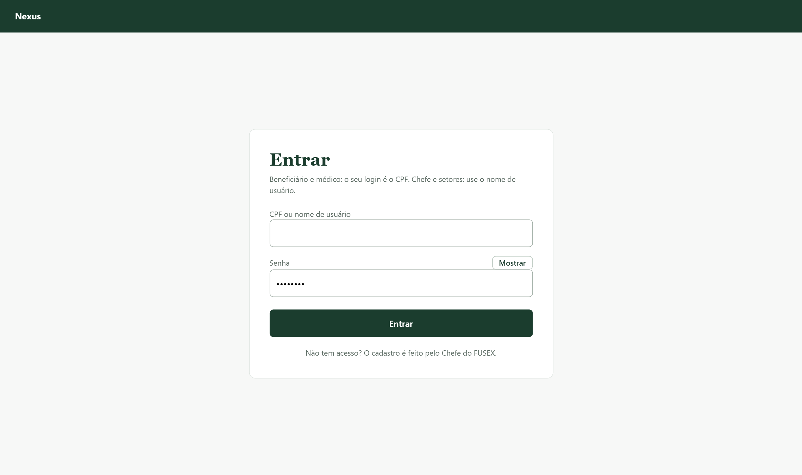

Tela única de entrada. Tem o campo **CPF ou nome de usuário** (texto livre, sem máscara), o campo **Senha** (com botão *Mostrar*) e o botão **Entrar**. A legenda informa que, para beneficiário e médico, o login é o CPF, e que chefe e setores usam o nome de usuário. O rodapé avisa que o cadastro é feito pelo Chefe do FUSEX. Depois de entrar, cada perfil vai para o seu menu. *(RN17, RN18)*

**Tela 2 — Login com erro**

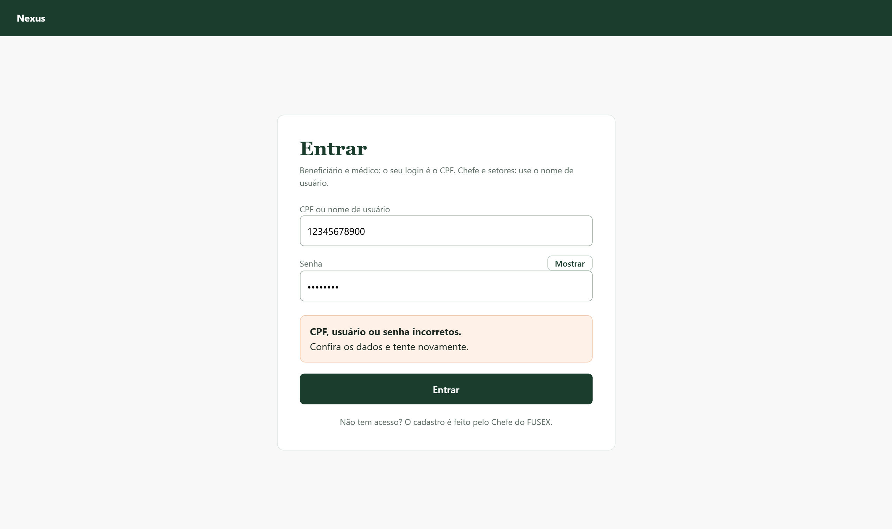

Quando os dados estão incorretos, aparece a mensagem genérica "CPF, usuário ou senha incorretos.", que não diz qual dado errou. Conta desativada também não entra. *(RN19)*

---

### 5.2 Telas do beneficiário

**Tela 3 — Início (Painel)**

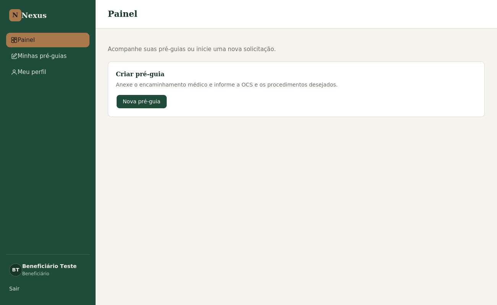

Tela inicial do beneficiário ao entrar, com acesso rápido à criação de uma nova pré-guia.

**Tela 4 — Nova pré-guia**

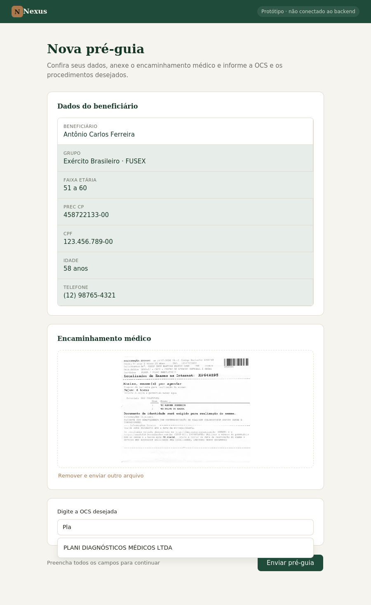

Criação da pré-guia. Tem os dados do beneficiário (somente leitura, puxados do perfil), a **busca da OCS** (por nome, contrato ou tipo, com lista de resultados) e o **upload do encaminhamento médico** (arrastar o arquivo, usar a câmera ou escolher o arquivo). O botão de envio só é liberado com os três itens preenchidos. *(RN01, RN03, RN06)*

**Tela 5 — Minhas pré-guias**

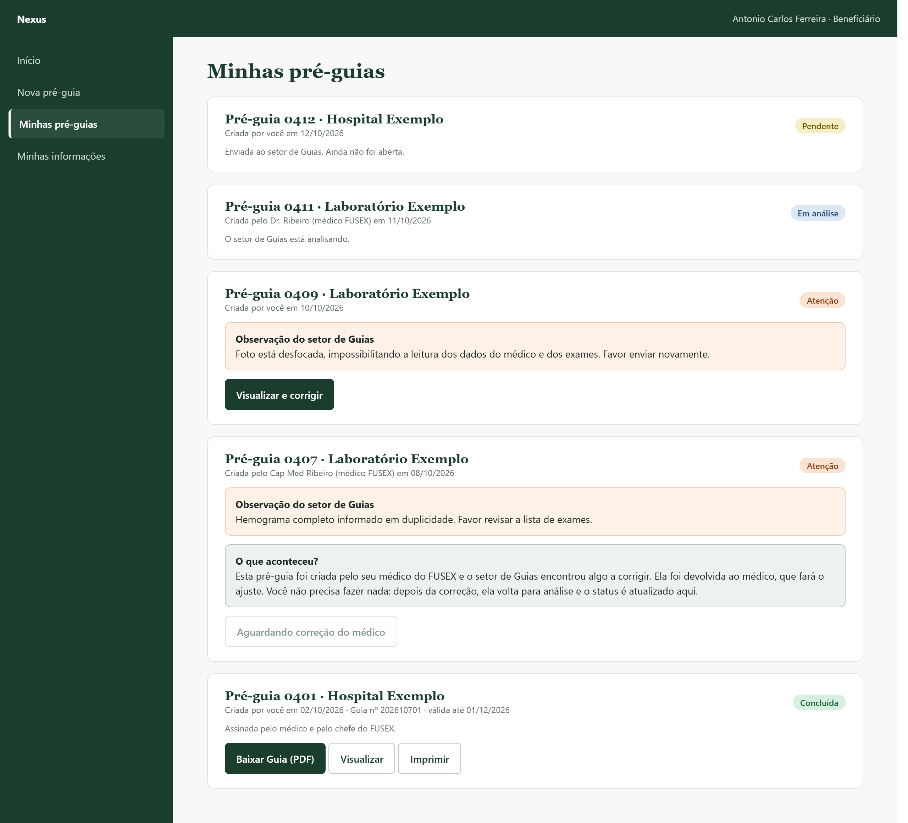

Um cartão por pré-guia, mostrando número, OCS, quem criou (o próprio beneficiário ou um médico do FUSEX), data e status. O comportamento depende do status:

* **Pendente / Em análise:** apenas acompanhamento.
* **Atenção (criada por ele):** mostra a observação do setor de Guias e o botão **Visualizar e corrigir**. *(RN09)*
* **Atenção (criada pelo médico):** mostra a observação e a legenda **"O que aconteceu?"**, explicando que a pré-guia foi devolvida ao médico. O botão fica desabilitado ("Aguardando correção do médico"), pois o beneficiário não pode intervir. *(RN10)*
* **Concluída:** mostra o número da Guia, a validade e os botões **Baixar PDF**, **Visualizar** e **Imprimir**. *(RN15)*

**Tela 6 — Pré-guia em Atenção (Visualizar e corrigir)**

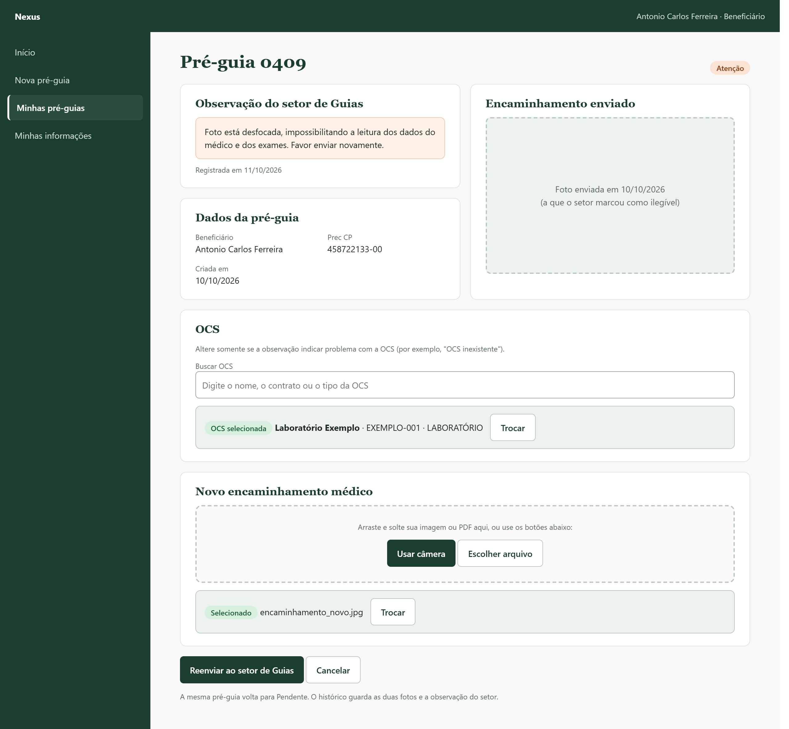

Aberta pelo botão **Visualizar e corrigir**. Mostra a observação do setor, os dados da pré-guia (somente leitura) e a foto de encaminhamento enviada antes. Para corrigir, o beneficiário pode **trocar a OCS** (pelo mesmo campo de busca, por exemplo quando a observação é "OCS inexistente") e/ou **enviar um novo encaminhamento**. Em **Reenviar ao setor de Guias**, a mesma pré-guia volta como Pendente. **Cancelar** descarta as mudanças. *(RN09)*

**Tela 7 — Minhas informações**

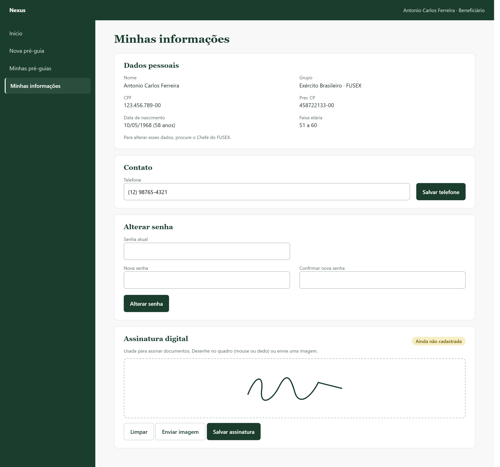

* **Dados pessoais** (somente leitura): nome, grupo, CPF, Prec CP, data de nascimento (com idade) e faixa etária. Alterações só pelo Chefe.
* **Contato:** o telefone é o único dado editável, com o botão **Salvar telefone**.
* **Alterar senha:** senha atual, nova senha e confirmação.
* **Assinatura digital:** o beneficiário desenha no quadro ou envia uma imagem e clica em **Salvar assinatura**. Enquanto não houver assinatura, aparece "Ainda não cadastrada". *(RN20)*

---

### 5.3 Telas do médico do FUSEX

**Tela 8 — Nova pré-guia**

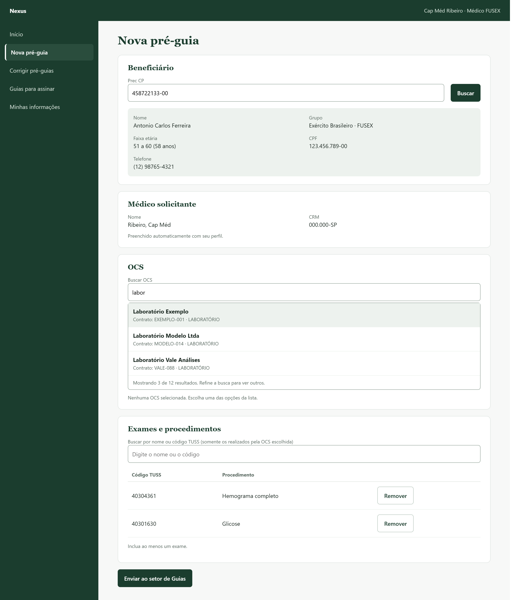

Criação da pré-guia durante a consulta. O médico digita a **Prec CP** e clica em **Buscar**: o sistema preenche os dados do beneficiário, e os dados do médico solicitante vêm do perfil dele. Depois ele escolhe a **OCS** (por busca) e inclui os **exames** (busca por nome ou código TUSS, com lista dos escolhidos e botão **Remover**). É obrigatório ter ao menos um exame, e não é preciso anexar encaminhamento. O envio vai para o setor de Guias. *(RN04, RN05, RN06)*

**Tela 9 — Corrigir pré-guias**

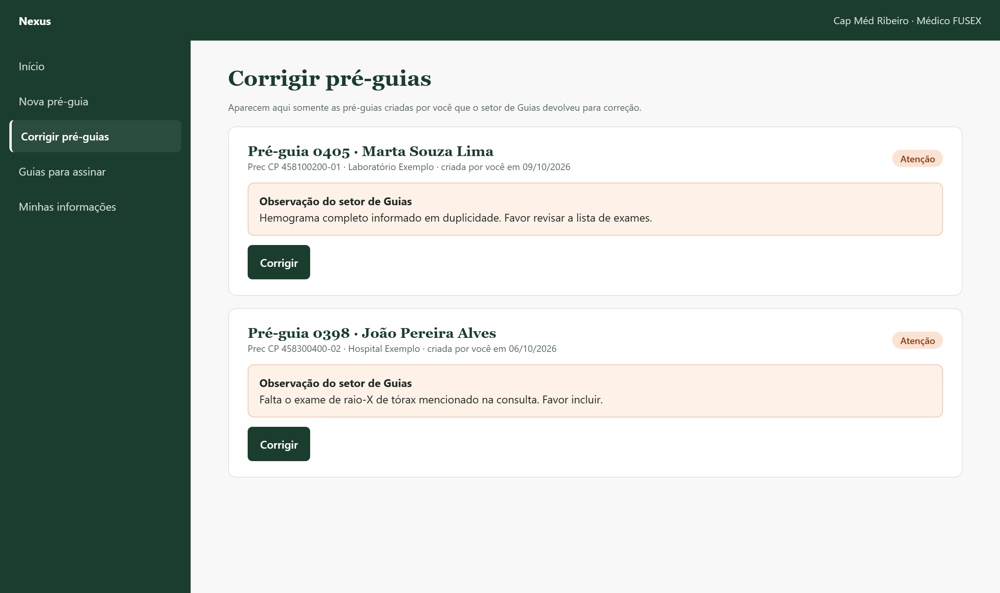

Aba usada **somente para corrigir**. Lista as pré-guias **criadas por ele** que o setor de Guias devolveu com status Atenção, mostrando beneficiário, Prec CP, OCS, data e a observação do setor, com o botão **Corrigir**. *(RN10)*

**Tela 10 — Corrigir pré-guia (expandida)**

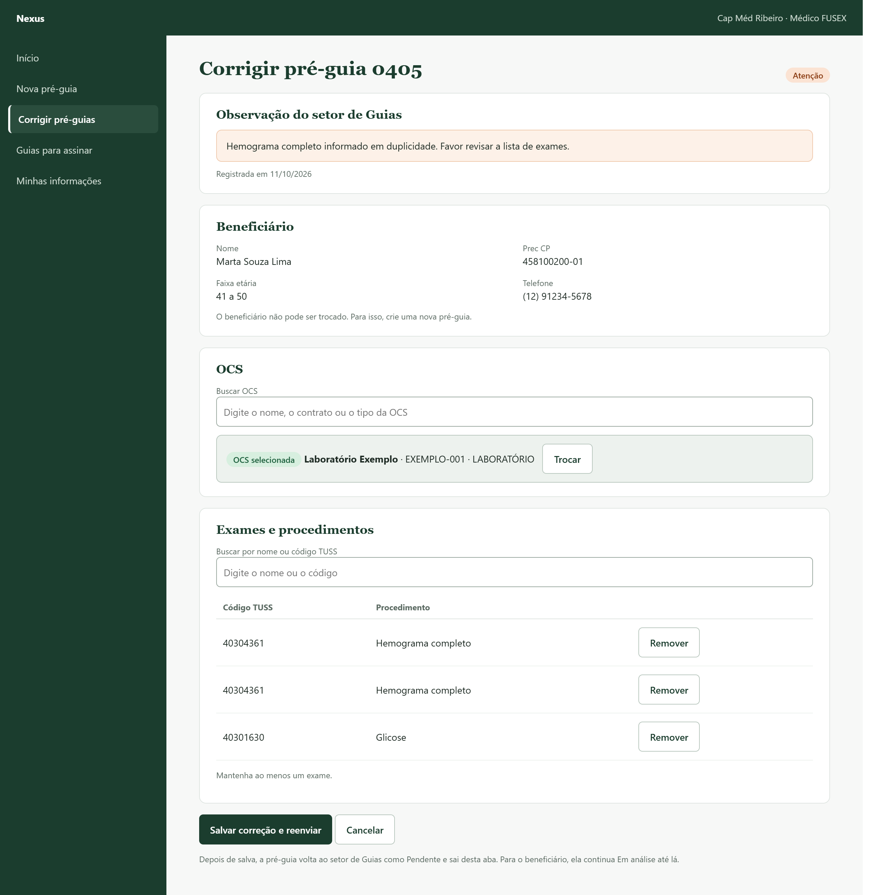

Ao corrigir, o médico vê a observação do setor, o beneficiário (somente leitura, não pode ser trocado), a **OCS** (busca, com "Trocar") e a lista de **exames** (remover e incluir, mantendo ao menos um). **Salvar correção e reenviar** devolve a pré-guia ao setor de Guias como Pendente, e ela sai da lista. **Cancelar** descarta as mudanças. *(RN10)*

**Tela 11 — Corrigir pré-guias (vazia)**

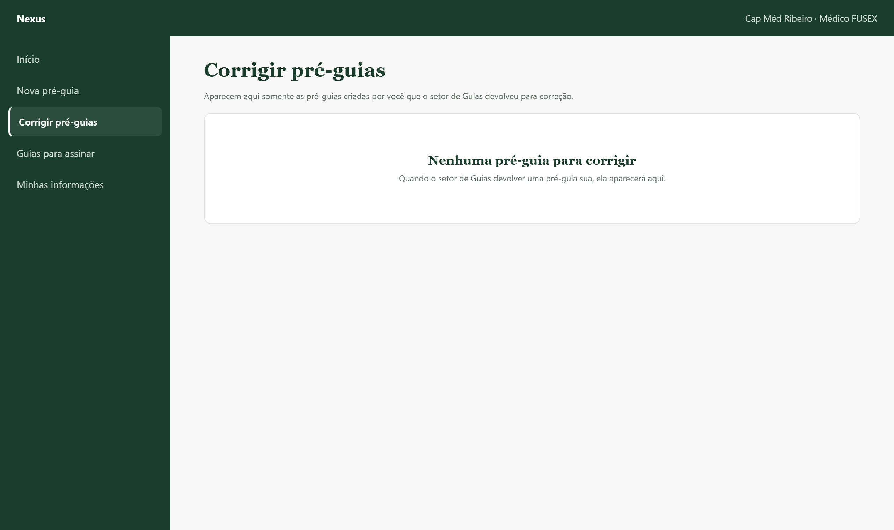

Quando não há nenhuma pré-guia para corrigir, a aba mostra a mensagem "Nenhuma pré-guia para corrigir". *(RN10)*

**Tela 12 — Guias para assinar**

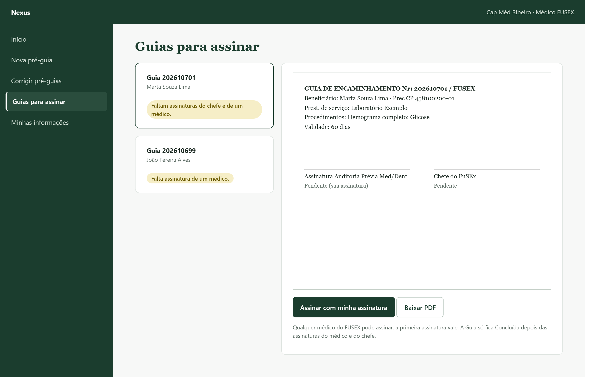

Lista as Guias inseridas pelo setor de Guias e a prévia do PDF, com as linhas de assinatura do médico e do chefe. Cada Guia mostra o status de assinatura com os textos padronizados. O botão **Assinar com minha assinatura** registra a assinatura do médico; qualquer médico pode assinar e a primeira vale. Só assina quem já cadastrou a assinatura digital. *(RN12, RN14, RN16)*

**Tela 13 — Minhas informações**

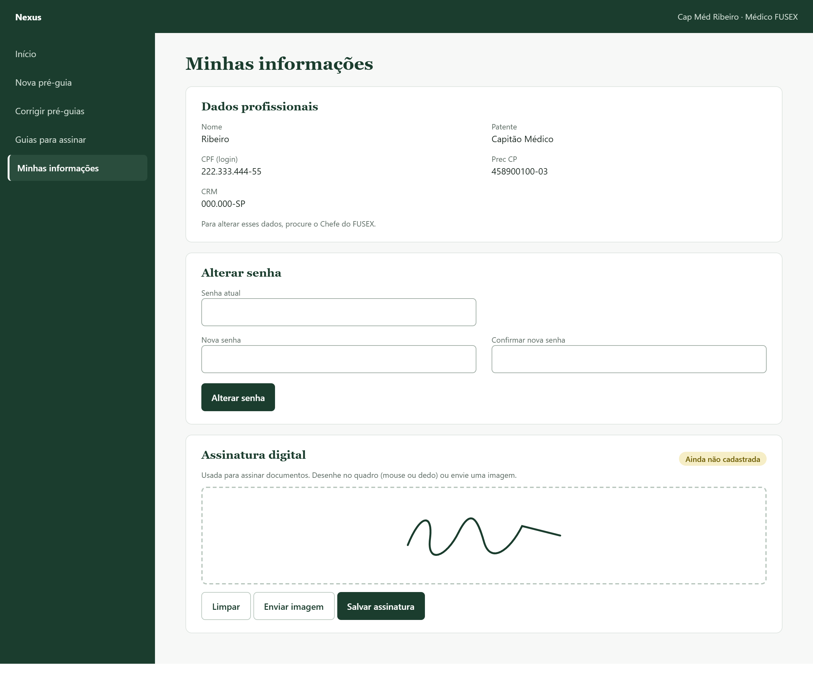

Mostra os dados profissionais (nome, patente, CPF, Prec CP e CRM), todos **somente leitura**, pois só o Chefe altera. Tem o bloco **Alterar senha** e o cadastro da **assinatura digital**, igual ao do beneficiário. *(RN20)*

---

### 5.4 Telas do Setor de Guias

**Tela 14 — Lista de pré-guias**

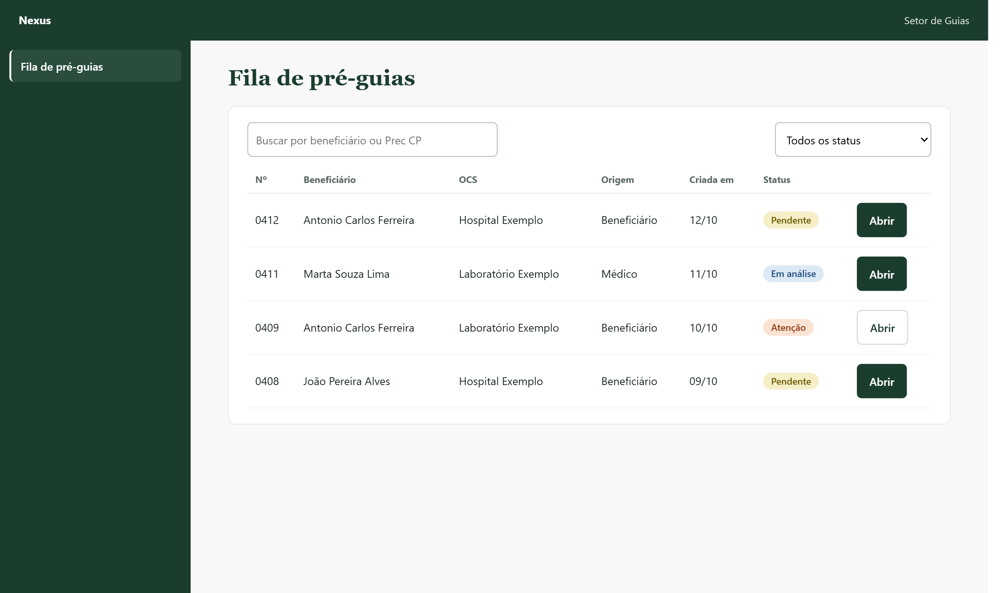

Fila de pré-guias recebidas, com busca por beneficiário ou Prec CP, filtro por status e tabela com número, beneficiário, OCS, origem (beneficiário ou médico), data, status e o botão **Abrir**. Ao abrir uma pré-guia Pendente, ela passa para **Em análise**. *(RN07)*

**Tela 15 — Pré-guia selecionada**

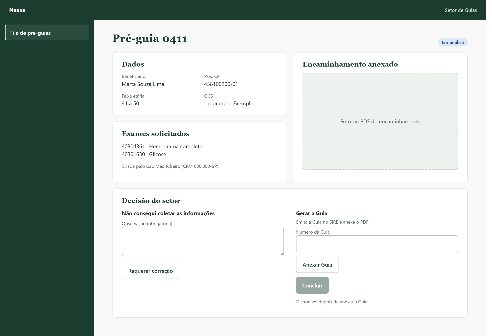

Mostra todas as informações da pré-guia: dados do beneficiário, OCS, exames (quando criada pelo médico) e o encaminhamento anexado. O bloco **Decisão do setor** tem dois caminhos:

* **Não consegui coletar as informações:** o funcionário escreve a observação (obrigatória) e clica em **Requerer correção**. A pré-guia vai para **Atenção**. *(RN08)*
* **Gerar a Guia:** o funcionário emite a Guia no SIRE, informa o número e clica em **Anexar Guia** (PDF). O botão **Concluir** fica desabilitado até a Guia ser anexada. *(RN11)*

**Tela 16 — Pré-guia com Guia anexada**

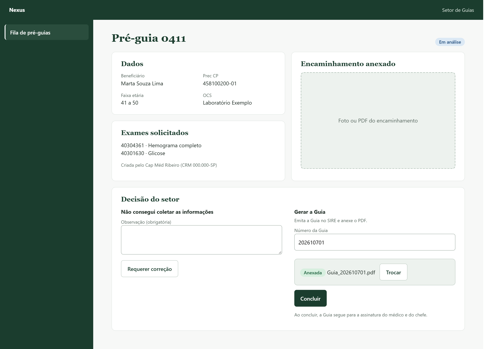

Estado da tela anterior depois de anexar a Guia: o PDF aparece como anexado (com opção de trocar) e o botão **Concluir** é habilitado. Ao concluir, a Guia segue para a assinatura do médico e do chefe. A pré-guia só vira Concluída depois das duas assinaturas. *(RN12, RN13)*

---

### 5.5 Telas do Chefe do FUSEX

**Tela 17 — Guias para assinar**

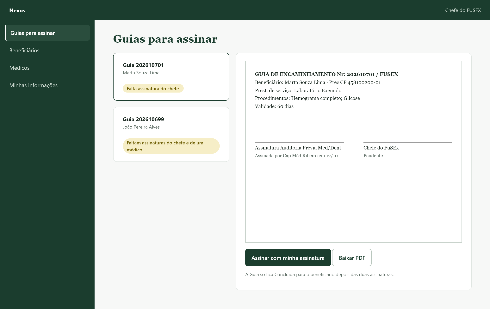

Mesma estrutura da tela do médico: lista das Guias pendentes, prévia do PDF com as duas linhas de assinatura e o botão **Assinar com minha assinatura**, que registra a assinatura do chefe. Mostra o status de assinatura de cada Guia com os textos padronizados. *(RN12, RN14, RN16)*

**Tela 18 — Lista de beneficiários**

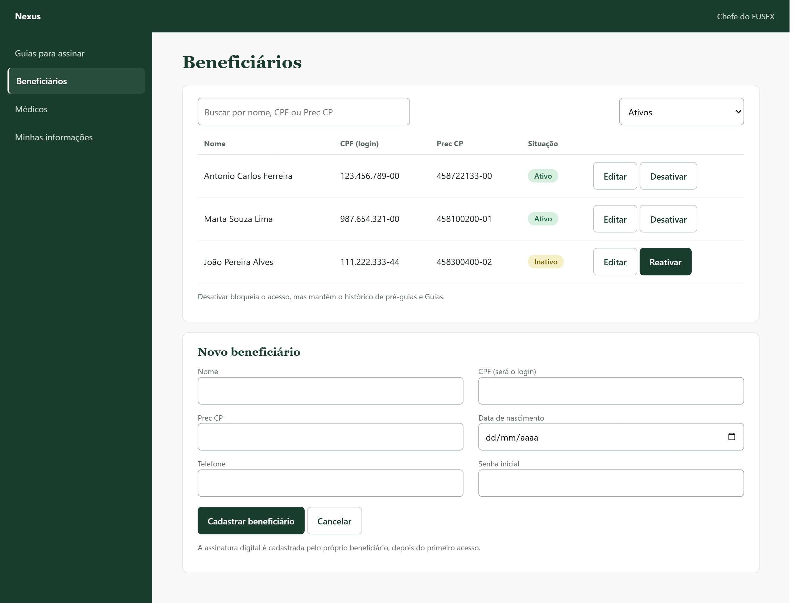

Busca, filtro de situação (Ativos, Inativos, Todos) e tabela com nome, CPF (login), Prec CP, situação e as ações **Editar**, **Desativar** e **Reativar**. O cadastro de um novo beneficiário é feito **no formulário abaixo da tabela** (nome, CPF, Prec CP, data de nascimento, telefone e senha inicial), sem botão no topo. Desativar mantém o histórico. *(RN18, RN19, RN21)*

**Tela 19 — Editando beneficiário**

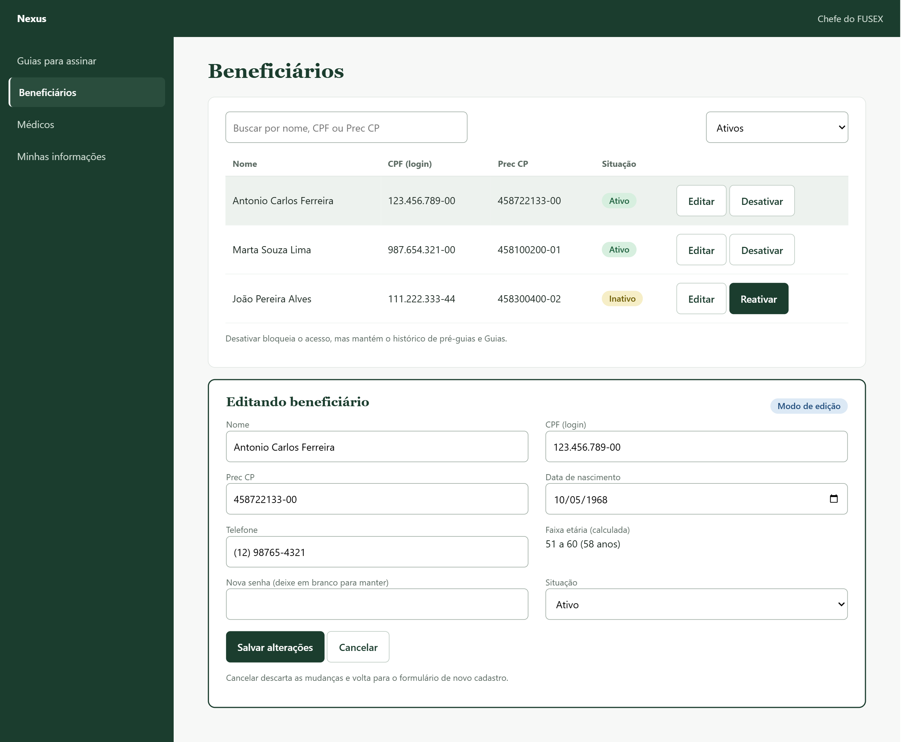

Ao clicar em **Editar**, a linha da tabela fica destacada e o formulário de baixo vira **"Editando beneficiário"** (com o selo "Modo de edição"), mostrando todos os dados preenchidos: nome, CPF, Prec CP, nascimento, telefone, faixa etária (calculada), situação e nova senha opcional. **Salvar alterações** grava, e **Cancelar** descarta as mudanças e volta ao formulário de novo cadastro. O chefe também pode editar beneficiários inativos. *(RN20)*

**Tela 20 — Lista de médicos**

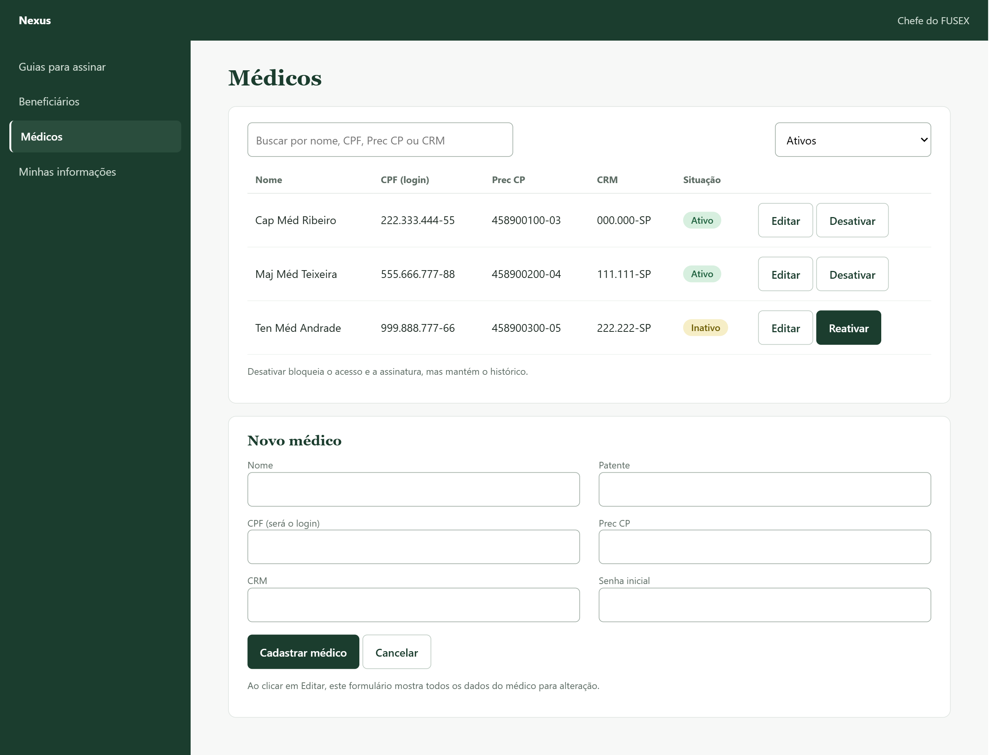

Mesmo padrão da lista de beneficiários: busca, filtro de situação e tabela com nome, CPF (login), Prec CP, CRM, situação e as ações Editar, Desativar e Reativar. O formulário abaixo cadastra um novo médico (nome, patente, CPF, Prec CP, CRM e senha inicial). O **Editar** funciona como na Tela 19. *(RN18, RN19)*

**Tela 21 — Minhas informações**

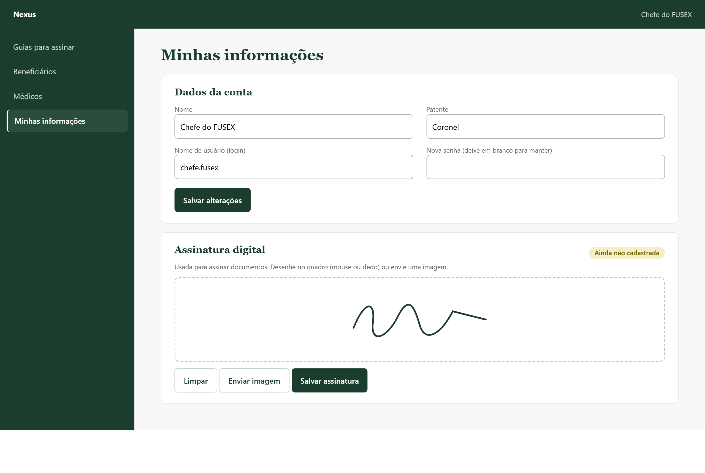

Todos os dados da conta do chefe são editáveis (nome, patente, nome de usuário e nova senha), além do cadastro da **assinatura digital**. *(RN20)*

---

### 5.6 Telas da Recepção

**Tela 22 — Lista de Guias**

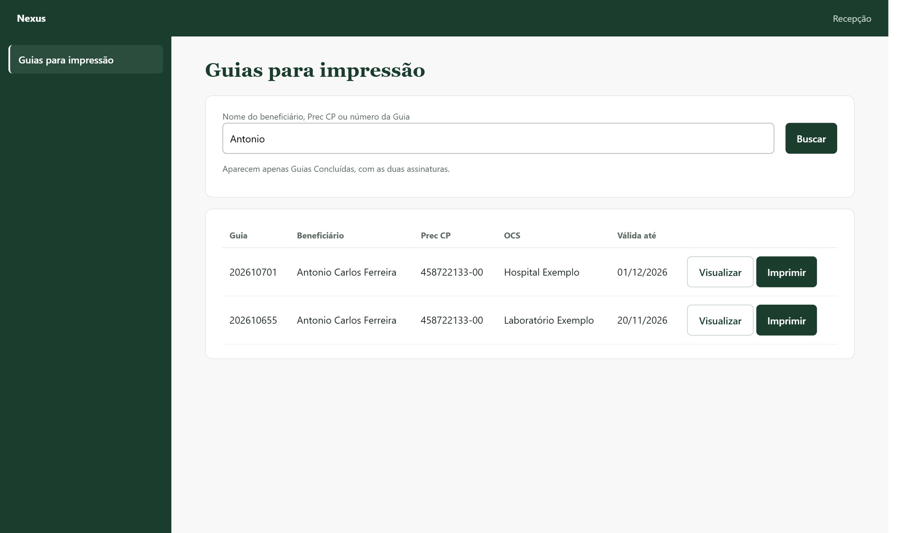

Busca por nome do beneficiário, Prec CP ou número da Guia. A tabela mostra Guia, beneficiário, **Prec CP**, OCS, validade e os botões **Visualizar** e **Imprimir**. Só aparecem Guias de pré-guias **Concluídas**. *(RN15)*

**Tela 23 — Guia selecionada**

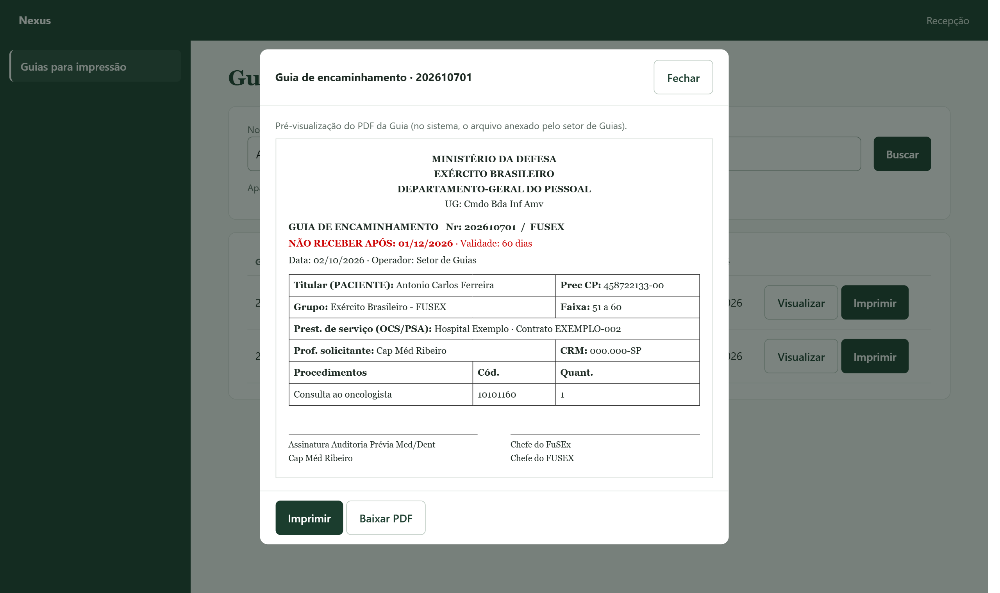

Ao clicar em **Visualizar**, abre uma janela sobre a lista com a Guia de encaminhamento (o PDF anexado pelo setor de Guias) e os botões **Imprimir**, **Baixar PDF** e **Fechar**. *(RN15)*

---

### 5.7 Convenções de formulário

* **CPF e Prec CP:** 11 dígitos, exibidos com máscara (123.456.789-00 e 458722133-00) e guardados só com dígitos.
* **Telefone:** celular com DDD, exibido como (12)99154-2346 e guardado só com os 11 dígitos. Qualquer outro formato é recusado.
* **Campo de login:** texto livre, sem máscara.
* **Busca de OCS:** mostra uma lista de resultados com contrato e tipo, avisa "Mostrando N de M resultados" quando há mais, e a OCS escolhida aparece como "OCS selecionada" com o botão **Trocar**.
* **Senha:** sempre guardada como hash. Na edição, deixar o campo de nova senha em branco mantém a atual.

---

## 6. Escopo por Sprint

| Sprint | Situação | User stories |
|---|---|---|
| Sprint 1 | Concluída | Rank 1: anexar o encaminhamento digitalizado. Rank 2: criar a pré-guia digital, informando a OCS. |
| Sprint 2 | Em andamento | Rank 3: acompanhar o status das pré-guias. Rank 4: médico cria a pré-guia durante a consulta. Rank 5: setor de Guias gerencia a pré-guia e anexa a Guia. Rank 6: beneficiário acessa as Guias em meio digital. Rank 7: Guia impressa pela Recepção. Rank 8: assinatura digital no perfil. |
| Sprint 3 | Próxima | Rank 9: dependente em uma pré-guia. Ranks 10 a 13: espelho padronizado, comparação da Guia com o espelho, comparação do espelho com o contrato e conferência antes de enviar à auditoria final (rastreabilidade). |

Fora do escopo da Sprint 2: dependentes e rastreabilidade (espelho, lisura, glosa, mapa e liquidação). Os conceitos aparecem no glossário apenas para contexto.

---

## 7. Documentos relacionados

* `modelo_logico` (versão 3.2): tabelas, colunas, chaves e regras a garantir.
* `modelo_logico_tipos_e_restricoes`: tipo e restrições de cada atributo (MySQL).
* `explicacoes_telas`: explicação detalhada de cada tela.